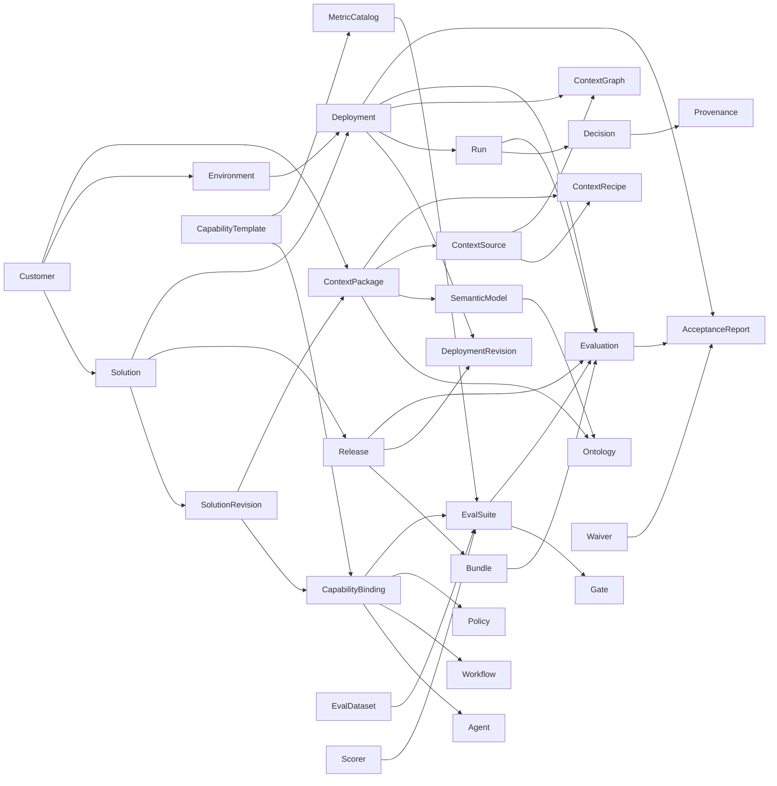

# FDE 工作台领域模型

> 状态：决策稿，对应 ticket「领域模型与核心抽象」。
> 范围：v0 单客户 bundle；不做多租户托管、首客场景、UI。
> 术语：见 [`GLOSSARY.md`](../GLOSSARY.md)。运行时接缝见 [`runtime-contract.md`](runtime-contract.md)。本文记录实体、关系、关键属性、生命周期、不变量和场景。

## 1. 范围与前提

- **交付模型**：v0 是单客户 bundle，运行在客户自有服务器/VPC；工作台是构建器/打包器，不是托管运行时。
- **运行时**：Mastra 是 v0 的默认执行层；Solution Spec 保持 runtime-agnostic，通过 runtime profile 和 generator 映射到具体版本。v0 只实现 Mastra generator；换 runtime 是新的 generator + Extension 打包 + Bundle 拓扑，不是配置切换。
- **语义层**：Semantica + 薄 context-service；TS/Python 通过 REST 隔离，MCP 仅本地/IDE。
- **许可**：Bundle 只用 Mastra Apache-2.0 core，不含 `ee/`；Semantica MIT；v0 图存储为 embedded（Semantica 进程内 + SQLite），生产检索后端已由[生产检索索引与 100k+ 规模上限](https://github.com/0xnicholas/Fdesforce/issues/15)定为 Postgres 17 + pgvector（Neo4j 仅客户许可 fallback，Apache AGE 留待 Cypher 兼容需求出现时再评估）；Bundle 含 SBOM/notice/license gate。
- **明确不建模**：Tenant、多租户控制面、Engagement、Workspace。
- **设计原则**：Spec 是唯一真相；生成物可重建；客户定制走 Extension 而不是 fork；评测与溯源是一等公民。

## 2. 领域分层

| 层 | 实体 | 职责 |
|---|---|---|
| 交付与配置 | Customer, Solution, Solution Revision, Solution Spec, Environment | 谁、哪个解决方案、部署到哪 |
| 身份与访问 | Platform Role, Business Role, Break-glass, Audit Event | 谁以什么身份操作、什么被审计 |
| 能力与实现 | Capability, Capability Template, Capability Binding, Agent, Workflow, Tool, Connector | 做什么、怎么实现 |
| 复用与定制 | Template, Overlay, Extension | 跨客户复用与客户差异 |
| 构建与发布 | Bundle, Release, Deployment, Deployment Revision | 从 Spec 到可部署产物 |
| 运行时资产 | Runtime Profile, Model Profile | 运行时组件版本组合与模型身份 |
| 运行与治理 | Run, Policy, Metric Catalog, Eval Suite, Eval Dataset, Scorer, Gate, Evaluation, Waiver, Acceptance Report, Decision, Provenance | 执行、约束、验收、溯源 |
| 语义与上下文 | Ontology, Semantic Model, Context Source, Context Recipe, Context Graph, Customer Context Package | 语义绑定、上下文打包与组装 |

## 3. 实体与关键属性

### 3.1 Customer

- `customer_id`：稳定 ID。
- `name`、`slug`。
- `status`：`active | archived`。
- `data_residency`：默认数据驻留区域，供 Environment 继承。
- `created_at`、`archived_at`。

规则：Customer 是构建、交付和隔离的边界，不是运行时多租户边界。所有客户侧实体必须能追溯到唯一 Customer；跨 Customer 引用一律非法。

### 3.2 Solution

- `solution_id`：稳定 ID。
- `customer_id`：所属 Customer。
- `name`、`slug`。
- `status`：`active | deprecated`。
- `current_revision_id`：当前草稿或已冻结 Revision。
- `created_at`。

规则：一个 Customer 可以有多个 Solution；每个 Solution 独立构建、发布和部署。Bundle、Release、Deployment 都按 Solution 切分，不跨 Solution 共享运行时状态。

### 3.3 Solution Revision 与 Solution Spec

**Solution Revision** 是 Solution 的不可变配置快照：

- `revision_id`、`solution_id`、`revision_number`：单调递增。
- `status`：`draft | validated | frozen`。
- `spec_digest`：Spec 内容摘要。
- `spec`：声明式配置，见下。
- `lock`：`solution.lock` 的内容摘要和对象引用；固定 Template、Asset、Model Profile、Eval Dataset、Extension、runtime profile、toolchain 和 Customer 级对象的精确版本与 digest。
- `based_on`：Solution Template 版本、Capability Template 版本、Model Profile 版本、Ontology / Semantic Model / Customer Context Package 版本、runtime profile。
- `created_by`、`created_at`、`frozen_at`。

**Solution Spec** 只包含作者内容，不包含生成物或环境实际值：

- `apiVersion`、`kind`、`metadata`：文档版本、类型和 Customer / Solution 身份。
- `spec.overlays`：生效的 Overlay 引用；Overlay 的 scope 在 Overlay manifest 中。
- `spec.capabilities`：Capability Binding，按 id 寻址。
- `spec.agents` / `spec.workflows`：运行时中立的实现定义，按 id 寻址。
- `spec.tools`：Tool 定义，按 id 寻址；Connector 只以 `connectorRef` 出现。
- `spec.semantic`：Customer Context Package 的引用（`contextPackageRef`），以及 Solution 级 Context Recipe Binding / 收紧覆盖。
- `spec.governance`：Solution 级 Policy / Eval Suite 引用；Capability 级引用是必需的最小集。
- `spec.environments`：环境能力要求（不是凭据、不是实际容量）。
- `spec.extensions`：Extension 引用和兼容声明。
- `spec.build`：runtime profile、目标平台（`compose | helm | airgap`）。
- `spec.deployment`：逻辑 profile 名、迁移策略默认值。

Connector、Context Source、Semantic Model 和 Ontology 扩展是 Customer 级资产；Customer Context Package 是这些语义资产的版本化聚合，放在 `customer/context-packages/`，由 Spec 按 id 引用；不在每个 Solution Spec 内联。Template 在 `fde spec init` 时物化为完整 Spec，build 不再解析模板；`solution.lock` 固定来源和精确版本。

示意（字段名不是最终 schema）：

```yaml
apiVersion: fde.dev/v0
kind: SolutionSpec
metadata:
  customer: acme
  solution: claims-triage
spec:
  overlays:
    - acme-baseline@^1.0.0
    - claims-triage-tuning@^1.0.0
  capabilities:
    document-triage:
      template: document-triage@^1.0.0
      implementation:
        type: agent
        ref: triage-agent
      policyRefs: [pii-redaction@^1.0.0]
      evalRefs: [triage-quality@^1.0.0]
      audit:
        runOutcomeDecision: required
  agents:
    triage-agent:
      modelProfile: standard@^1.0.0
      instructions: files/prompts/triage.md
      tools: [claims-lookup]
  tools:
    claims-lookup:
      connectorRef: claims-db
      operation: lookupClaim
      sideEffects: read
  semantic:
    contextPackageRef: acme-claims-context@^1.0.0
    recipeBindings:
      claims-context:
        recipeRef: claims-context@^1.0.0
        budget: {maxNodes: 50}
  governance:
    policies: [data-retention@^2.0.0]
  environments:
    acme-prod:
      kind: prod
      region: eu-west-1
      capacityClass: medium
      networkClass: restricted
      secretStoreKind: vault
  build:
    runtimeProfile: mastra-1.83-node26@^1.0.0
    targets: [compose, helm, airgap]
  deployment:
    profile: standard
    migrationPolicy: manual
```

同目录 `solution.lock` 记录物化来源、精确版本、digest 和规范化文件清单：

```yaml
lockVersion: 1

spec:
  digest: sha256:...
  files:
    solution.yaml: sha256:...
    files/prompts/triage.md: sha256:...
    files/schemas/claims-lookup.input.json: sha256:...
    files/schemas/claims-lookup.output.json: sha256:...
    files/schemas/claim-decision.input.json: sha256:...
    files/schemas/claim-decision.output.json: sha256:...
    files/schemas/triage.output.json: sha256:...

templates:                 # 跨客户、不可变 Template
  solution:
    fde-solution: 1.2.0@sha256:...
  capability:
    document-triage: 1.0.0@sha256:...
  policy:
    pii-redaction: 1.0.0@sha256:...
    data-retention: 2.0.0@sha256:...
    claims-approval-threshold: 1.0.0@sha256:...
  eval:
    triage-quality: 1.0.0@sha256:...
    claims-context: 1.0.0@sha256:...
  ontology:
    insurance-claims: 1.0.0@sha256:...
  deploymentProfile:
    standard: 1.0.0@sha256:...

assets:                    # frozen Spec 实际引用的 concrete Customer 资产
  policies:
    claims-approval-threshold:
      version: 1.0.0
      digest: sha256:...
      materializedFrom: policy/claims-approval-threshold@1.0.0
      files:
        claims-approval-threshold.yaml: sha256:...
  evalSuites:
    claims-triage-quality:
      version: 1.0.0
      digest: sha256:...
      materializedFrom: eval/triage-quality@1.0.0
      files:
        eval-suite.yaml: sha256:...
  connectors:
    claims-db:
      digest: sha256:...
      files:
        claims-db.yaml: sha256:...
        contracts/claims-db.md: sha256:...
    sharepoint-claims:
      digest: sha256:...
      files:
        sharepoint-claims.yaml: sha256:...
        contracts/sharepoint-claims.md: sha256:...
  customerContextPackage:
    acme-claims-context: 1.0.0@sha256:...   # 内部 Context Source / Semantic Model 由聚合 digest 覆盖

overlays:                  # derivation provenance；build 不重放
  acme-baseline: 1.0.0@sha256:...
  claims-triage-tuning: 1.0.0@sha256:...

extensions:
  acme-claims-connector: 1.0.0@sha256:...

modelProfiles:
  standard: 1.2.0@sha256:...

evalDatasets:
  acme-claims-triage: 1.0.0@sha256:...

runtime:
  profile: mastra-1.83-node26@1@sha256:...
  contractVersion: 1.2.0
  graphSchema: 1
  auditSchema: 1
  mastra: 1.83.0
  node: 26.2.0
  python: 3.12.2
  semantica: 0.7.0
  contextService: 0.1.0

toolchain:
  generator: 0.1.0
  image: ghcr.io/acme-fde/toolchain@sha256:...
```

规则：

- Spec 是声明式、可验证、可 diff 的；生成物（Mastra app、context-service 配置、部署清单、迁移、SBOM/notice、签名、镜像 digest、端口）不入 Spec。
- Spec 不含 secret 值，只含 secret 引用；Environment 实际值、模型 provider 细节和容量在 `environments/<env>.yaml` 中配置。
- Solution Spec 只引用 frozen CCP；Context Recipe Binding 只能收紧 filters/budget/ranking，不能放宽权限 baseline 或省略 mask/budget。
- 实体集合按 id 寻址（`capabilities`、`agents`、`tools` 等是 map，不是数组）；有序序列保留数组，Overlay 只能改 allowlist 路径。
- `validated` 要求 schema、引用完整性、版本兼容性、Overlay allowlist、lock 新鲜度和 Template/Overlay 合并全部通过。
- `frozen` 后不可修改；Release 必须 pin 一个 frozen Revision。
- 同一个 Spec + lock + pinned Extensions + toolchain 镜像必须能重建出同一个 Bundle digest。
- `solution.lock` 是生成物，不是手写文件：每个 Spec 引用必须恰好对应一个 lock 条目；缺条目、多余条目、digest 不匹配或文件缺失都 fail closed。`fde spec lock --check` 离线重算，`fde spec lock --refresh` 是唯一联网路径；`fde build` 只读 frozen Revision。
- `spec.digest` 覆盖 `solution.yaml` 和所有被 Spec 传递引用的 solution 本地文件；`spec.files` 保存逐文件 digest。路径用 POSIX 相对路径、排序，文本文件 LF 归一；拒绝绝对路径、`..`、symlink 和重复路径；`solution.lock` 自身不进入 digest。
- `templates` 只放跨客户 Template；`assets` 放 frozen Spec 实际引用的 concrete Customer 资产（Policy、Eval Suite、Connector、CCP）。CCP 内部的 Context Source、Semantic Model、Ontology、Recipe 和权限由 CCP 聚合 digest 覆盖，不重复 pin；Connector 在 CCP 外，单独 pin。由 Template 物化的 concrete 资产用 `materializedFrom` 保留来源，不把两者混为一谈。
- 一个 frozen Revision 内，每个 artifact ID（按类别）只能解析到一个版本；同一 ID 的两个版本必须拆成不同 ID 或新 Revision。`evalDatasets` 的 Environment binding 仍按 `dataset_id@version` 精确匹配。
- `modelProfiles` pin 平台维护的 `ModelProfile` 工件；Spec 只写逻辑名 + 兼容范围，Environment 只提供 endpoint/secret，不提供 provider/model/params。
- `evalDatasets` pin 客户侧数据集版本 + digest；数据集不进 Bundle，只进 lock 和 Evaluation。`overlays` 只保留 derivation provenance，build 不重放。
- Spec 保持 runtime-agnostic；v0 只实现 Mastra generator，换 runtime 需要新的 generator、Extension 打包和 Bundle 拓扑，不是改一个 runtime profile 字段。

### 3.4 Environment

- `environment_id`、`customer_id`。
- `name`、`kind`：`dev | staging | prod`。
- `region`：数据驻留区域。
- `status`：`provisioning | active | retired`。
- `health`：`healthy | degraded | unreachable`（独立于生命周期）。
- `network_policy`、`secret_store_ref`、`capacity`。
- `profile_values`：命名 profile（如 `model_profile`、`deployment_profile`）的具体非 secret 值。`model_profile` 只提供 `endpoint`、`region?`、`secretRef`、`endpointId?`，不提供 provider/model/params。
- `eval_dataset_bindings`：按 `dataset_id@version` 精确绑定的客户侧数据集解析信息，包含 `store`（`filesystem | s3 | azure-blob | gcs | oci`、`location`、`region?`、`secretRef?`、`serviceAccount?`）和可选的 `splits` 覆盖（如 `holdout` 独立 ACL）。
- `eval_signing_key_ref`：Evaluation 证据签名密钥的 `secretRef`；每个 Environment 独立。
- `identity_profile`：OIDC issuer/client、claim mapping、group→平台角色映射；不含 secret 值。
- `created_at`、`retired_at`。

规则：Environment 属于 Customer，不属于某个 Solution；v0 一个 Environment 只承载一个 Solution 的 Deployment（#17 D11，部署实例名从 `deployment_id` 派生、端口/卷名确定性生成，不引入分配契约），多 Solution 共处留待未来拓扑。Spec 只声明环境要求；命名 profile 的具体值、实际凭据、网络和容量在 Environment 中配置。`model_profile` 绑定只能换 endpoint/secret，不能换 provider/model/params；`eval_dataset_bindings` 必须覆盖该 Environment 上会运行的 Eval Suite 所引用的每个 `dataset_id@version`，缺失时 `fde eval` fail closed。

### 3.5 Capability / Capability Template / Capability Binding

**Capability** 是业务能力契约：

- `capability_id`、`name`、`description`。
- `input_schema`、`output_schema`。
- `side_effects`：只读、写入、外部副作用。
- `sla`：延迟、可用性、人工介入要求。
- `governance_requirements`：必需的 Policy / Eval 类别。
- `owner`。

**Capability Template** 是可跨 Customer 复用的、版本化且不可变的 Capability 定义：

- `template_id`、`capability_id`、`version`（semver）。
- `contract`：输入/输出、副作用、SLA。
- `default_implementation`：Agent 或 Workflow 模板。
- `default_policy_refs`、`default_eval_refs`。
- `compatible_spec_major`。
- `status`：`active | deprecated`。

**Capability Binding** 是 Solution 中的绑定记录：

- `binding_id`、`solution_revision_id`、`capability_template_ref`。
- `implementation_ref`：恰好一个顶层 Agent 或 Workflow。
- `overlay_refs`：Customer / Solution Overlay。
- `policy_refs`、`eval_refs`。
- `budget`：`max_tool_calls_per_run`（默认 20）、`max_steps`（默认 12）；Overlay 只能收紧。
- `audit`：副作用 Tool 的证据选择器 + `run_outcome_decision`（`required | omitted`）。
- `extension_refs`。

规则：Capability 是“做什么”，Agent / Workflow 是“怎么做”。Capability Template 是复用、评测和策略绑定的单位；Capability Binding 不能削弱契约，只能通过 Overlay 收紧或参数化。每个 Capability Binding 必须有 contract、至少一个实现、至少一个 Policy、至少一个 Eval Suite；其中每个副作用 Tool 必须有证据选择器和 `tool.pre_invoke` Policy 覆盖。

### 3.6 Agent / Workflow / Tool / Connector

**Agent**：

- `agent_id`、`name`。
- `instructions`、`model_profile`（逻辑名 + 兼容范围，如 `standard@^1.0.0`）、`tools`、`memory`。
- `policy_refs`、`capability_binding_ref`。
- 运行时中立定义；generator 映射到 Mastra agent。`model_profile` 只引用 `ModelProfile`，不内联 provider/model/params。

**Agent.memory**（v0 运行编排状态，不是语义真相源；详决见 [ADR-0012](adr/0012-agent-memory.md)）：

- `memory` 缺省 = 无记忆；`thread` / `longTerm` 子对象缺省 = 该类型关闭。
- `memory.thread`：`lastMessages`（1–100，默认 20）；要求使用该 Agent 的 Workflow `durable: true`，否则 `validate` 报错；使用它的 Capability 要求 Run 请求带 `thread_id`，首次使用绑定 `(tenant_id, actor.type, actor.id)`，归属不符返回 `404 thread_not_found`。
- `memory.longTerm`：`write: explicit`（v0 唯一取值，只经平台内建 `memory.remember` primitive 写入；不触发审批、不写 Decision、不走 record-before-act，计入 rate/budget）；`recall: semantic | none`（默认 none）；`scope: end_user | agent`（默认 end_user，`agent` 是显式放弃按人隔离，`validate` 产生 warning）；`recall: semantic` 时 `embeddingProfile` 必填，按 ADR-0007 由 `solution.lock` pin。
- `memory.retentionClass`：`ephemeral | standard | extended | legal_hold`（默认 standard）。
- 长期记忆记录形状（平台自有，非任意 JSON）：`{ memory_id, namespace, text ≤2000 字符, attributes(≤10 个扁平 string，值 ≤256 字符), source_run_id, created_at, expires_at, embedding_profile?, digest }`。
- namespace：`{tenant_id}/{environment_id}/{solution_id}/{agent_id}/{owner}`，`owner = end_user:<opaque sub> | agent | service:<client_id>`；不含 deployment revision、bundle digest、runtime family——同 runtime 的 Release 升级记忆不清零。
- 存储：状态存储同库的 `fde_memory` schema（`memory_record` 表，带 `schemaVersion`；SQLite 与 Postgres 同构），由各语言 `fde-runtime` 包实现同一表契约；跨 runtime 不迁移，只导出 `fde.memory/v1` JSONL 附件，不提供 import。
- 召回为自动注入：每次 Agent 调用前按 namespace 取 top-5，包成 `memory-block`（`trust=untrusted`、带 namespace）；embedding 不可用时 fail-soft，Run 继续并标 degraded。
- 记忆不自动晋升为 Context Graph 事实、Decision evidence 或 Policy；v0 不提供任何晋升路径。

**Workflow**：

- `workflow_id`、`name`。
- `steps`：有序的 `context | agent | tool | approval` 步骤；`approval` 是具名 gate step，gate 住其后第一个副作用 Tool 步骤；`durable`。
- 条件只在 `approval.requiredWhen` 出现，且只能引用 Policy Template 的命名 predicate + typed 参数；v0 无通用 `when`/branch/parallel，grammar 扩展等第二个参考场景再评估。
- `agents`、`tools`、`policy_refs`。
- 运行时中立定义；generator 映射到 Mastra workflow。

**Tool**：

- `tool_id`、`name`。
- `input_schema`、`output_schema`。
- `side_effects`、`auth`、`rate_limit`（非 read 必填 `per_run_max`/`per_actor_per_hour_max`）。
- `connector_ref`：可选；纯代码 Tool 不依赖 Connector。
- `audit`：`classification`、`retention_class`、digest 口径；`side_effects != read` 时必填。

**Connector**：

- `connector_id`、`name`、`type`。
- `endpoint`、`secret_ref`。
- `data_contract`、`rate_limit`、`allowed_operations`。
- Customer 级资产：可被多个 Solution 引用；Solution Spec 只写 `connectorRef`，不内联 endpoint 或 secret。

规则：Agent 和 Workflow 是 Capability 的实现，不是跨客户复用单位；复用通过 Capability Template 和实现模板完成。Tool 的副作用必须显式声明；`side_effects != read` 的 Tool 必须有 `audit`，并与调用它的 Capability 证据选择合并成 Decision Binding。Connector 的凭据只以引用出现，Connector 定义本身也只在 Customer 级维护。

### 3.7 Template / Overlay / Extension

**Template**：

- `template_id`、`type`：`solution | capability | ontology | policy | eval | deployment_profile`。
- `version`（semver）、`content`。
- `compatible_spec_major`。
- `status`：`active | deprecated`。
- `owner`。

**Overlay**：

- `overlay_id`、`scope`：`customer | solution`。
- `target_template_ref`。
- `operations`：`add | set | remove`，按白名单路径。
- `rationale`、`approved_by`。

合并顺序：Template default → Solution Overlay → Customer Overlay。Customer Overlay 用于客户级强制约束（合规、保留、数据驻留），Solution Overlay 用于该 Solution 的调优；冲突时 Customer 赢。

**Extension**：

- `extension_id`、`name`、`version`。
- `interface`：`tool | connector | recipe | scorer`；v0 实现 `tool | connector`，`recipe | scorer` 标记 experimental。
- `egress`：tool 接口必填 `none | connector:<id>`；connector 扩展的 egress 由 Connector 定义。
- `compatible_spec_major`、`compatible_template_majors`。
- `artifact_ref`：按接口打包为 `ts-package`（tool/connector）或 `python-wheel`（recipe/scorer）；v0 不支持任意容器镜像 Extension。
- `resource_requirements`、`owner`。

规则：Template 版本不可变；Overlay 不 fork Template，按 allowlist 路径 `add | set | remove`，实体集合按 id 寻址；Extension 是唯一的客户代码入口，必须声明接口和兼容范围，不能直接修改生成物。升级时 Template 新版本 + Overlay 重放 + Extension 兼容性检查。

### 3.8 Bundle

- `bundle_id`：内容摘要，作为身份。
- `solution_id`、`solution_revision_id`。
- `status`：`building | built | verified | signed | failed`。
- `manifest`：组件、镜像、版本、端口、环境变量、卷、健康检查。
- `artifacts`：生成的 Mastra app、context-service、图存储配置、迁移脚本、Policy/Eval Suite 定义与 scorer、部署清单、SBOM/notice、校验和、签名。
- `build_provenance`：generator 版本、Template/lock 版本、runtime profile、工具链镜像 digest、构建者、时间戳。
- `compatibility_matrix`：runtime × template × ontology × eval × extension。
- `license_gate_result`。
- `signature`。
- `created_at`。

规则：

- Bundle 不可变、内容寻址；不以版本号作为身份。
- Bundle 不含 secret 值，只含 secret 引用。
- Bundle 包含 Eval Suite 定义与 scorer，不包含 Eval 数据集；数据集按环境和权限在评测时解析。
- 同一 Spec + lock + pinned Extensions + 工具链镜像必须重建出同一 digest。
- 生成的 Bundle 必须包含 SBOM/notice，并通过 license gate。
- Bundle 1:1 对应 Release 的候选产物；未签名的 Bundle 不能成为 Release。

### 3.9 Release

- `release_id`、`solution_id`、`version`（semver）。
- `bundle_digest`。
- `status`：`draft | approved | superseded | recalled`。
- `pinned_versions`：Spec Revision、Spec digest、lock digest、Template、Asset、Model Profile、Eval Dataset、Ontology、Semantic Model、runtime profile。
- `environment_evaluations`：按 Environment 记录的 release-grade Evaluation 引用；同一 `eval_binding_digest` 的多个 Environment 可以共享同一份 Evaluation。
- `release_notes`、`approved_by`、`approved_at`、`approval_decision_id`。
- `signature`、`recalled_reason`。

规则：

- 1 Release ↔ 1 Bundle；Release 按 Solution 全局唯一、不可变。
- `approved` 要求 Bundle 已签名、license gate 通过，并且每个 `kind: prod` 的 distinct `eval_binding_digest` 都有一份通过验签的 release-grade Evaluation（或有效 Waiver）。非 prod Environment 不阻塞 Release，部署后由 L3 smoke/SLO 验证。
- 没有 `kind: prod` 的 `spec.environments` 时拒绝审批；不能默认拿 staging 当生产目标。
- `active` 不是 Release 的状态；Release 在某个 Environment 中是否生效由 Deployment 表示。
- 新 Release 会使同 Solution 的旧 Release 进入 `superseded`；安全问题可以 `recalled`。

### 3.10 Deployment / Deployment Revision

**Deployment**：

- `deployment_id`、`solution_id`、`environment_id`、`customer_id`。
- `current_release_id`、`current_deployment_revision_id`。
- `status`：`pending | deploying | active | failed | rolling_back | retired`。
- `health`：`healthy | degraded | unreachable`。
- `config_overrides`：环境特定配置，只含 secret 引用。
- `last_deployed_at`。

**Deployment Revision**：

- `deployment_revision_id`、`deployment_id`、`release_id`。
- `result`：`applied | failed | rolled_back`。
- `migration_plan`、`applied_migrations`。
- `started_at`、`finished_at`、`actor`、`decision_id`。

规则：

- 同一 Solution × Environment 同时只有一个 active Deployment。
- Deployment 的 Customer、Environment、Solution 必须一致。
- 升级创建新的 Deployment Revision；回滚重新部署上一个 Release，要求迁移可逆或显式拒绝。
- Deployment Revision 是不可变审计记录，不设独立状态机。

### 3.11 Run

- `run_id`、`deployment_id`、`capability_binding_id`。
- `implementation_ref`：Agent 或 Workflow。
- `trace_id`、`actor`。
- `status`：`queued | running | waiting_for_human | succeeded | failed | cancelled`。
- `input`、`output`、`error`。
- `started_at`、`finished_at`、`cost`。
- `provenance_id`。

规则：Run 必须属于一个 Deployment；必须有 trace_id 和 actor；人工审批对应 `waiting_for_human`；Runtime Decision 和 Provenance 挂在 Run 上。Run 不跨 Environment。

### 3.12 Policy / 评测与验收治理

**Policy**：

- `policy_id`、`name`、`version`。
- `scope`：`capability | solution | deployment`。
- `parameters`：typed 参数 schema；binding 只能传合法 `args`。
- `rules`、`enforcement_point`、`severity`、`owner`。
- `enforcement_point`：`context.retrieve | tool.pre_invoke | agent.pre_invoke | approval.request | run.post | output.emit`；由 Policy Template 声明，binding 不能改写。
- `output-guard` 是平台 Policy Template（`output.emit`），控制 PII `redact | block` 与链接策略；secret 阻断不可关闭。
- `Tool.rate_limit` 由平台评估为 `platform.tool-rate-limit`，不重复做成可编辑 Template。
- Binding 的 `policy_refs` 允许 `string | {ref, args?, appliesTo?}`；`appliesTo` 只收窄到指定 Tool，缺省覆盖本 Capability 的所有副作用 Tool。
- Build 校验每个副作用 Tool 至少有一条 `tool.pre_invoke` Policy 覆盖；缺失即 fail closed。

**Metric Catalog**：

- `metric_catalog_id`、`version`、`status`：`active | deprecated`。
- `metrics`：每条有 `metric_id`、`family`、`definition`、`formula`、`unit`、`direction`、`source`、`aggregation`、`owner`。
- 平台维护；Capability Template / Eval Suite 只引用 `metric_id` 和阈值。

**Eval Suite**：

- `eval_suite_id`、`name`、`version`、`scope`：`context | capability`。
- `metric_catalog_ref`、`dataset_ref`（dataset ID + version + digest，不是数据本身）、`scorers`、`gates`、`thresholds`、`pass_criteria`、`judge_ref`、`split_policy`。
- `owner`。
- `context` 是 L1 的 Context Eval Suite 形态；`capability` 是 L2 的答案级形态。

**Eval Dataset**：

- `dataset_id`、`customer_id`、`version`、`status`：`draft | validated | frozen`。
- `digest`、`splits`（`dev | holdout | regression | judge-calibration | adversarial`）、`case_count`、`source_summary`、`redaction_summary`、`compatibility`。
- 客户侧资产；不进入 Bundle，不复制到工作台；`holdout` 单独 ACL；生产日志不自动回流。

**Scorer**：

- `scorer_id`、`version`、`type`：`deterministic | statistical | llm_judge`。
- `metric_refs`；确定性 scorer 有 `implementation_ref`，judge 有 `prompt_ref`、`model_ref`、`calibration_ref`。
- 版本化；Evaluation 记录实际使用的 scorer 版本。

**Gate**：

- `gate_id`、`metric_ref`、`type`：`blocking | threshold | no_regression | monitor`。
- `threshold`、`severity`、`waiver_allowed`。
- `blocking` 逐 case 零容忍，`waiver_allowed=false`。

**Evaluation**：

- `evaluation_id`（`eval_<ULID>`）、`eval_suite_ref`、`metric_catalog_version`、`dataset_ref`（version + digest）。
- `subject_ref`：离线为 Bundle digest；在线为 Run 或 Deployment。
- `environment`、`eval_binding_digest`：评测使用的 Environment 及其 model/dataset 绑定的规范化 digest；绑定变化后旧 Evaluation 不再匹配。
- `spec_digest`、`lock_digest`：被评测 Bundle 的构建输入身份。
- `model_profile_refs`：pin 住的 Model Profile 引用；`model_usage`：provider 返回的实际 `model`/`modelVersion` 或 Environment 的 `endpointId`，以及是否使用 fallback。
- `release_grade`：`true | false`；只有 `true` 且通过验签的 Evaluation 才能用于 Release 审批。
- `status`：`queued | running | passed | failed | error`；`verdict`：`accepted | accepted_with_waivers | rejected | inconclusive`。
- `scorer_versions`、`judge_model`、`judge_prompt_version`、`results`、`summary`、`started_at`、`finished_at`、`decision_id`。
- `signature`、`signer`：customer-side `evalSigningKey` 的 detached 签名和 signer/key id。
- 逐 case 结果可引用 `run_id`、`trace_id`、`decision_id`、`retrieval_id`，但不重定义这些运行时字段。

**Waiver**：

- `waiver_id`、`gate_ref`、`reason`、`approved_by`、`expires_at`、`follow_up_ref`、`decision_id`。
- 只能豁免 `threshold`、`inconclusive`、`no_regression`；不能豁免 `blocking`。

**Acceptance Report**：

- `acceptance_report_id`（`acc_<ULID>`）、`deployment_id`、`solution_id`、`capability_id`。
- `evaluation_refs`、`slo_window`、`waiver_refs`、`open_incident_refs`、`verdict`。
- `decision_id`、`issued_at`、`issued_by`。
- 技术验收证据；客户签核、合同与交付流程不在领域模型内。

规则：Policy 在生成的代码和 context-service 强制执行；Eval Suite 是版本化评测定义，只引用 dataset digest，不内嵌数据；Evaluation 引用候选 Bundle/Release/Run/Deployment。Metric Catalog 是唯一指标定义源，Capability/Solution 只能收紧阈值；blocking gate 不能被 Waiver 覆盖；Eval Dataset 留在客户环境，Bundle 只含定义/scorer；在线 Evaluation 引用运行时 ID，但不逐条写审计 Decision。

Release-grade Evaluation 必须由客户侧 `evalSigningKey` 签名，并以 governance Decision 作为审计锚点；`fde release approve` 只验签、对比 `bundle_digest`/`spec_digest`/`lock_digest`/dataset/model profile pin/`eval_binding_digest`，不读取客户数据。`fde eval --mode live` 的 Release 门禁默认禁用 fallback；发生 fallback 的 case 失败或 `inconclusive`，不能产出 `release_grade: true`。`fde eval` 在调用模型前必须计算 dataset digest，并与 manifest、Eval Suite、lock 三方比对；`contract` 模式可以本地运行，但只能产出 `release_grade: false`。Release 审批按每个 `kind: prod` 的 distinct `eval_binding_digest` 要求一份 release-grade Evaluation；同一 digest 可共享，非 prod 不阻塞。

### 3.13 Ontology / Semantic Model / Context Source / Context Recipe / Context Graph

**Ontology**：

- `ontology_id`、`version`（semver）。
- `modules`、`classes`、`properties`、`shacl_shapes`。
- `source`：`template`（Domain Ontology）或 `customer`（Customer Ontology Extension）。
- `status`：`active | deprecated`。

**Semantic Model**：

- `semantic_model_id`、`customer_id`、`version`。
- `ontology_refs`、`entity_mappings`、`resolution_rules`、`merge_rules`、`source_precedence`、`freshness_rules`。
- `status`。

**Context Source**：

- `context_source_id`、`customer_id`。
- `connector_ref`、`dataset`、`classification`、`freshness`、`schedule`。
- `secret_ref`、`status`：`draft | active | paused | retired`。

**Context Recipe**：

- `context_recipe_id`、`name`、`version`。
- `scope`：`customer | solution | capability`；Customer 级定义可被 Solution 引用并收紧覆盖。
- `semantic_model_ref`、`source_refs`。
- `stages`、`filters`、`ranking`、`budget`、`output_schema`。
- `eval_suite_refs`。

**Context Graph**：

- `graph_id`、`deployment_id`。
- `semantic_model_ref`、`source_refs`、`snapshot_id`。
- `built_at`、`provenance_id`、`status`。

规则：

- Ontology 是全局 Template + Customer 扩展；Semantic Model 是 Customer 级、版本化。
- Context Source 是 Customer 级配置；Context Recipe 可以是 Customer 级可复用定义，或在 Solution/Capability 级绑定；Context Graph 是 Deployment 级物化。
- 同一 Customer 的多个 Solution 共享 Semantic Model 和 Context Source 定义，但运行时图各自独立；v0 不假设跨 Solution 共享图。
- Context Graph 可重建；所有断言带 provenance，不泄漏 Semantica/Neo4j 内部 ID。

### 3.14 Decision / Provenance

**Decision**：

- `decision_id`。
- `subject_type` / `subject_id`：Run、Evaluation、Release、Deployment、Solution Revision、Acceptance Report。
- `decision_type`：`runtime | governance | configuration | approval`。
- `phase`：`intent | outcome | retrieval | approval | run`。
- `invocation_id`：副作用 Tool 调用；intent/outcome 必填，run Decision 不带。
- `action`：`tool_id`、`side_effects`、可选 `connector_id`/`operation`。
- `status`：`proposed | succeeded | failed | denied | unknown | cancelled`。
- `evidence`：`graph_entity | retrieval | run_artifact | approval` 的 union。
- `policy_evaluations`：带 `enforcement_point`/`evaluated_by`。
- `actor`、`rationale`、`timestamp`。
- `provenance_id`。

**Provenance**：

- `provenance_id`、`subject_ref`。
- `activity`、`agent`、`source_documents`、`timestamp`、`checksum`。
- 导出为 PROV-O。

规则：Runtime Decision 挂 Run；治理 Decision（Evaluation、Acceptance Report、Release 批准、Waiver、回滚）挂对应治理对象；配置 Decision（为什么选这个 Overlay/Extension）挂 Solution Revision。治理 Decision 与运行时 Decision 共享领域语义，但写入路径不同；本契约只新增 runtime Decision 的 v1.1 字段，治理 Decision 不新增 wire 字段。context-service 拥有稳定 ID（entity_id / provenance_id）；`decision_id` 由调用方生成，`invocation_id` 由 runtime 模块生成。所有写入显式 `track_entity` / `track_relationship`，不依赖 Semantica 自动接线。

### 3.15 Customer Context Package

**Customer Context Package（CCP）** 是一个 Customer 的版本化、不可变语义上下文资产包：

- `context_package_id`、`customer_id`、`name`、`version`（semver）。
- `status`：`draft | validated | frozen`。
- `digest`、`source_commit`。
- `ontology_refs`：Domain Ontology 模块版本 + Customer Ontology Extension。
- `semantic_model_ref`、`context_source_refs`、`entity_mapping_refs`。
- `context_recipe_refs`、`permission_profile_ref`、`context_eval_refs`。
- `compatibility`：spec major、runtime contract、graph/audit schema。
- `created_by`、`frozen_at`、`decision_id`。

规则：

- CCP 是 Customer 级、声明式源工件；不包含客户数据、secret、生成图或运行时状态。
- frozen 后不可变；Solution Spec 通过 `contextPackageRef` 引用，`solution.lock` pin 版本 + digest。
- 同一 Customer 的多个 Solution 可以 pin 同一个 CCP；运行时图仍然各自独立。
- Connector 不在 CCP 内，只以 `connectorRef` 出现；Connector 仍是独立 Customer 级资产。
- Bundle 构建时编译 CCP；CCP 不直接产生运行时服务。

### 3.16 身份、权限与审计

**Platform Role**：
固定平台角色词表（`end_user`、`approver`、`customer_admin`、`deployment_operator`、`auditor`、`service`、`support`），授予运行时 scope；词表和 scope 矩阵随 Bundle 发布。
_Avoid_: Permission, Group。

**Business Role**：
客户 IdP group 透传的业务角色，只用于数据权限、row filter 和 `approver_roles`，不授予平台 scope；与平台角色重名由校验拒绝。
_Avoid_: Platform Role, Permission。

**Audit Event**：
审计库中除 Decision/Provenance 外的安全、身份、发布、部署或保留事件；append-only，带 actor、trace 和 retention class。
_Avoid_: Log, Telemetry。

**Break-glass**：
客户持有的应急管理访问；限时、需审批、写审计，仅用于 IdP 不可用时的管理面恢复。
_Avoid_: Backdoor, Emergency admin。

规则：`ExecutionContext.roles` 是平台角色与业务角色的并集；平台角色决定 scope，业务角色只决定数据可见性。角色映射在 Environment 配置，变更写 configuration Decision；一个 bundle 对应一个 Customer，不引入 sub-tenant。

### 3.17 Model Profile

**Model Profile** 是平台维护的、版本化且不可变的模型身份与参数组合：

- `profile_id`、`version`（semver）、`status`：`active | deprecated`。
- `kind`：`chat | embedding`；`embedding` 必填 `dimensions` 且**禁止 fallback**（静默换向量空间比 chat fallback 更危险）；embedding 维度变更 = 不兼容，必须先 purge 对应 namespace 再重建，v0 不提供在线 reindex。
- `provider`、`model`、`model_version`：provider 的不可变 snapshot/version；拒绝 `latest`、alias 和浮动 tag。
- `params`：temperature、topP、maxOutputTokens、seed、stop、responseFormat 等受控参数；provider 特有参数进 `extra`，未知参数拒绝。
- `fallback`：有序 fallback 列表，最多 1 跳；只允许 `timeout | rate_limit | provider_5xx` 触发，不允许内容/安全/策略失败触发；拒绝自引用和环。
- `compatibility`：`runtimeContract`、`specMajor`。
- `capabilities`：`contextWindow`、`toolCalling`、`jsonMode` 等运行时能力声明。
- `owner`、`digest`、`signature`：平台 owner；内容寻址；cosign 签名。

示意：

```yaml
apiVersion: fde.dev/v0
kind: ModelProfile
metadata:
  name: standard
  version: 1.2.0
  owner: platform
spec:
  kind: chat
  provider: azure-openai
  model: gpt-5.1
  modelVersion: 2026-10-01
  params: {temperature: 0.1, maxOutputTokens: 2000}
  fallback:
    - profile: standard-fallback@^1.0.0
      on: [timeout, rate_limit, provider_5xx]
  compatibility: {runtimeContract: fde.runtime/v1, specMajor: v0}
  capabilities: {contextWindow: 128000, toolCalling: true, jsonMode: true}
```

规则：

- Model Profile 是平台资产，不是 Template；Customer 不编写、不签名 Model Profile，客户特殊模型由平台新增 profile 版本（可带 customer scope）。
- Solution Spec 只写逻辑名 + 兼容范围（如 `standard@^1.0.0`）；`solution.lock` 固定精确版本 + digest + signer；Environment 只提供 `endpoint`、`region?`、`secretRef`、`endpointId?`。
- build 校验 Spec 的兼容范围包含 pin 的版本、`model_version` 不可变、fallback 图合法、`capabilities` 满足 Spec 的运行时要；不满足即 fail closed。
- 换模型 = 新 lock、新 Bundle digest、新 Release、新 Evaluation；同一 lock 在不同 Environment 只能换 endpoint/secret，不能换 provider/model/params。
- `fde eval --mode live` 的 Release 门禁禁用 fallback；运行时 fallback 允许，但 Decision 必须记录 `fallback_used`、实际 profile/provider/model/modelVersion。

## 4. 关系



关键关系：

- Customer 1—N Solution；Customer 1—N Environment。
- Solution 1—N Solution Revision；Solution 1—N Release；Solution 1—N Deployment。
- Solution Revision 1—N Capability Binding；Capability Binding N—1 Capability Template；Capability Binding N—1 Agent 或 Workflow。
- Capability Binding N—M Policy；Capability Binding N—M Eval Suite。
- Capability Template N—M Metric Catalog；Eval Suite N—1 Metric Catalog；Eval Suite N—1 Eval Dataset（按 digest 引用）；Eval Suite N—M Scorer / Gate。
- Agent / Workflow N—M Tool；Tool N—0..1 Connector。
- Release 1—1 Bundle；Release 1—N Deployment Revision；Deployment 1—N Deployment Revision。
- Deployment N—1 Environment；Deployment N—1 Solution；Deployment 1—N Run。
- Run 1—N Decision；Decision N—1 Provenance。
- Customer 1—N Context Package；Context Package N—M Ontology / Semantic Model / Context Source / Context Recipe；Solution Revision N—1 Context Package（pin 版本）。
- Customer 1—N Semantic Model；Semantic Model N—M Ontology；Customer 1—N Context Source；Context Recipe N—M Context Source；Deployment 1—1 Context Graph；Context Graph N—M Context Source。
- Evaluation N—1 Eval Suite；Evaluation N—1 Bundle/Release/Run/Deployment；Evaluation N—M Scorer 版本；Evaluation N—M 逐 case 运行时引用。
- Acceptance Report N—M Evaluation；Acceptance Report N—1 Deployment；Acceptance Report N—0..M Waiver；Acceptance Report 1—1 Decision。
- Waiver N—1 Gate；Waiver 1—1 Decision。
- Eval Dataset 是客户侧资产，Bundle 不内嵌数据集；Evaluation 只引用 dataset version + digest。

## 5. 生命周期

| 实体 | 状态 | 转换与门禁 |
|---|---|---|
| Customer | `active → archived` | 归档前不能有 active Deployment |
| Solution | `active → deprecated` | 废弃前必须没有 active Deployment |
| Solution Revision | `draft → validated → frozen` | validated 要求 schema/引用/兼容性通过；frozen 后不可变 |
| Bundle | `building → built → verified → signed`；失败 → `failed` | verified 要求测试、SBOM/license、可重建性通过；signed 后不可变 |
| Release | `draft → approved → superseded` / `recalled` | approved 要求 Bundle 已签名、每个 distinct prod `eval_binding_digest` 有 release-grade Evaluation 或有效 Waiver；新 Release 使旧 Release `superseded` |
| Deployment | `pending → deploying → active → failed → rolling_back → active` / `failed`；`active → retired` | 部署要求 Environment active、迁移计划通过、健康检查通过 |
| Deployment Revision | 不可变记录：`applied / failed / rolled_back` | 由 Deployment 状态转换生成 |
| Run | `queued → running → waiting_for_human → succeeded` / `failed` / `cancelled` | `waiting_for_human` 需要审批请求；失败/取消终态 |
| Evaluation | `queued → running → passed` / `failed` / `error` | 引用 Bundle/Release/Run/Deployment；离线写治理 Decision，在线窗口化聚合 |
| Eval Dataset | `draft → validated → frozen` | validated 要求 schema/引用/脱敏/重复检测通过；frozen 后不可变；删除走保留作业 |
| Acceptance Report | `draft → issued → superseded` | 引用 Evaluation、SLO 窗口和 Waiver；`issued` 写治理 Decision |
| Context Source | `draft → active → paused → retired` | paused 停止摄取；retired 不再被 Recipe 引用 |
| Customer Context Package | `draft → validated → frozen` | validated 要求 schema/SHACL/权限/context eval 通过；frozen 后不可变 |
| Environment | `provisioning → active → retired` | health 是独立属性，不改变生命周期 |

## 6. 不变量

### 6.1 Schema 强制

- 所有实体有稳定 ID；引用完整；删除被引用实体必须失败。
- 无跨 Customer 引用；Deployment 的 Customer、Environment、Solution 必须一致。
- Release 必须 pin 精确的 Bundle digest、Spec Revision、Template、Ontology、Semantic Model、Customer Context Package、runtime 版本。
- Bundle 和 Release 不可变；变更必须产生新 digest / 新 Release。
- 每个 Capability Binding 必须有 contract、至少一个实现、至少一个 Policy、至少一个 Eval Suite。
- Eval Suite 必须 pin Metric Catalog、dataset version + digest、scorer/judge 版本；不能内嵌数据集。
- Blocking gate 不可 Waiver；Release 审批必须有有效 Evaluation 或 Waiver。
- Eval Dataset 留在客户环境；Bundle 只含 Eval Suite 定义/scorer；原始 PII 不入审计、OTel 或评测报告。
- Evaluation/Acceptance Report 必须引用可追溯的 dataset/scorer/judge 版本和运行时 ID。
- 同一 Solution × Environment 只能有一个 active Deployment。
- 每个 Run 必须引用 Deployment；每个 Decision 必须有 trace/actor/provenance。
- 每个 `side_effects != read` 的 Tool 必须有 `audit`；每个副作用 Tool 调用必须有非空证据、至少一条 `tool.pre_invoke` Policy 覆盖；intent 写失败不得执行副作用，outcome 必须链接 intent。
- 每个终止 Run 必须写一条 `phase=run` Decision；`run_outcome_decision: omitted` 只对只读且输出不可行动的实现有效。
- 有副作用 Tool invocation 的 `decision_coverage` 必须为 100%；分母排除 policy deny 与审批 rejected/expired，`status=unknown` 的 outcome 算完整。
- `tenant_id` = 不可变 Customer；一个 bundle 只承载一个 tenant；不引入 sub-tenant；每个 Environment 有独立 IdP client、签名 key、audit store 和 graph。
- 平台角色与业务角色命名空间分离；业务角色不能获得平台 scope；角色映射变更必须写 configuration Decision。
- 审计库保存 Decision/Provenance 和 Audit Event；审计数据留在客户环境，工作台不回传；原始 PII、email、姓名、IP、UA 默认不入审计。
- 部署/升级/回滚/备份由客户运维执行；工作台无入站连接和常驻凭证；FDE 只通过客户 IdP 的限时 `support` 角色支持。
- Spec、Bundle、Deployment 中只能出现 secret 引用，不能出现 secret 值。
- CCP 只能被 frozen 版本引用；CCP 不含客户数据、secret 或生成物；Solution 不能放宽 CCP 的权限 baseline。
- Bundle 必须含 SBOM/notice 并通过 license gate。
- schema 变更必须有迁移声明；没有迁移的破坏性变更不能构建。
- 生成物必须与 source digest 一致；手改生成物会在 CI 中失败。
- `solution.lock` 必须覆盖每个 Spec 引用且不含多余条目；`spec.digest` 覆盖所有被引用的 solution 本地文件；一个 frozen Revision 内每个 artifact ID（按类别）只有一个版本。
- Model Profile 必须 pin 精确版本 + digest + signer，且 `model_version` 不可变；Spec 只引用兼容范围，Environment 不能覆盖 provider/model/params。
- Eval Suite 的 `datasetRef` 必须是精确 `dataset_id@version@digest`，并在 lock 的 `evalDatasets` 有对应条目；Environment 的 `eval_dataset_bindings` 必须覆盖实际运行的版本。
- Release-grade Evaluation 必须验签通过，并记录 `bundle_digest`、`spec_digest`、`lock_digest`、dataset/model profile pin、`eval_binding_digest`、实际 model 和 `fallback_used`；`fde release approve` 不读取客户数据。
- 每个 `kind: prod` 的 distinct `eval_binding_digest` 必须有一份 release-grade Evaluation；没有 prod Environment 时不能审批 Release。

### 6.2 流程强制

- 生产发布审批和客户验收。
- 安全、法务、数据驻留审查。
- Waiver 审批；Waiver 必须有理由、审批人和有效期。
- 密钥轮换、备份/恢复演练、灾备演练。
- 事件响应和召回流程。
- 供应商/许可证变更审查。

### 6.3 构建与可重建性

构建流水线：Validate Spec + CCP → Freeze Revision → Build Bundle → Verify/Sign → Release → Deploy → Run。

- Validate：schema、引用、Template/Overlay 合并、Extension 兼容性；CCP 的 schema/SHACL/权限/context eval。
- Build：generator 从 Spec + pinned Templates + Extensions + frozen CCP + 锁文件生成 Bundle。
- Verify：contract tests、Eval Suite、SBOM/license、可重建性检查（重跑构建对比 digest）。
- Sign：签名 Bundle；Release 审批引用签名。
- Deploy：执行迁移，记录 Deployment Revision，健康检查通过后 active。

## 7. 版本与兼容性

- Spec schema 用 `apiVersion` 的 major 表示；`fde spec migrate` 负责跨 major。
- Solution Spec 不写 Solution 版本；Revision 由系统生成单调编号，Release 才分配 semver。
- Spec 写 Template/Extension/Model Profile/runtime profile 的兼容范围；`solution.lock` 固定精确版本 + digest；build 只读 lock。
- runtime profile 是平台维护的版本化 profile；toolchain 镜像 digest 随 lock 固定，保证同 Spec + lock + toolchain → 同 Bundle digest。
- Model Profile 用 semver，版本不可变；Spec 写兼容范围，lock pin 精确版本 + digest + signer；`model_version` 必须是 provider 的不可变 snapshot。
- `solution.lock` 的 `lockVersion` 精确匹配；v0 为 1。不兼容变更升到 2，并提供 `fde spec lock migrate`；不自动升级。
- Template / Capability Template / Ontology / Policy / Eval Suite 用 semver，版本不可变。
- Metric Catalog / Scorer / Eval Dataset 版本化或内容寻址；Eval Dataset frozen 后只读，Evaluation pin version + digest；`solution.lock` 的 `evalDatasets` pin 同一组 version + digest，Environment 按 `dataset_id@version` 精确绑定解析位置。
- Eval Suite 变更（数据集、scorer、gate、阈值）必须产生新版本；不能原地改历史 Evaluation。
- Overlay 声明兼容的 Template major；minor/patch 自动跟随，major 升级必须显式迁移。
- Solution Revision 单调递增；Release 用 semver 并 pin 精确版本。
- Customer Context Package 用 semver，frozen 后不可变；Solution lock pin 版本 + digest；ontology/mapping major 变更要求新 CCP 版本。
- Bundle 用内容摘要，不以版本号作为身份。
- 每次 Release 生成兼容性矩阵：runtime × template × ontology × eval × extension；不兼容时构建失败。
- 升级：新 Template minor/patch + Overlay 重放 + Extension 兼容性检查 + 新 Bundle/Release；`fde spec update` 物化新默认值。
- 回滚：重新部署上一个 Release；迁移必须可逆，不可逆时要求恢复快照/计划，否则显式拒绝回滚。
- Customer Overlay 优先于 Solution Overlay；Customer Overlay 只用于客户级强制约束，Solution Overlay 用于调优。

## 8. 场景走查

### 8.1 参考场景：Acme Claims 的理赔分诊

1. Customer `acme`，Solution `claims-triage`，Environment `acme-staging` 和 `acme-prod`。
2. FDE 选择 Solution Template `fde-solution@1.2.0`、Capability Template `document-triage@1.0.0`、Ontology Template `insurance-claims@1.0.0`、Policy Template `pii-redaction@1.0.0`、Eval Suite Template `triage-quality@1.0.0`。
3. Solution Overlay 设置置信度阈值 0.8，绑定 Context Source `sharepoint-claims` 和 `claims-db`，选择 Agent 实现 `triage-agent`；FDE 冻结 Customer Context Package `acme-claims-context@1.0.0`（ontology/mapping/Recipe/permissions/context eval），Solution Spec pin 该版本。
4. Validate 通过；Spec Revision 7 冻结。
5. Build 生成 Bundle `sha256:abc...`，包含 Mastra app、context-service、图存储配置、迁移、Policy/Eval Suite 定义与 scorer、部署清单、SBOM/notice、签名和 build provenance；不包含评测数据集。
6. L1 Context Eval 通过；L2 Eval Suite `triage-quality@1.0.0` 对 Bundle 运行 `fde eval --mode live`（50 条 case，≥10 holdout）：解析 `acme-prod` 的 dataset binding、校验 dataset digest、记录实际 model/modelVersion、禁用 fallback、签名 Evaluation 并写 governance Decision。blocking gates + threshold 通过，Evaluation `eval_...` verdict `accepted`、`release_grade: true`；license gate 通过；Bundle 签名。
7. Release `1.0.0` 获批（Decision `d-100`），pin Bundle digest、Evaluation、Spec Revision 7、Template/Asset/Model Profile/Eval Dataset/Ontology/runtime 版本；`environment_evaluations` 覆盖每个 distinct `kind: prod` 的 `eval_binding_digest`。
8. 部署到 `acme-staging`（Deployment Revision `dr-1`），再部署到 `acme-prod`（`dr-2`）；迁移应用成功，smoke test 通过。
9. Runtime：Run `r-1` 调用 `document-triage`，通过 Context Recipe `claims-context@1` 检索上下文，Agent 调用 Tool `claims-lookup`，记录 Decision `d-101`（批准理赔）和 Provenance `prov-1`；人工审批进入 `waiting_for_human`，审批后 `succeeded`。
10. 在线监控：100% 确定性指标 + 2% judge 抽样；窗口化 Evaluation 记录分数并引用 `run_id`/`decision_id`/`trace_id`；30 天 SLO 窗口后签发 Acceptance Report（治理 Decision）。
11. 查询 Provenance：从 Decision 追溯到 Run、Agent、Context Source 和源文档；只暴露稳定 ID，不暴露 Semantica/Neo4j 内部 ID。

### 8.2 第二个客户复用：Beta Bank 的 KYC 复核

1. Customer `beta`，Solution `kyc-review`，Environment `beta-prod`。
2. 复用 Capability Template `document-triage@1.0.0`，但选择不同的 Ontology Template `kyc-ontology@1.0.0`、新的 Semantic Model `beta-kyc@1` 和 Customer Context Package `beta-kyc-context@1.0.0`。
3. Beta 的 Solution Overlay 使用更严格的 Policy `pii-retention-eu@2.0.0`、不同的 Context Source `beta-dms` 和 `core-banking`、Eval 阈值 0.9，选择 Agent 实现 `kyc-agent`。
4. 不 fork Template；所有版本显式 pin；构建新的 Bundle `sha256:def...`，Release `1.0.0`，部署到 `beta-prod`。
5. `document-triage@1.0.1` 发布后，Acme 和 Beta 各自重放 Overlay、运行兼容性检查和 Eval，构建新 Bundle/Release；两个客户的运行时和 Context Graph 完全隔离。
6. Customer Overlay `acme@1` 不会影响 Beta；跨 Customer 引用在 schema 层被拒绝。

### 8.3 客户定制升级：Acme 的 claims-lookup 扩展

1. Acme 增加 Extension `claims-lookup@1`（Tool 接口，兼容 Capability Template `document-triage` major 1）；Spec Revision 8 引用它，构建 Bundle `sha256:ghi...`，Release `1.1.0`。
2. Capability Template `document-triage@2.0.0` 修改 Tool 接口（breaking）。兼容性检查发现 `claims-lookup@1` 不兼容 major 2，构建失败并给出明确错误。
3. 选择迁移 Extension：`claims-lookup@2` 实现新接口；Overlay 重放；Spec Revision 9；Bundle `sha256:jkl...`；Release `2.0.0`，带迁移计划，部署到 staging/prod。
4. 若迁移不可逆，回滚被显式拒绝；若可逆，回滚重新部署 Release `1.1.0`，生成新的 Deployment Revision。
5. 新 Eval 在边缘案例失败；请求 Waiver `w-1`，Decision `d-200` 记录理由、审批人和有效期；Release `2.0.0` 在 Waiver 下获批，下一次 Release 前必须重新评测。

## 9. 开放问题与边界

语义建模与 Customer Context Package 已由「语义建模与上下文组装方法」定稿，见 [`semantic-modeling.md`](semantic-modeling.md)；以下只列仍未决或由相邻 ticket 承接的问题。

- 生产检索后端：已由[生产检索索引与 100k+ 规模上限](https://github.com/0xnicholas/Fdesforce/issues/15)定为 Postgres 17 + pgvector + GIN + recursive CTE（Neo4j 仅客户许可 fallback，Qdrant 仅可选 sidecar）；100k/500k p95 实测留作实施阶段 gate。稳定实体 ID 映射与图迁移路径随之收敛。
- 运行时失败语义、重试、回滚细节：已由[运行时与集成契约](https://github.com/0xnicholas/Fdesforce/issues/8)定稿，见 [`runtime-contract.md`](runtime-contract.md)。
- 客户环境内的身份、权限与部署：已由[客户环境内的身份、权限与部署](https://github.com/0xnicholas/Fdesforce/issues/12)定稿，见 [`security-and-deployment.md`](security-and-deployment.md) 与 [ADR-0006](adr/0006-identity-permissions-and-deployment.md)。
- Agent 专项安全控制（prompt injection、tool abuse、data exfiltration）：已由[Agent 专项安全](agent-security.md) 与 [ADR-0009](adr/0009-agent-security-controls.md) 定稿；概率检测/内容消毒/Extension 沙箱/HMAC digest 延后。
- 评测方法、数据集和 scorer：已由[评测、验收与可观测性](https://github.com/0xnicholas/Fdesforce/issues/10)定稿，见 [`evaluation-and-observability.md`](evaluation-and-observability.md)；评测 UI/标注平台、自动回滚、跨客户 benchmark 明确不做。
- lock 完整性、Model Profile、Eval Dataset 绑定与 Evaluation 证据链：已由 [solution.lock 完整性、model profile 与 eval dataset 解析](https://github.com/0xnicholas/Fdesforce/issues/19) 定稿，见 [ADR-0007](adr/0007-lock-completeness-and-eval-evidence.md)。
- 运行时可替换性（LangGraph 映射缺口）：[LangGraph 运行时映射缺口](https://github.com/0xnicholas/Fdesforce/issues/16)。
- 升级、迁移与回滚的操作流程：契约见[运行时与集成契约](https://github.com/0xnicholas/Fdesforce/issues/8)；端到端切片见[架构综合与实施切片](https://github.com/0xnicholas/Fdesforce/issues/13)。
- 成本模型：地图的「Not yet specified」；Agent memory schema 已由 [#22](https://github.com/0xnicholas/Fdesforce/issues/22) 定稿（见 [ADR-0012](adr/0012-agent-memory.md)），信任处理已由 [Agent 专项安全](agent-security.md) 定稿。
- 多 Solution 共享 Context Graph：v0 不做，留到未来多 Solution 拓扑。
- 可视化工作台/前端、首客场景、行业加速器、多租户托管：地图的「Out of scope」。

## 10. 关键决策摘要

| 决策 | 结论 |
|---|---|
| 主轴 | Customer 1—N Solution；Environment 属于 Customer；Engagement/Workspace 不建模 |
| 能力边界 | Capability 是契约与治理单位；Agent/Workflow 是实现；Tool/Connector 是动作与接入 |
| 复用 | versioned immutable Template + 声明式 Overlay + versioned Extension；禁止 fork |
| 构建发布 | Bundle 内容寻址不可变；Release 是签署/批准记录；Deployment 绑定 Solution × Environment；Run 是执行 |
| Spec / 工具链 | YAML + Zod schema；per-Customer Git；init 物化 Template + `solution.lock`；CLI-first；Extension-only code；OCI 分发 |
| Lock 与模型身份 | lock v1：spec manifest + typed templates/assets + modelProfiles/evalDatasets；Model Profile 是平台资产；Environment 只留 endpoint/secret；见 ADR-0007 |
| 评测证据 | dataset 按 `dataset_id@version` 精确绑定；Evaluation 签名 + `eval_binding_digest`；Release 按每个 distinct prod 绑定逐份验收；见 ADR-0007 |
| 运行时可移植性 | Spec 中立，v0 单 generator；换 runtime 需新 generator + Extension 打包 + Bundle 拓扑（见 ADR-0002） |
| 语义层 | Ontology 全局 Template + Customer 扩展；Semantic Model/Context Source 为 Customer 级；Context Recipe 可为 Customer 级可复用定义或在 Solution/Capability 级绑定；Context Graph 为 Deployment 级 |
| 语义上下文打包 | Customer Context Package 是客户级、版本化、不可变的声明式源工件；Solution pin，Bundle 编译；不含数据/secret/生成物（见 ADR-0004） |
| 上下文组装 | FDE 编写确定性 Recipe；Agent 只选 `recipe_id` + 参数；分层权限与 Context Eval gate（见 ADR-0004） |
| 运行时契约 | context-service 独占 `/v1` REST；签名 ExecutionContext；独立 append-only 审计库；v0 embedded 图（单写者、10k/50k），生产检索后端已定 Postgres + pgvector（见 #15） |
| 身份与访问 | 客户 IdP OIDC + JIT；平台角色/业务角色分层；group 映射在 Environment；`mastra-app` + `fde-jobs` 双 issuer；见 ADR-0006 |
| 租户边界 | 一个 bundle 一个 `tenant_id`（= Customer）；不引入 sub-tenant；硬隔离用独立 bundle；见 ADR-0006 |
| 审计 | 客户侧 append-only；Decision/Provenance + Audit Event；`auditor` 读/导出，`customer_admin` 读 + retention；工作台不回传；见 ADR-0006 |
| 部署 | 客户运维执行；Compose 单节点认证，Helm 生成不承诺；airgap 离线包；FDE 限时 support；见 ADR-0006 |
| 治理 | Policy 运行时约束；Eval Suite 测试门禁；Waiver 是 Decision；Release 审批前必须通过 Evaluation 或有效 Waiver |
| Agent 安全 | 确定性基线：不可信内容 data block、副作用 Tool 审批覆盖、rate/budget、output guard、egress allowlist、kill switch；概率检测/沙箱延后；见 ADR-0009 |
| 评测与验收 | 三层验收（Context / Capability / Deployment）；Metric Catalog + 指标向量；确定性 gate + 校准 judge；数据集客户侧；SLO 与在线抽样；见 ADR-0005 |
| 可观测性 | OTel 客户侧；工作台默认不回传；审计不采样；保留类 `ephemeral`/`standard`/`extended`/`legal_hold` |
| 生命周期 | 见第 5 节；状态转换由 schema 校验，跨状态动作写入 Decision |
| 不变量 | 结构性/安全边界由 schema 强制；组织性判断由流程强制 |
| 版本 | semver + 不可变版本；Release pin 精确版本；Bundle 用 digest；兼容性矩阵不通过则构建失败 |
| 溯源 | Decision 是一等实体；Provenance 用 PROV-O；context-service 拥有稳定 ID |
