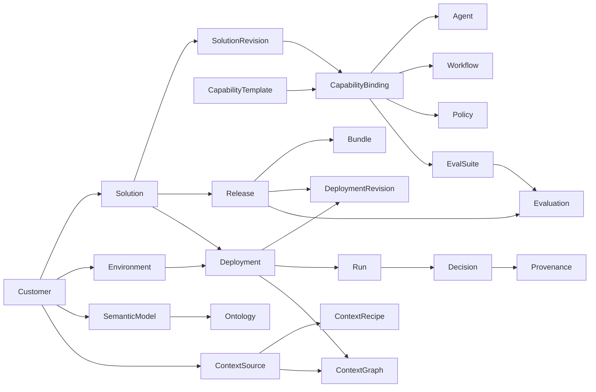

# FDE 工作台领域模型

> 状态：决策稿，对应 ticket「领域模型与核心抽象」。
> 范围：v0 单客户 bundle；不做多租户托管、首客场景、UI。
> 术语：见 [`GLOSSARY.md`](../GLOSSARY.md)。本文记录实体、关系、关键属性、生命周期、不变量和场景。

## 1. 范围与前提

- **交付模型**：v0 是单客户 bundle，运行在客户自有服务器/VPC；工作台是构建器/打包器，不是托管运行时。
- **运行时**：Mastra 是默认执行层；Solution Spec 保持 runtime-agnostic，通过 runtime profile 和 generator 映射到具体版本。
- **语义层**：Semantica + 薄 context-service；TS/Python 通过 REST 隔离，MCP 仅本地/IDE。
- **许可**：Bundle 只用 Mastra Apache-2.0 core，不含 `ee/`；Semantica MIT；图存储默认 Apache AGE/Oxigraph 或客户自带 Neo4j；Bundle 含 SBOM/notice/license gate。
- **明确不建模**：Tenant、多租户控制面、Engagement、Workspace。
- **设计原则**：Spec 是唯一真相；生成物可重建；客户定制走 Extension 而不是 fork；评测与溯源是一等公民。

## 2. 领域分层

| 层 | 实体 | 职责 |
|---|---|---|
| 交付与配置 | Customer, Solution, Solution Revision, Solution Spec, Environment | 谁、哪个解决方案、部署到哪 |
| 能力与实现 | Capability, Capability Template, Capability Binding, Agent, Workflow, Tool, Connector | 做什么、怎么实现 |
| 复用与定制 | Template, Overlay, Extension | 跨客户复用与客户差异 |
| 构建与发布 | Bundle, Release, Deployment, Deployment Revision | 从 Spec 到可部署产物 |
| 运行与治理 | Run, Policy, Eval Suite, Evaluation, Waiver, Decision, Provenance | 执行、约束、验收、溯源 |
| 语义与上下文 | Ontology, Semantic Model, Context Source, Context Recipe, Context Graph | 语义绑定与上下文组装 |

## 3. 实体与关键属性

### 3.1 Customer

- `customer_id`：稳定 ID。
- `name`、`slug`。
- `status`：`active | archived`。
- `data_residency`：默认数据驻留区域，供 Environment 继承。
- `created_at`、`archived_at`。

规则：Customer 是构建、交付和隔离的边界，不是运行时多租户边界。所有客户侧实体必须能追溯到唯一 Customer；跨 Customer 引用一律非法。

### 3.2 Solution

- `solution_id`：稳定 ID。
- `customer_id`：所属 Customer。
- `name`、`slug`。
- `status`：`active | deprecated`。
- `current_revision_id`：当前草稿或已冻结 Revision。
- `created_at`。

规则：一个 Customer 可以有多个 Solution；每个 Solution 独立构建、发布和部署。Bundle、Release、Deployment 都按 Solution 切分，不跨 Solution 共享运行时状态。

### 3.3 Solution Revision 与 Solution Spec

**Solution Revision** 是 Solution 的不可变配置快照：

- `revision_id`、`solution_id`、`revision_number`：单调递增。
- `status`：`draft | validated | frozen`。
- `spec_digest`：Spec 内容摘要。
- `spec`：声明式配置，见下。
- `based_on`：Solution Template 版本、Capability Template 版本、Ontology / Semantic Model 版本、runtime profile。
- `created_by`、`created_at`、`frozen_at`。

**Solution Spec** 只包含作者内容，不包含生成物：

- `solution`：元数据、目标 Customer。
- `capabilities`：Capability Binding 列表。
- `agents` / `workflows`：实现定义。
- `tools` / `connectors`：引用或定义。
- `semantic`：Semantic Model 引用、Context Recipe 引用。
- `governance`：Policy 引用、Eval Suite 引用。
- `environments`：环境能力要求（不是凭据）。
- `extensions`：Extension 引用和兼容声明。
- `build`：runtime profile、目标平台、生成器选项。
- `overlays`：生效的 Overlay 引用。

示意（不是最终 schema）：

```yaml
solution:
  id: claims-triage
  customer: acme
  templates:
    solution: fde-solution@1.2.0
  overlays:
    - customer/acme@1
capabilities:
  - id: document-triage
    template: document-triage@1.0.0
    implementation:
      type: agent
      ref: triage-agent
    policy_refs: [pii-redaction@1.0.0]
    eval_refs: [triage-quality@1.0.0]
agents:
  - id: triage-agent
    model_profile: standard
    tools: [claims-lookup]
tools:
  - id: claims-lookup
    connector: claims-db
connectors:
  - id: claims-db
    type: postgres
    secret_ref: acme/claims-db
semantic:
  model: acme-claims@1
  recipes: [claims-context@1]
environments:
  - id: acme-prod
    kind: prod
extensions:
  - claims-lookup@1
```

规则：

- Spec 是声明式、可验证、可 diff 的；生成物（Mastra app、context-service 配置、部署清单、迁移、SBOM/notice、签名）不入 Spec。
- Spec 不含 secret 值，只含 secret 引用。
- `validated` 要求 schema、引用完整性、版本兼容性和 Template/Overlay 合并全部通过。
- `frozen` 后不可修改；Release 必须 pin 一个 frozen Revision。
- 同一个 Spec + pinned Templates + Extensions + 工具链必须能重建出同一个 Bundle digest。

### 3.4 Environment

- `environment_id`、`customer_id`。
- `name`、`kind`：`dev | staging | prod`。
- `region`：数据驻留区域。
- `status`：`provisioning | active | retired`。
- `health`：`healthy | degraded | unreachable`（独立于生命周期）。
- `network_policy`、`secret_store_ref`、`capacity`。
- `created_at`、`retired_at`。

规则：Environment 属于 Customer，不属于某个 Solution；同一 Environment 可以承载多个 Solution 的 Deployment。Spec 只声明环境要求，实际凭据、网络和容量在 Environment 中配置。

### 3.5 Capability / Capability Template / Capability Binding

**Capability** 是业务能力契约：

- `capability_id`、`name`、`description`。
- `input_schema`、`output_schema`。
- `side_effects`：只读、写入、外部副作用。
- `sla`：延迟、可用性、人工介入要求。
- `governance_requirements`：必需的 Policy / Eval 类别。
- `owner`。

**Capability Template** 是可跨 Customer 复用的、版本化且不可变的 Capability 定义：

- `template_id`、`capability_id`、`version`（semver）。
- `contract`：输入/输出、副作用、SLA。
- `default_implementation`：Agent 或 Workflow 模板。
- `default_policy_refs`、`default_eval_refs`。
- `compatible_spec_major`。
- `status`：`active | deprecated`。

**Capability Binding** 是 Solution 中的绑定记录：

- `binding_id`、`solution_revision_id`、`capability_template_ref`。
- `implementation_ref`：恰好一个顶层 Agent 或 Workflow。
- `overlay_refs`：Customer / Solution Overlay。
- `policy_refs`、`eval_refs`。
- `extension_refs`。

规则：Capability 是“做什么”，Agent / Workflow 是“怎么做”。Capability Template 是复用、评测和策略绑定的单位；Capability Binding 不能削弱契约，只能通过 Overlay 收紧或参数化。每个 Capability Binding 必须有 contract、至少一个实现、至少一个 Policy、至少一个 Eval Suite。

### 3.6 Agent / Workflow / Tool / Connector

**Agent**：

- `agent_id`、`name`。
- `instructions`、`model_profile`、`tools`、`memory`。
- `policy_refs`、`capability_binding_ref`。
- 运行时中立定义；generator 映射到 Mastra agent。

**Workflow**：

- `workflow_id`、`name`。
- `steps`、`branches`、`parallel`、`human_approval`、`durable`。
- `agents`、`tools`、`policy_refs`。
- 运行时中立定义；generator 映射到 Mastra workflow。

**Tool**：

- `tool_id`、`name`。
- `input_schema`、`output_schema`。
- `side_effects`、`auth`、`rate_limit`。
- `connector_ref`：可选；纯代码 Tool 不依赖 Connector。

**Connector**：

- `connector_id`、`name`、`type`。
- `endpoint`、`secret_ref`。
- `data_contract`、`rate_limit`、`allowed_operations`。

规则：Agent 和 Workflow 是 Capability 的实现，不是跨客户复用单位；复用通过 Capability Template 和实现模板完成。Tool 的副作用必须显式声明；Connector 的凭据只以引用出现。

### 3.7 Template / Overlay / Extension

**Template**：

- `template_id`、`type`：`solution | capability | ontology | policy | eval | deployment_profile`。
- `version`（semver）、`content`。
- `compatible_spec_major`。
- `status`：`active | deprecated`。
- `owner`。

**Overlay**：

- `overlay_id`、`scope`：`customer | solution`。
- `target_template_ref`。
- `operations`：`add | set | remove`，按白名单路径。
- `rationale`、`approved_by`。

合并顺序：Template default → Solution Overlay → Customer Overlay。Customer Overlay 用于客户级强制约束（合规、保留、数据驻留），Solution Overlay 用于该 Solution 的调优；冲突时 Customer 赢。

**Extension**：

- `extension_id`、`name`、`version`。
- `interface`：`tool | connector | recipe | scorer`。
- `compatible_spec_major`、`compatible_template_majors`。
- `artifact_ref`：镜像或包 digest。
- `resource_requirements`、`owner`。

规则：Template 版本不可变；Overlay 不 fork Template；Extension 是唯一的客户代码入口，必须声明接口和兼容范围，不能直接修改生成物。升级时 Template 新版本 + Overlay 重放 + Extension 兼容性检查。

### 3.8 Bundle

- `bundle_id`：内容摘要，作为身份。
- `solution_id`、`solution_revision_id`。
- `status`：`building | built | verified | signed | failed`。
- `manifest`：组件、镜像、版本、端口、环境变量、卷、健康检查。
- `artifacts`：生成的 Mastra app、context-service、图存储配置、迁移脚本、Policy/Eval 定义、部署清单、SBOM/notice、校验和、签名。
- `build_provenance`：generator 版本、Template 版本、工具链版本、构建者、时间戳。
- `compatibility_matrix`：runtime × template × ontology × eval × extension。
- `license_gate_result`。
- `signature`。
- `created_at`。

规则：

- Bundle 不可变、内容寻址；不以版本号作为身份。
- Bundle 不含 secret 值，只含 secret 引用。
- 同一 Spec + pinned Templates + Extensions + 工具链必须重建出同一 digest。
- 生成的 Bundle 必须包含 SBOM/notice，并通过 license gate。
- Bundle 1:1 对应 Release 的候选产物；未签名的 Bundle 不能成为 Release。

### 3.9 Release

- `release_id`、`solution_id`、`version`（semver）。
- `bundle_digest`。
- `status`：`draft | approved | superseded | recalled`。
- `pinned_versions`：Spec Revision、Template、Ontology、Semantic Model、runtime。
- `release_notes`、`approved_by`、`approved_at`、`approval_decision_id`。
- `signature`、`recalled_reason`。

规则：

- 1 Release ↔ 1 Bundle；Release 按 Solution 全局唯一、不可变。
- `approved` 要求 Bundle 已签名、Eval 通过或存在有效 Waiver、license gate 通过。
- `active` 不是 Release 的状态；Release 在某个 Environment 中是否生效由 Deployment 表示。
- 新 Release 会使同 Solution 的旧 Release 进入 `superseded`；安全问题可以 `recalled`。

### 3.10 Deployment / Deployment Revision

**Deployment**：

- `deployment_id`、`solution_id`、`environment_id`、`customer_id`。
- `current_release_id`、`current_deployment_revision_id`。
- `status`：`pending | deploying | active | failed | rolling_back | retired`。
- `health`：`healthy | degraded | unreachable`。
- `config_overrides`：环境特定配置，只含 secret 引用。
- `last_deployed_at`。

**Deployment Revision**：

- `deployment_revision_id`、`deployment_id`、`release_id`。
- `result`：`applied | failed | rolled_back`。
- `migration_plan`、`applied_migrations`。
- `started_at`、`finished_at`、`actor`、`decision_id`。

规则：

- 同一 Solution × Environment 同时只有一个 active Deployment。
- Deployment 的 Customer、Environment、Solution 必须一致。
- 升级创建新的 Deployment Revision；回滚重新部署上一个 Release，要求迁移可逆或显式拒绝。
- Deployment Revision 是不可变审计记录，不设独立状态机。

### 3.11 Run

- `run_id`、`deployment_id`、`capability_binding_id`。
- `implementation_ref`：Agent 或 Workflow。
- `trace_id`、`actor`。
- `status`：`queued | running | waiting_for_human | succeeded | failed | cancelled`。
- `input`、`output`、`error`。
- `started_at`、`finished_at`、`cost`。
- `provenance_id`。

规则：Run 必须属于一个 Deployment；必须有 trace_id 和 actor；人工审批对应 `waiting_for_human`；Runtime Decision 和 Provenance 挂在 Run 上。Run 不跨 Environment。

### 3.12 Policy / Eval Suite / Evaluation / Waiver

**Policy**：

- `policy_id`、`name`、`version`。
- `scope`：`capability | solution | deployment`。
- `rules`、`enforcement_point`、`severity`、`owner`。

**Eval Suite**：

- `eval_suite_id`、`name`、`version`。
- `dataset_ref`、`scorers`、`thresholds`、`pass_criteria`。
- `owner`。

**Evaluation**：

- `evaluation_id`、`eval_suite_ref`、`subject_ref`：Bundle 或 Release。
- `status`：`queued | running | passed | failed | error`。
- `results`、`started_at`、`finished_at`、`decision_id`。

**Waiver**：

- `waiver_id`、`gate_ref`。
- `reason`、`approved_by`、`expires_at`、`decision_id`。

规则：Policy 在生成的代码和 context-service 强制执行；Eval Suite 是版本化评测定义；Evaluation 引用候选 Bundle/Release；Release 审批前必须通过 Eval，失败可阻断，也可由有权限的 actor 记录 Waiver 后放行。Waiver 本身是一条 Decision，必须带理由、审批人和有效期。

### 3.13 Ontology / Semantic Model / Context Source / Context Recipe / Context Graph

**Ontology**：

- `ontology_id`、`version`（semver）。
- `modules`、`classes`、`properties`、`shacl_shapes`。
- `source`：`template | customer`。
- `status`：`active | deprecated`。

**Semantic Model**：

- `semantic_model_id`、`customer_id`、`version`。
- `ontology_refs`、`entity_mappings`、`resolution_rules`、`merge_rules`。
- `status`。

**Context Source**：

- `context_source_id`、`customer_id`。
- `connector_ref`、`dataset`、`classification`、`freshness`、`schedule`。
- `secret_ref`、`status`：`draft | active | paused | retired`。

**Context Recipe**：

- `context_recipe_id`、`name`、`version`。
- `semantic_model_ref`、`source_refs`。
- `graph_queries`、`filters`、`ranking`、`budget`、`output_schema`。
- `eval_suite_refs`。

**Context Graph**：

- `graph_id`、`deployment_id`。
- `semantic_model_ref`、`source_refs`、`snapshot_id`。
- `built_at`、`provenance_id`、`status`。

规则：

- Ontology 是全局 Template + Customer 扩展；Semantic Model 是 Customer 级、版本化。
- Context Source 是 Customer 级配置；Context Recipe 是 Solution/Capability 级；Context Graph 是 Deployment 级物化。
- 同一 Customer 的多个 Solution 共享 Semantic Model 和 Context Source 定义，但运行时图各自独立；v0 不假设跨 Solution 共享图。
- Context Graph 可重建；所有断言带 provenance，不泄漏 Semantica/Neo4j 内部 ID。

### 3.14 Decision / Provenance

**Decision**：

- `decision_id`。
- `subject_type` / `subject_id`：Run、Evaluation、Release、Deployment、Solution Revision。
- `decision_type`：`runtime | governance | configuration`。
- `actor`、`rationale`、`evidence`、`timestamp`。
- `provenance_id`。

**Provenance**：

- `provenance_id`、`subject_ref`。
- `activity`、`agent`、`source_documents`、`timestamp`、`checksum`。
- 导出为 PROV-O。

规则：Runtime Decision 挂 Run；治理 Decision（Release 批准、Waiver、回滚）挂对应治理对象；配置 Decision（为什么选这个 Overlay/Extension）挂 Solution Revision。context-service 拥有稳定 ID（entity_id / decision_id / provenance_id），所有写入显式 `track_entity` / `track_relationship`，不依赖 Semantica 自动接线。

## 4. 关系



关键关系：

- Customer 1—N Solution；Customer 1—N Environment。
- Solution 1—N Solution Revision；Solution 1—N Release；Solution 1—N Deployment。
- Solution Revision 1—N Capability Binding；Capability Binding N—1 Capability Template；Capability Binding N—1 Agent 或 Workflow。
- Capability Binding N—M Policy；Capability Binding N—M Eval Suite。
- Agent / Workflow N—M Tool；Tool N—0..1 Connector。
- Release 1—1 Bundle；Release 1—N Deployment Revision；Deployment 1—N Deployment Revision。
- Deployment N—1 Environment；Deployment N—1 Solution；Deployment 1—N Run。
- Run 1—N Decision；Decision N—1 Provenance。
- Customer 1—N Semantic Model；Semantic Model N—M Ontology；Customer 1—N Context Source；Context Recipe N—M Context Source；Deployment 1—1 Context Graph；Context Graph N—M Context Source。
- Evaluation N—1 Eval Suite；Evaluation N—1 Bundle/Release；Waiver N—1 门禁；Waiver 1—1 Decision。

## 5. 生命周期

| 实体 | 状态 | 转换与门禁 |
|---|---|---|
| Customer | `active → archived` | 归档前不能有 active Deployment |
| Solution | `active → deprecated` | 废弃前必须没有 active Deployment |
| Solution Revision | `draft → validated → frozen` | validated 要求 schema/引用/兼容性通过；frozen 后不可变 |
| Bundle | `building → built → verified → signed`；失败 → `failed` | verified 要求测试、SBOM/license、可重建性通过；signed 后不可变 |
| Release | `draft → approved → superseded` / `recalled` | approved 要求 Bundle 已签名、Eval 通过或 Waiver；新 Release 使旧 Release `superseded` |
| Deployment | `pending → deploying → active → failed → rolling_back → active` / `failed`；`active → retired` | 部署要求 Environment active、迁移计划通过、健康检查通过 |
| Deployment Revision | 不可变记录：`applied / failed / rolled_back` | 由 Deployment 状态转换生成 |
| Run | `queued → running → waiting_for_human → succeeded` / `failed` / `cancelled` | `waiting_for_human` 需要审批请求；失败/取消终态 |
| Evaluation | `queued → running → passed` / `failed` / `error` | 引用 Bundle/Release；结果写入 Decision |
| Context Source | `draft → active → paused → retired` | paused 停止摄取；retired 不再被 Recipe 引用 |
| Environment | `provisioning → active → retired` | health 是独立属性，不改变生命周期 |

## 6. 不变量

### 6.1 Schema 强制

- 所有实体有稳定 ID；引用完整；删除被引用实体必须失败。
- 无跨 Customer 引用；Deployment 的 Customer、Environment、Solution 必须一致。
- Release 必须 pin 精确的 Bundle digest、Spec Revision、Template、Ontology、Semantic Model、runtime 版本。
- Bundle 和 Release 不可变；变更必须产生新 digest / 新 Release。
- 每个 Capability Binding 必须有 contract、至少一个实现、至少一个 Policy、至少一个 Eval Suite。
- 同一 Solution × Environment 只能有一个 active Deployment。
- 每个 Run 必须引用 Deployment；每个 Decision 必须有 trace/actor/provenance。
- Spec、Bundle、Deployment 中只能出现 secret 引用，不能出现 secret 值。
- Bundle 必须含 SBOM/notice 并通过 license gate。
- schema 变更必须有迁移声明；没有迁移的破坏性变更不能构建。
- 生成物必须与 source digest 一致；手改生成物会在 CI 中失败。

### 6.2 流程强制

- 生产发布审批和客户验收。
- 安全、法务、数据驻留审查。
- Waiver 审批；Waiver 必须有理由、审批人和有效期。
- 密钥轮换、备份/恢复演练、灾备演练。
- 事件响应和召回流程。
- 供应商/许可证变更审查。

### 6.3 构建与可重建性

构建流水线：Validate Spec → Freeze Revision → Build Bundle → Verify/Sign → Release → Deploy → Run。

- Validate：schema、引用、Template/Overlay 合并、Extension 兼容性。
- Build：generator 从 Spec + pinned Templates + Extensions + 锁文件生成 Bundle。
- Verify：contract tests、Eval Suite、SBOM/license、可重建性检查（重跑构建对比 digest）。
- Sign：签名 Bundle；Release 审批引用签名。
- Deploy：执行迁移，记录 Deployment Revision，健康检查通过后 active。

## 7. 版本与兼容性

- Template / Capability Template / Ontology / Policy / Eval Suite 用 semver，版本不可变。
- Overlay 声明兼容的 Template major；minor/patch 自动跟随，major 升级必须显式迁移。
- Solution Revision 单调递增；Release 用 semver 并 pin 精确版本。
- Bundle 用内容摘要，不以版本号作为身份。
- 每次 Release 生成兼容性矩阵：runtime × template × ontology × eval × extension；不兼容时构建失败。
- 升级：新 Template minor/patch + Overlay 重放 + Extension 兼容性检查 + 新 Bundle/Release。
- 回滚：重新部署上一个 Release；迁移必须可逆，否则显式拒绝回滚。
- Customer Overlay 优先于 Solution Overlay；Customer Overlay 只用于客户级强制约束，Solution Overlay 用于调优。

## 8. 场景走查

### 8.1 参考场景：Acme Claims 的理赔分诊

1. Customer `acme`，Solution `claims-triage`，Environment `acme-staging` 和 `acme-prod`。
2. FDE 选择 Solution Template `fde-solution@1.2.0`、Capability Template `document-triage@1.0.0`、Ontology Template `insurance-claims@1.0.0`、Policy Template `pii-redaction@1.0.0`、Eval Suite Template `triage-quality@1.0.0`。
3. Solution Overlay 设置置信度阈值 0.8，绑定 Context Source `sharepoint-claims` 和 `claims-db`，选择 Agent 实现 `triage-agent`。
4. Validate 通过；Spec Revision 7 冻结。
5. Build 生成 Bundle `sha256:abc...`，包含 Mastra app、context-service、图存储配置、迁移、Policy/Eval、部署清单、SBOM/notice、签名和 build provenance。
6. Eval Suite `triage-quality@1.0.0` 对 Bundle 运行并通过；license gate 通过；Bundle 签名。
7. Release `1.0.0` 获批（Decision `d-100`），pin Bundle digest、Spec Revision 7、Template/Ontology/runtime 版本。
8. 部署到 `acme-staging`（Deployment Revision `dr-1`），再部署到 `acme-prod`（`dr-2`）；迁移应用成功，健康检查通过。
9. Runtime：Run `r-1` 调用 `document-triage`，通过 Context Recipe `claims-context@1` 检索上下文，Agent 调用 Tool `claims-lookup`，记录 Decision `d-101`（批准理赔）和 Provenance `prov-1`；人工审批进入 `waiting_for_human`，审批后 `succeeded`。
10. 查询 Provenance：从 Decision 追溯到 Run、Agent、Context Source 和源文档；只暴露稳定 ID，不暴露 Semantica/Neo4j 内部 ID。

### 8.2 第二个客户复用：Beta Bank 的 KYC 复核

1. Customer `beta`，Solution `kyc-review`，Environment `beta-prod`。
2. 复用 Capability Template `document-triage@1.0.0`，但选择不同的 Ontology Template `kyc-ontology@1.0.0` 和新的 Semantic Model `beta-kyc@1`。
3. Beta 的 Solution Overlay 使用更严格的 Policy `pii-retention-eu@2.0.0`、不同的 Context Source `beta-dms` 和 `core-banking`、Eval 阈值 0.9，选择 Agent 实现 `kyc-agent`。
4. 不 fork Template；所有版本显式 pin；构建新的 Bundle `sha256:def...`，Release `1.0.0`，部署到 `beta-prod`。
5. `document-triage@1.0.1` 发布后，Acme 和 Beta 各自重放 Overlay、运行兼容性检查和 Eval，构建新 Bundle/Release；两个客户的运行时和 Context Graph 完全隔离。
6. Customer Overlay `acme@1` 不会影响 Beta；跨 Customer 引用在 schema 层被拒绝。

### 8.3 客户定制升级：Acme 的 claims-lookup 扩展

1. Acme 增加 Extension `claims-lookup@1`（Tool 接口，兼容 Capability Template `document-triage` major 1）；Spec Revision 8 引用它，构建 Bundle `sha256:ghi...`，Release `1.1.0`。
2. Capability Template `document-triage@2.0.0` 修改 Tool 接口（breaking）。兼容性检查发现 `claims-lookup@1` 不兼容 major 2，构建失败并给出明确错误。
3. 选择迁移 Extension：`claims-lookup@2` 实现新接口；Overlay 重放；Spec Revision 9；Bundle `sha256:jkl...`；Release `2.0.0`，带迁移计划，部署到 staging/prod。
4. 若迁移不可逆，回滚被显式拒绝；若可逆，回滚重新部署 Release `1.1.0`，生成新的 Deployment Revision。
5. 新 Eval 在边缘案例失败；请求 Waiver `w-1`，Decision `d-200` 记录理由、审批人和有效期；Release `2.0.0` 在 Waiver 下获批，下一次 Release 前必须重新评测。

## 9. 开放问题与边界

以下问题不在本 ticket 内解决，已留在对应 ticket 或地图的 fog：

- 图存储选型、Neo4j serving adapter、稳定实体 ID 映射：[运行时与集成契约](https://github.com/0xnicholas/Fdesforce/issues/8)、[生产检索索引与 100k+ 规模上限](https://github.com/0xnicholas/Fdesforce/issues/15)。
- 检索索引的部署形态、重建与降级：[生产检索索引与 100k+ 规模上限](https://github.com/0xnicholas/Fdesforce/issues/15)。
- 运行时失败语义、重试、回滚细节：[运行时与集成契约](https://github.com/0xnicholas/Fdesforce/issues/8)。
- 客户环境内的身份、权限与部署：[客户环境内的身份、权限与部署](https://github.com/0xnicholas/Fdesforce/issues/12)。
- 评测方法、数据集和 scorer：[评测、验收与可观测性](https://github.com/0xnicholas/Fdesforce/issues/10)。
- Solution Spec 的最终 schema 和配置工具形态：[Solution Spec 与配置工具形态](https://github.com/0xnicholas/Fdesforce/issues/7)。
- 升级、迁移与回滚的操作流程：本文给出模型与状态；具体流程见[运行时与集成契约](https://github.com/0xnicholas/Fdesforce/issues/8)与[架构综合与实施切片](https://github.com/0xnicholas/Fdesforce/issues/13)。
- 成本模型、Agent 安全威胁模型、长会话记忆：地图的「Not yet specified」。
- 多 Solution 共享 Context Graph：v0 不做，留到未来多 Solution 拓扑。
- 可视化工作台/前端、首客场景、行业加速器、多租户托管：地图的「Out of scope」。

## 10. 关键决策摘要

| 决策 | 结论 |
|---|---|
| 主轴 | Customer 1—N Solution；Environment 属于 Customer；Engagement/Workspace 不建模 |
| 能力边界 | Capability 是契约与治理单位；Agent/Workflow 是实现；Tool/Connector 是动作与接入 |
| 复用 | versioned immutable Template + 声明式 Overlay + versioned Extension；禁止 fork |
| 构建发布 | Bundle 内容寻址不可变；Release 是签署/批准记录；Deployment 绑定 Solution × Environment；Run 是执行 |
| 语义层 | Ontology 全局 Template + Customer 扩展；Semantic Model/Context Source 为 Customer 级；Context Recipe 为 Solution/Capability 级；Context Graph 为 Deployment 级 |
| 治理 | Policy 运行时约束；Eval Suite 测试门禁；Waiver 是 Decision；Release 审批前必须通过 Eval |
| 生命周期 | 见第 5 节；状态转换由 schema 校验，跨状态动作写入 Decision |
| 不变量 | 结构性/安全边界由 schema 强制；组织性判断由流程强制 |
| 版本 | semver + 不可变版本；Release pin 精确版本；Bundle 用 digest；兼容性矩阵不通过则构建失败 |
| 溯源 | Decision 是一等实体；Provenance 用 PROV-O；context-service 拥有稳定 ID |
