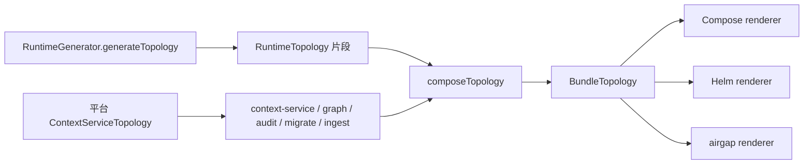

# 运行时 Adapter：RuntimeGenerator 端口、能力矩阵与构建门禁

> 状态：决策稿，对应 [Runtime Adapter 端口与能力矩阵](https://github.com/0xnicholas/Fdesforce/issues/17)。
> 范围：v0 单运行时（Mastra）；本文件只定构建期端口、Runtime Profile / Capabilities、构建门禁、Bundle Topology、`runtime-info` 握手与 conformance，不实现第二 generator。
> 契约：`fde.runtime/v1`；本文件提出 additive `v1.3`（`runtime-info`）。术语见 [`GLOSSARY.md`](../GLOSSARY.md)。

## 1. 结论摘要

| # | 决策 | 结论 |
|---|---|---|
| D1 | 端口定位 | `RuntimeGenerator` 是工作台构建链的端口，不是运行时抽象层；换 runtime = 新 generator + 新 Bundle/Release。 |
| D2 | 端口归属 | `packages/runtime-generator`（`@fde/runtime-generator`），TypeScript、纯函数；不进入 Bundle，不依赖运行时 SDK。 |
| D3 | Profile | `RuntimeProfile` 是版本化、内容寻址的 artifact；Spec 只引用 `build.runtimeProfile`，`solution.lock` 固定版本与 digest。 |
| D4 | 能力矩阵 | 10 组 `RuntimeCapability`，每组叶节点用 `native / adapter / degraded / none`；Profile 描述生成后的 runtime app，不是裸 runtime。 |
| D5 | 要求推导 | `must / should` 从 Solution Spec 推导，不写进 Profile；`must` 缺失或降级即 build fail，无 `--force`、无 waiver。 |
| D6 | Connector 接缝 | Connector-backed Tool 只通过 context-service 的 typed operation 端点；纯计算 Tool 按 runtime 打包；`recipe / scorer` 留在 Python。 |
| D7 | Topology | generator 输出 `RuntimeTopology` 片段；平台与 `ContextServiceTopology` 合成唯一 `BundleTopology`；Compose/Helm/airgap 渲染器共享。 |
| D8 | 握手 | `runtime-info` additive `v1.3`：`service` 统一为 `runtime-app`，新增 `runtime` 与 `capability_details`，启动时二次 fail closed。 |
| D9 | Conformance | C1–C15 仍归 context-service；新增 A1–A11 adapter suite；Mastra 必须全过，LangGraph 只做伪适配器走查。 |
| D10 | 迁移 | 跨 runtime 切换是 stop-the-world 的新 Bundle/Release；checkpoint/thread memory 不迁移，audit 不回滚；v0 不提供切换工具。 |
| D11 | v0 约束 | 只接受 `split` 拓扑；一个 Environment 一个 Solution；只有 runtime app 暴露到入口。 |
| D12 | 交付物 | 本文件 + ADR-0007 + Runtime Profile/Capabilities/Bundle Topology schema + A1–A11 conformance。 |

## 2. 范围与明确不做

本票解决的是“新 runtime 如何以新 generator 接入”，不是“如何把两个 runtime 抽象成同一个运行时”。

**做**：

- 定义 `RuntimeGenerator` 的构建期接口、输入/输出和失败语义。
- 定义 `RuntimeProfile` / `RuntimeCapabilities` 的 schema、能力分级和构建期推导。
- 定义 `BundleTopology` 的片段合成、v0 拓扑约束和部署实例命名。
- 定义 `runtime-info` v1.3 的二次握手。
- 定义 A1–A11 adapter conformance 和 CI/`fde verify` 的位置。
- 给出 Mastra 适配器走查和 LangGraph 伪适配器走查。

**不做**：

- 不做 universal `AgentRuntime` / `WorkflowRuntime` 抽象。
- 不抽象 checkpoint、agent loop、memory 的内部结构，不做跨 runtime checkpoint 迁移。
- 不让 context-service 感知 runtime；不修改客户 Run API 的稳定形状（除 additive v1.3）。
- 不做第二 generator 的生产实现；不实现 LangGraph generator。
- 不做多 runtime 同时托管、多租户、`merged-container` v0 支持、Agent Server v0 支持。
- 不做任意容器镜像 Extension、通用 sidecar 生命周期。
- 不实现 `fde runtime switch`；只定义未来切换的边界和门禁。

## 3. 术语与边界

| 术语 | 含义 | 不是什么 |
|---|---|---|
| **Runtime Generator** | 把 Solution Spec + Runtime Profile + 环境非 secret 值转换为 runtime app 源码、迁移、`RuntimeTopology` 和 contract tests 的构建期组件。 | 不是运行时服务，不是 Bundle 内组件，不是通用 runtime 接口。 |
| **Runtime Profile** | 平台维护的、版本化、内容寻址的 runtime 组合与能力声明。 | 不是 Solution Spec 的一部分，不是模型 profile。 |
| **Runtime Capability** | 生成后的 runtime app 对某类执行能力的支持声明。 | 不是业务 `Capability`，不是 Policy。 |
| **RuntimeTopology** | generator 对自己拥有的组件、卷、作业、启动依赖、健康检查和 secret 绑定的声明片段。 | 不是完整 Bundle 清单，不是 Compose/Helm 文件。 |
| **BundleTopology** | 平台把 `RuntimeTopology` 与 `ContextServiceTopology` 合成的唯一部署拓扑清单。 | 不是渲染后的平台 manifest。 |
| **Generated App** | generator 返回的可重建源码树、Dockerfile、入口和构建元数据。 | 不是已构建镜像，不是运行中的进程。 |

`RuntimeProfile` 只描述 runtime；`build.platform`（`compose | helm`）与 `build.delivery`（`registry | offline-bundle`）属于构建/交付字段，不进入 Profile。`spec.build.requirements` 只承载少数无法从 Spec 推导的要求，且只能把 `should` 提升为 `must`。

## 4. `RuntimeGenerator` 端口

### 4.1 包边界

```text
packages/
  spec/                    # Solution Spec / Runtime Profile / Bundle Topology 的 Zod schema 与类型
  contracts-client/        # contracts/ 生成的 wire 类型与薄客户端；不手写 wire 类型
  runtime-generator/       # 端口、输入/输出类型、validation 结果、共享工具
  runtime-generator-mastra/# v0 实现；生成 Mastra app / topology / migrations / tests
  cli/                     # fde build / verify / deploy plan
```

- `@fde/contracts-client` 是生成物：OpenAPI + JSON Schema → TS 类型与客户端，CI 校验生成结果与 `contracts/` 一致；generator 与 CLI 消费它，不各自手写 wire 类型。
- `@fde/runtime-generator` 只依赖 `@fde/spec` 的类型与纯工具；不依赖 Mastra、LangGraph、Node 运行时或 Python。
- 具体 generator 可以在构建时依赖自己的模板/代码生成器，但不得执行 runtime 代码、联网或写盘。
- 未来 Python generator 通过一个 JSON/CLI shim 实现同一端口；v0 不要求，但输入/输出必须保持 JSON 可序列化。

### 4.2 接口

```ts
type RuntimeFamily = string;                 // "mastra" | "langgraph" | ...
type RuntimeLanguage = "typescript" | "python";

interface RuntimeGenerator {
  readonly family: RuntimeFamily;
  readonly version: string;

  capabilities(profile: RuntimeProfile): RuntimeCapabilities;

  validate(input: RuntimeValidationInput): RuntimeValidationResult;

  generateApp(input: RuntimeGenerateInput): GeneratedApp;

  generateTopology(input: RuntimeGenerateInput): RuntimeTopology;

  generateMigrations(input: RuntimeGenerateInput): RuntimeMigrationPlan;

  generateContractTests(input: RuntimeGenerateInput): TestPlan;
}
```

方法契约：

| 方法 | 输入 | 输出 | 说明 |
|---|---|---|---|
| `capabilities` | `RuntimeProfile` | `RuntimeCapabilities` | 解析并规范化 Profile；纯函数；不校验 Spec。 |
| `validate` | Spec + Profile + Environment + Lock + Extension manifests | `RuntimeValidationResult` | 从 Spec 推导 `must / should`；检查能力、Extension、state store、topology、license、contract/schema；不写文件。 |
| `generateApp` | 同上 + build context | `GeneratedApp` | 返回文件 map、Dockerfile、entrypoint、build args、component metadata；不构建镜像、不联网、不写盘。 |
| `generateTopology` | 同上 | `RuntimeTopology` | 只声明 generator 拥有的 runtime 组件、卷、作业和启动依赖。 |
| `generateMigrations` | 同上 | `RuntimeMigrationPlan` | 只包含 runtime 拥有的 state store/checkpointer 迁移；context-service 迁移由平台提供。 |
| `generateContractTests` | 同上 | `TestPlan` | A-case 到测试命令/fixture 的映射；不实现 runner。 |

`files` 与 `modelProfiles` 是 [#27](https://github.com/0xnicholas/Fdesforce/issues/27) 的实现补充：generator 不读盘（§4.4 确定性），Spec 引用的 prompt、JSON Schema 与 Model Profile 必须由 CLI 解析后随输入传入；generator 需要而没拿到即抛错，不降级生成。`RuntimeExtensionView` 同样带 `interface`（`tool | connector | recipe | scorer`），因为「谁加载这个 artifact」决定生成物是否要为它写 loader：`connector` 由 context-service 执行，`tool` 需要 app 内的 artifact loader。

**不提供**：`build`、`deploy`、`run`、`resume`、`checkpoint`、`snapshot`。出现这些方法说明端口已退化为运行时抽象。

`GeneratedApp.components` 与 `RuntimeTopology` 的组件/卷/作业字段以 [`contracts/schemas/bundle-topology.schema.json`](../contracts/schemas/bundle-topology.schema.json) 为准；TypeScript 类型由 schema 生成，本文不重复字段定义。

### 4.3 输入输出

```ts
interface RuntimeValidationInput {
  spec: SolutionSpec;
  profile: RuntimeProfile;
  environment: EnvironmentView;   // 非 secret 值、networkClass、state store 选择
  lock: SolutionLock;
  extensions: ExtensionManifest[];
}

interface RuntimeGenerateInput extends RuntimeValidationInput {
  build: BuildContext;            // toolchain digest、source digests、build id
  files?: Record<string, string>;              // Spec 本地文件（prompt、JSON Schema），CLI 已按 lock digest 校验
  modelProfiles?: Record<string, ModelProfile>; // Agent 引用的 Model Profile，CLI 已解析并校验 digest
}

interface RuntimeValidationResult {
  requirements: RuntimeRequirement[];
  errors: RuntimeDiagnostic[];
  warnings: RuntimeDiagnostic[];
}

interface RuntimeRequirement {
  capability: string;             // e.g. "hitl.consume"
  level: "must" | "should";
  source: string;                 // e.g. "spec.workflows.document-triage-flow.steps[2]"
  note?: string;
}

interface RuntimeDiagnostic {
  code: string;
  message: string;
  capability?: string;
  path?: string;
  remediation?: string;
}

interface GeneratedApp {
  files: Array<{ path: string; content: string; mode?: number }>;
  dockerfile: { path: string; content: string };
  entrypoint: string[];
  buildArgs: Record<string, string>;
  components: RuntimeComponentDescriptor[];
  sourceDigest: string;           // 文件内容的稳定摘要
}

interface RuntimeMigrationPlan {
  steps: Array<{
    id: string;
    owner: "runtime";
    phase: "runtime-state";
    reversible: boolean;
    command: string[];
    dependsOn: string[];
    schemaVersion?: string;
  }>;
}

interface TestPlan {
  cases: Array<{
    caseId: "A1" | "A2" | "A3" | "A4" | "A5" | "A6" | "A7" | "A8" | "A9" | "A10" | "A11";
    tier: "static" | "smoke" | "release";
    command: string[];
    fixtures: string[];
    notes?: string;
  }>;
  generatedFiles: Array<{ path: string; content: string }>;
}
```

### 4.4 构建顺序与确定性

`fde build` 的顺序固定为：

1. 读取 Spec + lock，校验 lock 新鲜度和 digest。
2. 解析 `build.runtimeProfile`，加载 Profile artifact，校验 digest。
3. `generator.capabilities(profile)` → 规范化能力声明。
4. `generator.validate(...)` → 推导要求；有 `errors` 立即失败，`warnings` 写入 build provenance。
5. `generateApp` / `generateTopology` / `generateMigrations` / `generateContractTests`。
6. 平台合成 `BundleTopology` 与完整 `MigrationPlan`，写入生成物，计算 Bundle digest。
7. 跑 static conformance（A1、A9 静态部分、A11、schema 校验）。

确定性要求：

- 生成过程中不读取当前时间、随机数、环境变量值或网络；所有版本来自 lock/Profile/build context。
- 文件按稳定路径排序；JSON 使用 canonical serialization；文件 mode 显式。
- 同一 Spec + lock + Profile + Extensions + toolchain image 必须产生同一 `sourceDigest` 和 Bundle digest（A11）。
- `validate` 不抛异常表示预期校验失败；错误进入 `RuntimeValidationResult.errors`。只有内部错误才抛。

## 5. `RuntimeProfile` 与 `RuntimeCapabilities`

### 5.1 Profile artifact

`RuntimeProfile` 是平台维护的、版本化、内容寻址的 YAML artifact：

```yaml
apiVersion: fde.dev/v0
kind: RuntimeProfile
metadata:
  name: mastra-1.83-node22
  version: 1.0.0
spec:
  generator: { name: mastra, version: 1.0.0 }
  family: mastra
  language: typescript
  runtimeVersion: 1.83.0
  contractVersion: 1.3.0
  packages:
    "@mastra/core": 1.83.0
    node: 22.13.0
  capabilities:
    durableWorkflow:
      support: native
      durabilityModes: [sync, async]
      autoResume: adapter
    hitl:
      support: adapter
      interrupt: native
      resume: native
      approvalResource: adapter
      expiry: adapter
      multipleInterrupts: native
      consume: adapter
    streaming:
      support: native
      tokenStream: native
      toolEvents: native
      interruptEvents: adapter
      transport: native
    observability:
      support: native
      otel: native
      evalHooks: native
    memory:
      support: native
      thread: native
      longTerm: native
      ttl: adapter
    tools:
      support: native
      native: native
      mcp: adapter
      connectorOperations: adapter
    extensions:
      support: adapter
      artifactKinds: [ts-package, http]
    stateStore:
      support: native
      kinds: [sqlite, postgres]
      schemaVersion: "1"
      encryption: adapter
      retention: adapter
    topology:
      support: native
      modes: [split]
      singleWriter: true
    offline:
      support: native
  licensing:
    runtime: Apache-2.0
    requiresLicenseKey: false
    egress: false
```

为避免两处漂移，`capabilities` 是 state store、Extension artifact kind、topology mode 的**单一来源**；Profile 不再重复 `stateStore` / `extensionArtifacts` / `topologyModes` 顶层字段。

Schema：

- [`contracts/schemas/runtime-profile.schema.json`](../contracts/schemas/runtime-profile.schema.json)
- [`contracts/schemas/runtime-capabilities.schema.json`](../contracts/schemas/runtime-capabilities.schema.json)

### 5.2 能力语义

`RuntimeCapabilities` 描述**生成后的 runtime app**（runtime 原语 + generator adapter），不是裸 runtime 库。

| 级别 | 含义 | 构建行为 |
|---|---|---|
| `native` | runtime 原语直接提供，generator 只做配置/映射。 | 满足。 |
| `adapter` | 需要 generator 生成适配代码，但端到端能力成立。 | 满足。 |
| `degraded` | 能用，但有明确损失；必须声明 `limitations`。 | `must` 时失败；`should` 时 warning。 |
| `none` | generator 无法生成这项能力。 | `must` 时失败；`should` 时 warning。 |

10 组能力：

| 组 | 子项 |
|---|---|
| `durableWorkflow` | `durabilityModes`、`autoResume` |
| `hitl` | `interrupt`、`resume`、`approvalResource`、`expiry`、`multipleInterrupts`、`consume` |
| `streaming` | `tokenStream`、`toolEvents`、`interruptEvents`、`transport` |
| `observability` | `otel`、`evalHooks` |
| `memory` | `thread`、`longTerm`、`ttl` |
| `tools` | `native`、`mcp`、`connectorOperations` |
| `extensions` | `artifactKinds` |
| `stateStore` | `kinds`、`schemaVersion`、`encryption`、`retention` |
| `topology` | `modes`、`singleWriter` |
| `offline` | 无子项；license/egress 在 `licensing` |

组级 `support` 是子项的最坏情况；任一子项为 `degraded` 时，组级必须为 `degraded` 并带 `limitations`。schema 强制“组级 degraded 必须有 limitations”；build 还要校验子项与组级的一致性，避免 `hitl.consume: degraded` 被组级 `native` 掩盖。

不是 Runtime Capability 的东西：

- **record-before-act**：generator + context-service 的 wrapper 不变式，所有 adapter 必须通过 A4。
- **Connector operation contract**：属于 context-service；`tools.connectorOperations` 只表示 generator 能生成调用它的薄 Tool。
- **single-writer**：`topology.singleWriter` 是约束，不是能力。
- **eval hooks**：`none` 可接受；评测 worker 走 Run API，不依赖 runtime 内建 eval。

### 5.3 Lock 字段

`solution.lock.runtime` 固定：

| 字段 | 说明 |
|---|---|
| `profile` | `name@version` |
| `profileDigest` | `sha256:...`，内容摘要 |
| `generatorVersion` | 精确 semver |
| `family` / `language` | 用于握手和 Extension 兼容检查 |
| `contractVersion` | `fde.runtime/v1` 的精确版本 |
| `packages` | 精确版本 pin，不允许范围 |
| `stateStore` | `kind` + `schemaVersion` |
| `checkpointerSchema` | runtime state store 的 schema 版本（如有） |

## 6. 能力矩阵

| 能力 | Mastra | LangGraph JS | LangGraph Python | 要求级别 | 端口吸收 | generator / topology 必须实现 |
|---|---|---|---|---|---|---|
| **durable workflow** | `native`：workflow snapshot、`suspend()/resume()` | `native`：checkpointer + `durability`；恢复 worker 自建 | 同左 | `must`（`durable: true`） | 声明、配置、校验 | checkpointer 配置、恢复 worker、Run registry |
| **HITL** | `native` 暂停/恢复；审批资源在 context-service | `adapter`：`interrupt()/Command(resume)` + 审批代理 | 同左 | `must`（`approval` step） | 事件/API 形状、审批代理接口 | request/wait/commit 展开、consume reconcile、expiry job |
| **streaming** | `native`：server + SSE | `adapter`：stream 原语 + generator SSE | 同左 | `must`（Run API 总是） | SSE envelope、事件类型 | SSE 路由、seq、heartbeat、断线重连 |
| **observability** | `native`：OTel exporter | `degraded`：LangSmith-first；OTel-only 未验证 | 同左 | `should`（可提升为 must） | `otel` / `evalHooks` 声明 | exporter/collector 配置、trace 映射 |
| **memory** | `native`：thread/resource | `adapter`：checkpointer + Store | 同左 | `must`（Agent 声明 memory） | `thread` / `longTerm` 声明 | namespace、retention、加密、隔离 |
| **tools** | `native`：tools + MCP | `native`：LangChain tools + MCP adapters | 同左 | `must`（声明 tools） | 能力声明、tool schema 校验 | tool 生成、Connector 接缝、record-before-act wrapper |
| **extensions** | `adapter`：`ts-package` | `adapter`：`ts-package` | `adapter`：`python-wheel` / `http` | `must`（声明 Extension） | artifact kind/runtime 兼容声明 | artifact loader、版本/签名校验、HTTP sidecar |
| **state store** | `native`：libsql/SQLite/Postgres | `native`：SQLite/Postgres checkpointer | 同左 | `must`（durable） | `kinds` / `schemaVersion` 声明 | 卷/数据库、迁移、加密、单写者 |
| **topology** | `native`：split | `native`：split | `adapter`：split / merged-container（后者 v0 不支持） | `must`（总是） | `modes` 声明 | 组件、卷、端口、启动顺序、health |
| **offline / air-gapped** | `native`：Apache-2.0 OSS | `native`：MIT OSS | `native`：MIT OSS；Agent Server 为 `none` | `must`（airgap/restricted） | license/egress 声明 | 离线包、镜像/wheel 镜像、license gate |

## 7. 构建期推导与 fail-closed

### 7.1 从 Spec 推导要求

| Spec 构造 | 推导出的要求 | 缺失时 |
|---|---|---|
| 任意 Workflow `durable: true` | `durableWorkflow.support != none`；Environment 选择的 state store 在 `capabilities.stateStore.kinds` 内 | error |
| 任意 `approval` step | `hitl.interrupt / resume / approvalResource / consume != none`；context-service approval API 可用 | error（grammar 由 [Workflow/HITL step grammar 与 policy 参数化](https://github.com/0xnicholas/Fdesforce/issues/18) 定） |
| 任意 Agent 声明 `memory` | `memory.thread` 或 `longTerm != none` | error（schema 由 [Agent memory 语义与 Spec schema](https://github.com/0xnicholas/Fdesforce/issues/22) 定） |
| 任意 Tool `sideEffects != read` | tool calling + record-before-act wrapper；A4 通过 | error |
| 任意 `connectorRef` | Connector manifest 有 typed operation（input/output schema、sideEffects、scopes、idempotency） | error（context-service build 检查） |
| `build.delivery: offline-bundle` 或 Environment `networkClass: restricted` | `offline.support != none`；`licensing.egress == false`；需要 license key 时必须有 `licenseRef` | error |
| 任意 Extension | `extensions.artifactKinds` 覆盖 artifact；`runtimeCompatibility` 包含当前 family/language | error |
| Run API 总是需要 SSE | `streaming.support != none` | error |
| `evalRefs` 非空 | **不推导 runtime 要求**；评测 worker 调 Run API | 无（`evalHooks` 可选） |
| `deployment` 要求 OTel-only | `observability.otel != none`；通过 `spec.build.requirements` 提升为 must | error |
| Profile `topology.modes` 不含 `split` | v0 只选择 `split` | error |
| Profile `topology.modes` 含 `merged-container` / `agent-server` | v0 build 只选择 `split`；其他 mode 不渲染并产生 warning | warning |

实现补充（[#26](https://github.com/0xnicholas/Fdesforce/issues/26)，与上表一起生效）：

- `approval` step 除 `interrupt / resume / approvalResource / consume` 外还要求 `hitl.expiry`：step 声明了 `expiresAfter`，生成物必须能调度到期处理（A7）。
- Agent 声明 `memory.thread` 时，除 `memory.thread` 外还要求 `stateStore`：thread memory 落在 runtime state store 里（A12）；`longTerm` 由平台 `fde_memory` 承担，不要求 runtime state store。
- 任意声明的 Tool（含只读）都要求 `tools.native` 或 `tools.connectorOperations`：上表只写副作用 Tool 的 record-before-act，能力矩阵的"声明 tools 即 must"同样成立。
- 离线目标遇到 `licensing.requiresLicenseKey: true` 一律 `runtime_license_blocked`：v0 的 Solution Spec 尚无 `licenseRef` 字段，没有可满足的路径（A10）。

### 7.2 `spec.build.requirements`

只允许封闭集合，默认不写：

```yaml
build:
  runtimeProfile: mastra-1.83-node22@1.0.0
  platform: compose
  delivery: registry
  requirements:
    observability:
      otel: required
    offline: true
```

规则：

- 只能把推导出的 `should` 提升为 `must`；不能把 `must` 降为 `should`。
- 不接受任意 capability 字符串；未知 key 是 schema 错误。
- 字段名最终由 [Solution Spec 与配置工具形态](https://github.com/0xnicholas/Fdesforce/issues/7) 合并；本票只定语义和门禁。

### 7.3 Fail-closed 规则

| 错误码 | 触发条件 | 处理 |
|---|---|---|
| `runtime_profile_missing` | Profile 不存在、不可读、digest 不匹配 | build fail |
| `runtime_profile_mismatch` | Profile 的 family/language/contract 与 lock 不一致 | build fail |
| `runtime_capability_missing` | `must` 要求的能力为 `none` | build fail |
| `runtime_capability_degraded` | `must` 要求的能力为 `degraded` | build fail |
| `runtime_capability_inconsistent` | 组级 `support` 强于子项（如 `hitl.support: native` 而 `hitl.consume: degraded`），或组级 `degraded` 未带 `limitations` | build fail |
| `runtime_extension_unsupported` | artifact kind 或 runtime compatibility 不匹配 | build fail |
| `runtime_state_store_unsupported` | Environment 选择的 state store 不在 `kinds` | build fail |
| `runtime_topology_unsupported` | 需要 split 但 Profile 不含 `split` | build fail |
| `runtime_license_blocked` | 离线/受限目标需要 license key 或 egress | build fail |
| `runtime_contract_mismatch` | contract major 不兼容 | build fail |
| `runtime_schema_mismatch` | graph/audit/state store schema 不匹配 | build fail |
| `runtime_connector_contract_missing` | `connectorRef` 没有 typed operation | build fail |
| `runtime_grammar_unsupported` | Spec grammar 允许、但当前 generator 版本无法如实生成的结构（`approval` step、副作用 Tool、`memory` 声明、解析不了的引用） | build fail |
| `runtime_generation_nondeterministic` | 同一输入两次生成 digest 不同 | build fail |
| `runtime_manifest_invalid` | 生成的 app/topology 不符合 schema | build fail |

规则：

- **无 `--force`、无 waiver（v0）**。要过门禁只能改 Spec、Profile、Environment 或 Extension。
- `should` 的 `degraded / none` 产生 warning，写入 build provenance；不静默。
- 组级一致性只比较 build 可见的三档（满足 / `degraded` / `none`）：§5.2 中 `native` 与 `adapter` 都"满足"，因此互不比强弱（参考 Profile 的 `durableWorkflow: native` 搭配 `autoResume: adapter` 是合法声明）；组级不得掩盖子项的 `degraded / none`。
- 两个 warning 码（不阻塞 build）：`runtime_topology_unused_mode`（Profile 声明了 v0 不渲染的 mode，§8.3）、`runtime_connector_operation_untyped`（`connectorRef` 的 typed operation 已声明，但既无 input/output schema、Tool 也未自行 pin schema，GAP-1）。
- `runtime_grammar_unsupported` 是 generator 侧的错误码：共享的 `validate` 只判断「Profile 能不能提供这项能力」，具体 generator 还要判断「这份 Spec 的语法我能不能如实生成」。当前版本不生成 `approval` step、副作用 Tool、`memory` 声明，也没有 Extension artifact loader；遇到它们必须 build fail 并指明位置，静默丢弃或降级生成会让完整样例看起来可构建（[#27](https://github.com/0xnicholas/Fdesforce/issues/27) 首个实现）。
- `RuntimeValidationResult.requirements` 记录每条要求的 `capability / level / source`，build provenance 同时记录 Profile digest、generator 版本、解析后的要求和 warnings。
- 运行时启动再握手一次；build 通过不等于运行时可服务。

## 8. Bundle Topology

### 8.1 片段合成



规则：

- generator 只声明 runtime 拥有的组件、卷、作业、启动依赖、健康检查和 secret 绑定。
- 平台提供 context-service、graph、audit、migrate/ingest 的平台片段。
- `BundleTopology` 是唯一部署拓扑真相；Compose/Helm/airgap 渲染器只消费它。
- generator 不生成 Compose/Helm；平台渲染器不读 generator 代码。

Schema：[`contracts/schemas/bundle-topology.schema.json`](../contracts/schemas/bundle-topology.schema.json)。

### 8.2 `RuntimeTopology` 示例

```yaml
apiVersion: fde.dev/v0
kind: RuntimeTopology
metadata:
  profile: mastra-1.83-node22@1.0.0
  profileDigest: sha256:aaaaaaaaaaaaaaaaaaaaaaaaaaaaaaaaaaaaaaaaaaaaaaaaaaaaaaaaaaaaaaaa
  generatorVersion: 1.0.0
spec:
  components:
    - name: mastra-app
      role: runtime-app
      image:                      # `Component.image` is exactly one of `image` or `build`
        build:
          context: generated/claims-triage/mastra-app
          dockerfile: Dockerfile
      ports:
        - { name: http, containerPort: 4111, expose: true }
      volumes:
        - { name: mastra-state, mountPath: /app/state }
      env:
        - { name: NODE_ENV, value: production }
      secretRefs:
        - { store: vault, key: claims-triage/mastra-app, version: "3" }
      healthCheck: { path: /readyz, port: 4111 }
      dependsOn: [context-service]
      resources: { cpu: "1", memory: 1Gi }
  volumes:
    - { name: mastra-state, backup: true }
  jobs:
    - name: runtime-migrate
      owner: runtime
      steps:
        - id: libsql-migrate
          command: ["node", "dist/migrate.js"]
          runBefore: [mastra-app]
  startupOrder: [runtime-migrate, mastra-app]
  secretBindings:
    - secretRef: { store: vault, key: claims-triage/mastra-app, version: "3" }
      target: env
      name: MASTRA_STATE_KEY
      required: true
  deploymentNaming:
    componentNameTemplate: "fde-{{deployment_id}}-{{component}}"
    namespaceTemplate: "fde-{{deployment_id}}"
```

### 8.3 v0 拓扑约束

- **v0 只选择 `split`**：runtime-app + context-service + state store + graph/audit 卷 + migrate/ingest 作业。`merged-container` / `agent-server` 可以在 Profile 中声明为未来 mode；v0 build 只选择 `split`，其他 mode 不渲染并产生 warning；如果 `split` 不可用，build fail。
- **一个 Environment 一个 Solution**（[样例 Solution Spec 与生成物骨架](https://github.com/0xnicholas/Fdesforce/issues/11) 已确认）；部署实例名从 `deployment_id` 派生，端口/卷名确定性生成；只有 runtime app 暴露到入口。
- **启动顺序**：context-service graph/audit 迁移（平台）→ runtime state store 迁移（generator）→ context-service ready → ingest（不阻塞 readiness）→ runtime app ready → smoke。`migrate` 是带顺序的作业；Compose 的一次性 service 与 Helm 的 Job/initContainer 是渲染器实现差异。
- **secret**：拓扑只含 `secretRef`；Environment 提供 store/key/version；不写 secret 值。
- **卷**：`graph` 与 `audit` 必须不同卷；`audit` 单独备份；runtime state store 单独卷，切换 runtime 时不迁移。

build 在合成后校验引用完整性：`dependsOn` / `runBefore` / `runAfter` / `startupOrder` 必须指向存在的组件或作业；端口和卷名不冲突；只有标记 `expose: true` 的 runtime app 端口进入 ingress。

## 9. `runtime-info` v1.3 握手

### 9.1 Additive 变更

- `contract_version` 从 `1.0.0` 起步；本文件定义 `1.3.0` additive 变更。
- `service` 规范值：`runtime-app` / `context-service`；`mastra-app` 保留为 v1.0 deprecated alias，不要求携带 v1.3 字段，避免 minor 变成破坏性变更。新 generator 必须报 `runtime-app`。
- 新增 `runtime` 对象和 `capability_details`；`service: runtime-app` 时二者必填；保留 `capabilities: string[]` 供旧客户端读取。
- `components[]` 增加 `runtime-app`、`runtime-state`；保留 `mastra-app`、`mastra-state` 兼容。
- context-service 不返回 `runtime`，不读 Profile；它只回答自己的 contract/schema/capabilities。runtime app 调用 context-service 的 `runtime-info` 后聚合。

### 9.2 示例

```json
{
  "contract_version": "1.3.0",
  "service": "runtime-app",
  "service_version": "1.0.0",
  "graph_schema_version": "1",
  "audit_schema_version": "1",
  "backend": { "graph": "embedded", "audit": "sqlite" },
  "runtime": {
    "family": "mastra",
    "language": "typescript",
    "version": "1.83.0",
    "profile_digest": "sha256:aaaaaaaaaaaaaaaaaaaaaaaaaaaaaaaaaaaaaaaaaaaaaaaaaaaaaaaaaaaaaaaa",
    "generator_version": "1.0.0",
    "state_store": "sqlite",
    "topology": "split",
    "licensing": { "runtime": "Apache-2.0", "requiresLicenseKey": false, "egress": false }
  },
  "capability_details": {
    "durableWorkflow": { "support": "native" },
    "hitl.consume": { "support": "adapter" },
    "observability.otel": { "support": "degraded", "limitations": ["otel-only path unverified"] }
  },
  "capabilities": ["runs", "streaming", "approvals", "otel"],
  "limits": {
    "max_nodes": 10000,
    "max_edges": 50000,
    "max_request_timeout_ms": 30000,
    "max_run_deadline_ms": 1800000
  },
  "components": [
    { "name": "mastra-app", "version": "1.0.0", "contract_version": "1.3.0", "status": "ready" },
    { "name": "context-service", "version": "0.1.0", "contract_version": "1.3.0", "status": "ready" }
  ],
  "started_at": "2026-11-15T09:00:00Z"
}
```

### 9.3 启动校验

runtime app 启动时：

1. 读取构建时烘入的 Profile digest、generator 版本、family/language、contract version。
2. 调用 context-service `/v1/runtime-info`，校验 contract major 与 graph/audit schema。
3. 校验 `runtime.profile_digest` 与 lock 一致；`family/language/version` 与 lock 一致；`state_store` 与 Environment 一致。
4. 校验每个 `must` 要求的能力路径存在于 `capability_details`，且不是 `none`；`must` 不能是 `degraded`。
5. 校验 `licensing.egress` / `requiresLicenseKey` 与离线目标一致。
6. 聚合 `components[]`，对外返回 `/v1/runtime-info`。

失败时 `/readyz` 返回 503，Run API 不服务：

- 契约/schema 不匹配 → `contract_mismatch`。
- 能力/Profile 不匹配 → `runtime_capability_mismatch`（503，non-retryable，新增）。
- profile digest/版本不匹配 → `contract_mismatch`，details 带 `runtime_profile_mismatch`。

## 10. Conformance

### 10.1 两套 suite

- **C1–C15**：`fde.runtime/v1` 的 context-service 契约行为，仍由 context-service 实现负责。
- **A1–A11**：adapter 行为，由 generator 的 `generateContractTests` 映射；见 [`contracts/conformance/adapter-cases.md`](../contracts/conformance/adapter-cases.md)。

A 用例与 C 用例交叉引用，不复制定义；例如 A4 扩展 C7，A5 扩展 C11，A8 扩展 C3/C6。

| ID | Case | 复用/扩展 | Tier |
|---|---|---|---|
| A1 | Runtime capability handshake | C9 | static + smoke |
| A2 | Run API parity | C1/C11 | smoke |
| A3 | HITL round trip | C8 | smoke |
| A4 | Record-before-act | C7 | smoke |
| A5 | SSE envelope | C11 | smoke |
| A6 | Restart resume | — | release |
| A7 | Approval expiry / cancel | C8/C12 | release |
| A8 | Tenant/trace propagation | C3/C6 | smoke |
| A9 | Extension load | — | static + smoke |
| A10 | Offline install | — | release |
| A11 | Deterministic generation | — | 每次 build + `fde verify` |

### 10.2 运行位置

- `fde build`：static（A1 的 Profile/能力检查、A9 的静态兼容、A11、schema 校验）。
- `fde verify`：重跑 static + A11 + C1 的示例 schema 校验。
- CI：C1–C15 在 context-service CI；A2–A5、A8、A9 在 Compose bundle smoke；A6、A7、A10 在 release gate。
- Mastra adapter 必须通过 A1–A11。
- LangGraph 伪适配器只做走查：每条 A 用例映射到“需要什么实现/当前缺什么”，不写 generator、不跑测试。

## 11. 版本、迁移与回滚

### 11.1 兼容矩阵

| 维度 | 规则 |
|---|---|
| Profile `apiVersion` major ↔ generator major | 不匹配 → build fail |
| Profile `contractVersion` major ↔ `fde.runtime` major | 不匹配 → build fail |
| Profile `packages` ↔ lock | 必须精确一致 |
| generator 版本 ↔ lock | 必须精确一致 |
| state store schema ↔ migration job | 不匹配 → build fail / 启动 fail |
| Extension artifact kind + runtimeCompatibility ↔ Profile | 不匹配 → build fail |
| topology mode | v0 只接受 `split` |

### 11.2 跨 runtime 切换

本票只定义边界，不实现切换工具；v0 不提供 `fde runtime switch`。

1. 冻结 Spec/Release；生成新 runtime 的 Bundle 和迁移计划。
2. 公告维护窗口；停止新 Run。
3. 处理 pending approvals：批准/拒绝/过期；新 runtime 不接受旧 `approval_id` 的 resume。
4. drain 或 cancel 在途 Run；无法 drain 的 cancel，并写 Decision。
5. 备份 `graph`、`audit`、旧 state store，记录 `chain_head`。
6. 部署新 bundle：platform migrate → runtime state migrate → context-service ready → ingest → runtime app ready → `runtime-info` 握手 → smoke。
7. 标记 Deployment active；写 Deployment Revision 和迁移 Decision。
8. 保留旧 bundle/旧卷至少一个保留周期，用于回滚。

### 11.3 数据边界

| 数据 | 跨 runtime | 处理 |
|---|---|---|
| 在途 Run | 不可恢复 | drain/cancel；旧 Run 只能由旧 bundle 完成 |
| Workflow snapshot / checkpoint | 不可迁移 | 旧 state store 保留只读；不转换、不导入 |
| Thread / memory | 不迁移 | 新 runtime 新 namespace；需要保留的对话导出为附件 |
| Retrieval Snapshot | 保持有效 | 属于 context-service/audit；Decision 引用不变 |
| Pending approval | 不交叉 resume | 切换前批准/拒绝/过期；记录保留 |
| Audit | 不迁移、不回滚 | append-only；迁移本身写 Decision |
| State store 卷 | 不迁移 | 新 runtime 空库；旧卷随旧 bundle 保留 |
| Client Run API | 保持稳定 | additive v1.3；不暴露 runtime 原生 API |

### 11.4 回滚

- 只能回同一 runtime family 的旧 Release + 旧 state store 卷；跨 runtime 回滚等于再切一次。
- audit 不参与常规回滚；回滚写 Decision。
- 迁移声明 `reversible=false` 且无快照时，回滚显式拒绝，需要人工批准快照恢复。

## 12. Mastra 适配器走查

### 12.1 Profile

```yaml
apiVersion: fde.dev/v0
kind: RuntimeProfile
metadata: { name: mastra-1.83-node22, version: 1.0.0 }
spec:
  generator: { name: mastra, version: 1.0.0 }
  family: mastra
  language: typescript
  runtimeVersion: 1.83.0
  contractVersion: 1.3.0
  packages:
    "@mastra/core": 1.83.0
    node: 22.13.0
  capabilities:
    durableWorkflow: { support: native, durabilityModes: [sync, async], autoResume: adapter }
    hitl: { support: adapter, interrupt: native, resume: native, approvalResource: adapter, expiry: adapter, multipleInterrupts: native, consume: adapter }
    streaming: { support: native, tokenStream: native, toolEvents: native, interruptEvents: adapter, transport: native }
    observability: { support: native, otel: native, evalHooks: native }
    memory: { support: native, thread: native, longTerm: native, ttl: adapter }
    tools: { support: native, native: native, mcp: adapter, connectorOperations: adapter }
    extensions: { support: adapter, artifactKinds: [ts-package, http] }
    stateStore: { support: native, kinds: [sqlite, postgres], schemaVersion: "1", encryption: adapter, retention: adapter }
    topology: { support: native, modes: [split], singleWriter: true }
    offline: { support: native }
  licensing: { runtime: Apache-2.0, requiresLicenseKey: false, egress: false }
```

### 12.2 端口方法映射

| 方法 | Mastra 实现 |
|---|---|
| `capabilities` | 解析 Profile，返回规范化能力；校验 10 组必填。 |
| `validate` | 推导 durable/HITL/streaming/memory/tools/extensions/offline 要求；检查 `ts-package`、SQLite/Postgres、split、OTel；`should` 产生 warning。 |
| `generateApp` | 生成 `src/agents`、`src/workflows`、`src/tools`、`src/runtime/{context-client,execution-context,retrieval}.ts`、`index.ts`、`Dockerfile`；Node 22 entrypoint。`run-service.ts`、`sse.ts`、`record-before-act.ts`、`approvals.ts` 归 #28/#29。v0 骨架只提供 `/healthz`（存活）；`/readyz` 与握手在 #30 落地，拓扑的 healthCheck 随之切换。 |
| `generateTopology` | `mastra-app` + `mastra-state` 卷 + `runtime-migrate` 作业；端口 4111 暴露；依赖 context-service；health `/readyz`。 |
| `generateMigrations` | libsql/SQLite state store 初始化；不生成 context-service graph/audit 迁移。 |
| `generateContractTests` | A1–A11 到 Mastra 测试命令/fixture 的映射；A11 比较 `sourceDigest`。 |

### 12.3 能力与缺口

- `streaming` 原生；`interruptEvents` 需要 generator 把审批事件转成 SSE。
- `hitl` 端到端是 `adapter`：context-service 拥有 approval resource、expiry、consume；generator 生成 request/wait/commit 和 resume 后 consume。
- `durableWorkflow.autoResume` 是 `adapter`：generated app 需要 Run registry/reconciler；不能只依赖 workflow snapshot。
- `connectorOperations` 是 `adapter`：context-service 暴露 typed operation 端点后，generator 生成薄 Tool；GAP-1 的默认方向。
- 依赖：[Workflow/HITL step grammar 与 policy 参数化](https://github.com/0xnicholas/Fdesforce/issues/18)（HITL grammar）、[record-before-act evidence 与审计绑定](https://github.com/0xnicholas/Fdesforce/issues/20)（evidence）、[Agent memory 语义与 Spec schema](https://github.com/0xnicholas/Fdesforce/issues/22)（memory schema）、[运行时与集成契约](https://github.com/0xnicholas/Fdesforce/issues/8)（`runtime-info` v1.3 正文）、[客户环境内的身份、权限与部署](https://github.com/0xnicholas/Fdesforce/issues/12)（secret/identity）。

## 13. LangGraph 伪适配器走查

> 本走查不实现 generator，只验证端口能否表达 LangGraph 的差异；结论仍是 v0 单运行时（Mastra only）。

### 13.1 Profile 草案

| 字段 | LangGraph JS | LangGraph Python |
|---|---|---|
| `family` | `langgraph` | `langgraph` |
| `language` | `typescript` | `python` |
| `runtimeVersion` | `1.7.4` | `1.2.22` |
| `packages` | `@langchain/langgraph: 1.7.4` | `langgraph: 1.2.22` |
| `extensions.artifactKinds` | `[ts-package, http]` | `[python-wheel, http]` |
| `topology.modes` | `[split]` | `[split, merged-container]` |
| `observability.otel` | `degraded` | `degraded` |
| `observability.evalHooks` | `none` | `none` |
| `licensing` | MIT / no key / no egress（OSS） | 同左；Agent Server 为 Elastic-2.0 / key / egress |

### 13.2 端口方法映射

| 方法 | LangGraph 实现要点 |
|---|---|
| `capabilities` | 声明 `hitl` / `streaming` / `memory` 为 `adapter`；`observability` 为 `degraded`；`offline` 为 `native`（OSS）。 |
| `validate` | 检查 Workflow/HITL grammar、record-before-act evidence、memory schema 三票的约束；Python 只接受 `python-wheel/http`；v0 只选择 `split`，`merged-container` / `agent-server` 产生 warning；Agent Server 的 license/egress gate 必须失败。 |
| `generateApp` | JS：Express/Hono wrapper + `StateGraph` + `interrupt()` + SSE + approval proxy + context client + record-before-act + Dockerfile。Python：FastAPI wrapper + 同构逻辑；Run registry/reconciler 自建。 |
| `generateTopology` | `runtime-app` + `langgraph-state` 卷 + checkpointer migrate 作业；split；JS 接近 Mastra；Python 可声明 merged-container，但 v0 不渲染。 |
| `generateMigrations` | checkpointer `setup()`/migrations；不生成 context-service 迁移。 |
| `generateContractTests` | A1–A11 映射；A6 重启恢复依赖 checkpointer + Run registry；A9 按语言选择 artifact；A10 OSS 离线可过，Agent Server 显式失败。 |

### 13.3 被端口吸收 vs 留给 generator

- **端口吸收**：能力声明、Profile 校验、事件/API 形状、conformance 入口、拓扑片段。
- **generator 必须实现**：checkpoint 配置、Run registry/reconciler、SSE 传输、审批 request/wait/commit、consume/expiry、Extension loader、state store schema、topology 渲染。
- **不能吸收**：跨 runtime checkpoint/thread 迁移；Agent Server 的 license/egress；Python 加载 `ts-package`；OTel-only 未经自写 callback 验证。

### 13.4 结论

LangGraph 可以作为未来第二 generator 的候选，但 v0 不应切换：

- Agent Server 的 Elastic-2.0 runtime 包、Postgres/Redis、license key、beacon egress 与 v0 的单客户、单节点、air-gapped 两服务拓扑冲突。
- LangGraph OSS 不是 server；Run API、队列、取消、恢复 worker 都要 generator 自建。
- HITL、Extension、state store、迁移仍需新抽象；Workflow/HITL grammar、record-before-act evidence、memory schema 三票未定。
- 如果未来做，先做 LangGraph.js；只有团队 Python-first 或明确要合并 context-service 与 runtime 时才选 Python。

## 14. 交接与开放问题

### 14.1 实施切片（归 [架构综合与实施切片](https://github.com/0xnicholas/Fdesforce/issues/13)）

1. `packages/spec`：Runtime Profile / Capabilities / Bundle Topology Zod schema 与 JSON Schema 生成。
2. `packages/runtime-generator`：端口类型、validation、`composeTopology`、`composeMigrationPlan`。
3. `packages/runtime-generator-mastra`：生成 app / topology / migrations / TestPlan。
4. `packages/cli`：`fde build` 的 profile 解析、门禁、build provenance、`fde verify` A11。
5. 平台 `ContextServiceTopology` 与 Compose/Helm/airgap 渲染器。
6. A-suite runner 与 CI 接线；C1–C15 仍归 context-service。
7. `runtime-info` v1.3 schema/codegen 与启动握手。

### 14.2 依赖

| 票 | 依赖内容 |
|---|---|
| [Solution Spec 与配置工具形态](https://github.com/0xnicholas/Fdesforce/issues/7) | `build.platform` / `build.delivery` / `build.requirements` 最终字段；Connector operation manifest；Extension manifest 字段。 |
| [样例 Solution Spec 与生成物骨架](https://github.com/0xnicholas/Fdesforce/issues/11) | 一个 Environment 一个 Solution；GAP-1/GAP-4 的输入。 |
| [运行时与集成契约](https://github.com/0xnicholas/Fdesforce/issues/8) | `runtime-info` v1.3 正文、错误表、示例；`runtime_capability_mismatch`。 |
| [客户环境内的身份、权限与部署](https://github.com/0xnicholas/Fdesforce/issues/12) | secretRef 绑定、部署实例命名、身份/权限边界。 |
| [Workflow/HITL step grammar 与 policy 参数化](https://github.com/0xnicholas/Fdesforce/issues/18) | `approval` step 字段与 grammar；本票只定能力门禁。 |
| [record-before-act evidence 与审计绑定](https://github.com/0xnicholas/Fdesforce/issues/20) | A4 的 evidence/policy 绑定；本票只定 wrapper 不变式。 |
| [Agent memory 语义与 Spec schema](https://github.com/0xnicholas/Fdesforce/issues/22) | `Agent.memory` schema；本票只定 memory 能力门禁。 |
| [LangGraph 运行时映射缺口](https://github.com/0xnicholas/Fdesforce/issues/16) | 本票的输入；v0 仍推荐 Mastra only。 |
| [生产检索索引与 100k+ 规模上限](https://github.com/0xnicholas/Fdesforce/issues/15) | 不属于 runtime adapter；GraphStore 后端切换不改变本端口。 |

### 14.3 仍未验证

- OTel-only（不经过 LangSmith）的 LangGraph 路径未验证；Profile 标 `degraded`，需要自写 callback 才能提升。
- LangGraph Python/JS 的 HITL、checkpointer、SSE 未运行验证；本文只做静态映射。
- Agent Server 的离线许可/再分发条款未验证；v0 不纳入。
- Mastra 1.83 的 auto-resume 行为未重新跑测试；Profile 标 `adapter`，由 generator 的 reconciler 补足。
- `runtime-info` v1.3 的客户端兼容性：v0 尚未实现，按 additive minor 处理；实现时需同步更新 schema/客户端。
