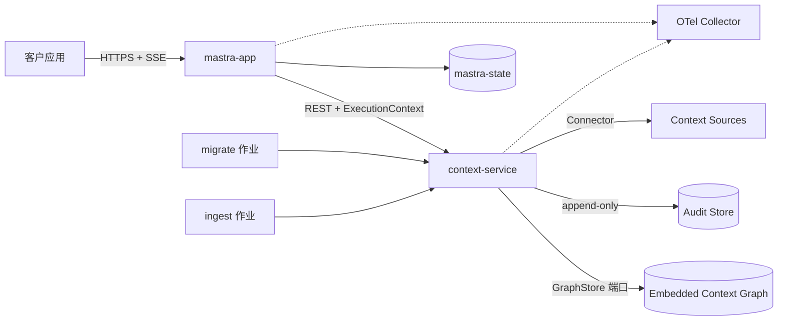
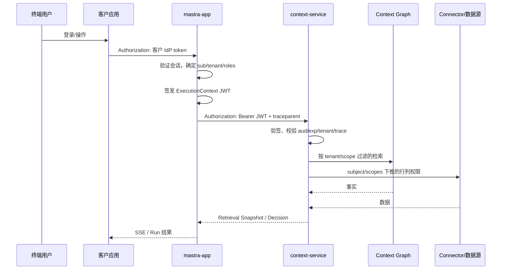
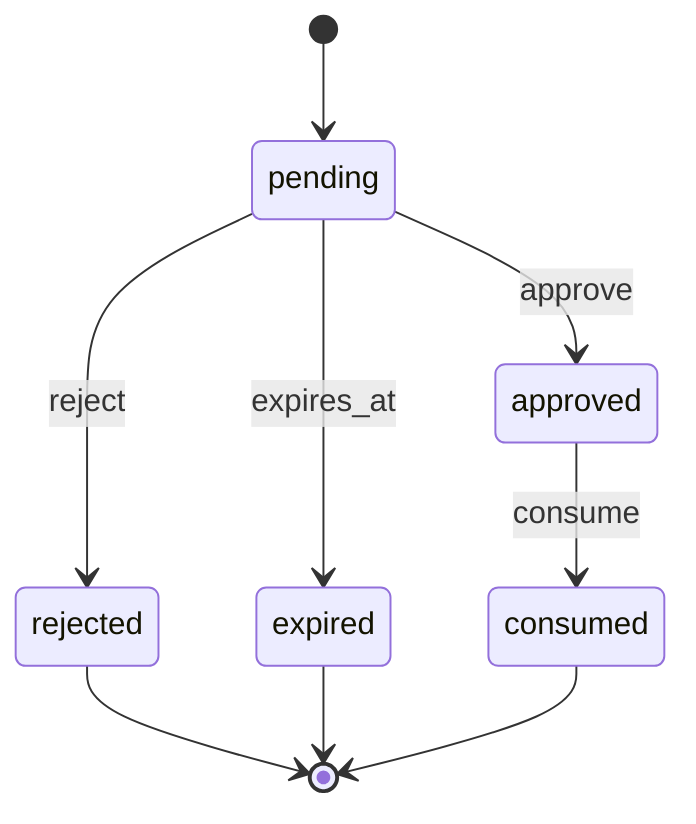
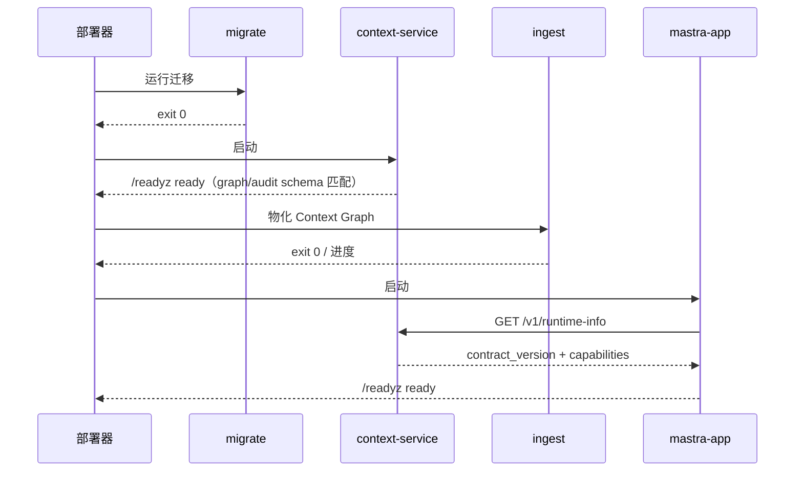
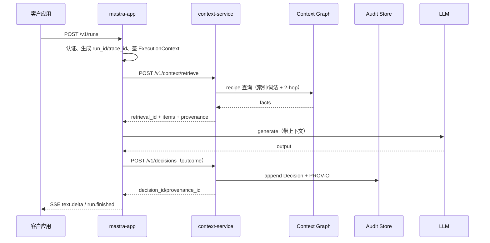
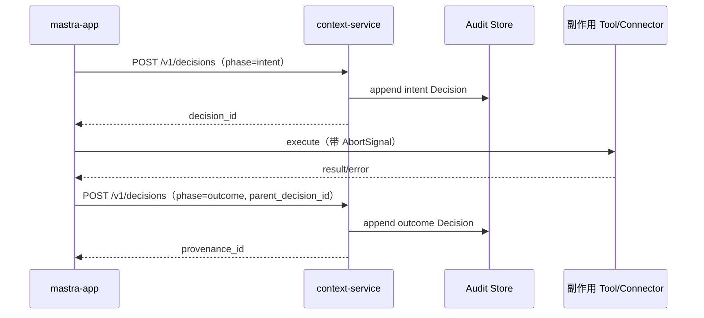
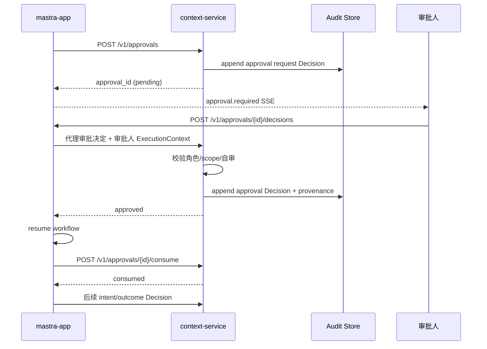
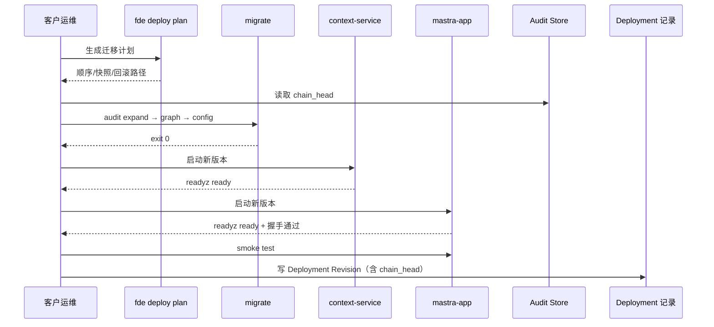

# FDE 运行时与集成契约 v1

> 状态：决策稿，对应 ticket「运行时与集成契约」。
> 范围：v0 单客户 bundle；Mastra + 薄 context-service + Semantica；不做多租户、UI、首客场景。
> 契约版本：`fde.runtime/v1`。机器可读接口与 schema 见 [`contracts/`](../contracts/)。
> 术语：见 [`GLOSSARY.md`](../GLOSSARY.md)。

## 1. 结论摘要

| # | 决策 | 结论 |
|---|---|---|
| D1 | 契约所有权 | context-service 独占 `/v1` REST 契约；Mastra 只通过生成的 TS client 调用；Semantica 原生 REST/MCP 不进入生产路径 |
| D2 | 真相源 | 语义事实、Decision、Provenance 归 context-service + 图/审计存储；Mastra 只持运行编排状态 |
| D3 | 身份透传 | Mastra 签发短时 `ExecutionContext` JWT；context-service 验签并在服务端强制 tenant/scope |
| D4 | trace/provenance | W3C `traceparent`；稳定 ID；Decision/Provenance 写独立 append-only 审计库；OTel 只做运维观测 |
| D5 | 图存储 | v0 用 Semantica 进程内 embedded 图 + SQLite；保留 `GraphStore` 端口；生产图存储/索引推迟 |
| D6 | 边界 | 本契约只定运行时接缝；身份/RBAC、评测、检索索引、可移植性归相邻 ticket |
| D7 | 失败语义 | 统一错误 envelope；幂等写；只为可重试错误重试；record-before-act；检索失败显式降级 |
| D8 | HITL | Mastra `suspend()/resume()` 持执行状态；审批是 context-service 的一等资源，审批本身写 Decision |
| D9 | Bundle 拓扑 | `mastra-app` + `context-service` + `mastra-state`/`graph`/`audit` 卷 + `migrate`/`ingest` 作业；compose/helm/airgap 同构 |
| D10 | 契约产物 | 契约文档 + OpenAPI + JSON Schema + conformance cases + ADR；本票不实现生产服务 |
| D11 | 客户端 API | 生成的 `mastra-app` 暴露稳定 Run API；客户应用不直连 context-service |
| D12 | 版本协商 | `fde.runtime/v1` 语义版本；`runtime-info` 握手；build 兼容矩阵；major 不匹配 fail closed |
| D13 | 升级/回滚 | stop-the-world；迁移分类；audit 不参与常规回滚；回滚产生新 Deployment Revision |
| D14 | 签名密钥 | 每 Deployment ES256 密钥对；私钥只在 mastra-app；`kid` 轮换 |
| D15 | 审计数据 | 默认只存引用/摘要；PII 脱敏后才可入审计；独立卷；append-only；保留/legal hold 由 Policy 配置 |

## 2. 组件与责任边界



| 组件 | 职责 | 不负责 |
|---|---|---|
| 客户应用 | 终端用户 UI、客户 IdP 会话、调用 Run API | 不直连 context-service；不接触图/审计存储 |
| `mastra-app` | 入口认证、Run 生命周期、Agent/Workflow 编排、SSE、签发 `ExecutionContext`、代理审批、record-before-act wrapper | 不持久化语义事实；不直接查图；不写审计库 |
| `context-service` | Context Recipe 执行、检索、Decision/Provenance 写入、审批状态、稳定 ID、ingest | 不做 Agent 编排；不暴露给终端用户；不直接调模型 |
| Semantica | Python 语义/图引擎，作为库运行在 context-service 内 | 不作为独立网络服务；原生 REST/MCP 不进入生产路径 |
| 图存储 | v0 为 embedded Context Graph（JSON 快照 + 进程内图）；未来通过 `GraphStore` 端口替换 | 不是审计库；不保存 Decision/Provenance 的权威副本 |
| 审计库 | append-only、哈希链式保存 Decision/Provenance/审批 | 不与主图共用快照生命周期；不存完整 PII |
| `mastra-state` | workflow snapshot、thread/memory、流式状态 | 不是语义真相源；不参与跨 Solution 共享 |
| 工作台 | 构建、签名、打包、交付 bundle | 不托管运行时；不持有客户数据 |
| 客户运维 | 主机、网络、TLS ingress、IdP、secret store、备份介质 | 不修改 bundle 内的生成物 |

**v0 只有两个应用网络服务**：`mastra-app` 和 `context-service`。Semantica 不单独起服务；图与审计是 context-service 拥有的持久化卷。这样跨语言接缝只有一个，也避免 Semantica 原生 serving 的两套状态问题。

## 3. 运行时接口

### 3.1 两个 API 面

| API | 所有者 | 调用方 | 认证 | 暴露范围 |
|---|---|---|---|---|
| Runtime API | `mastra-app` | 客户应用 | 客户 IdP/session token | 客户网络入口 |
| Context API | `context-service` | 仅 `mastra-app`、ingest/migrate 作业 | `ExecutionContext` JWT | bundle 内部网络 |

客户应用永远不直连 context-service。审批也走 `mastra-app` 代理，保证只有一个入口认证与审计边界。

### 3.2 Runtime API（客户端）

| Method | Path | 用途 |
|---|---|---|
| `POST` | `/v1/runs` | 启动一个 Run；需要 `Idempotency-Key` |
| `GET` | `/v1/runs/{run_id}` | Run 状态、输出、错误、Decision/Approval 引用 |
| `GET` | `/v1/runs/{run_id}/stream` | SSE 事件流 |
| `POST` | `/v1/runs/{run_id}/cancel` | 取消 Run |
| `GET` | `/v1/approvals` | 待审/历史审批队列 |
| `POST` | `/v1/approvals/{approval_id}/decisions` | 批准/拒绝；需要 `Idempotency-Key` |
| `GET` | `/v1/runtime-info` | 聚合的运行时版本与能力 |
| `GET` | `/healthz` `/readyz` | 健康与就绪 |

`POST /v1/runs` 请求：

```json
{
  "capability_id": "document-triage",
  "input": { "document_id": "doc-1001" },
  "thread_id": "thread-7",
  "metadata": { "channel": "web" }
}
```

响应：

```json
{
  "run_id": "run_01ARZ3NDEKTSV4RRFFQ69G5FAV",
  "trace_id": "4bf92f3577b34da6a3ce929d0e0e4736",
  "status": "queued",
  "stream_url": "/v1/runs/run_01ARZ3NDEKTSV4RRFFQ69G5FAV/stream"
}
```

### 3.3 Context API（内部）

| Method | Path | 用途 |
|---|---|---|
| `POST` | `/v1/context/retrieve` | 执行 Context Recipe，返回 Retrieval Snapshot |
| `POST` | `/v1/decisions` | 写不可变 Decision + Provenance；需要 `Idempotency-Key` |
| `GET` | `/v1/provenance/{decision_id}` | 读 Decision 的 PROV-O 谱系 |
| `POST` | `/v1/approvals` | 创建审批请求；需要 `Idempotency-Key` |
| `GET` | `/v1/approvals` | 审批队列 |
| `POST` | `/v1/approvals/{approval_id}/decisions` | 提交审批决定；需要 `Idempotency-Key` |
| `POST` | `/v1/approvals/{approval_id}/consume` | 标记审批已消费（resume 成功后）；需要 `Idempotency-Key` |
| `GET` | `/v1/runtime-info` | 契约/组件/schema 版本 |
| `GET` | `/healthz` `/readyz` | 健康与就绪 |

`POST /v1/context/retrieve` 请求：

```json
{
  "recipe_id": "claims-context",
  "query": "refund policy for premium customer",
  "subject": { "type": "user", "id": "u-42", "roles": ["claims-adjuster"] },
  "budget": { "max_nodes": 50, "max_tokens": 4000, "max_hops": 2 }
}
```

响应：

```json
{
  "retrieval_id": "ret_01ARZ3NDEKTSV4RRFFQ69G5FAV",
  "items": [
    {
      "entity_id": "fde:acme:policy:refund",
      "type": "Policy",
      "content": "Premium customers may receive a refund within 30 days.",
      "score": 0.92,
      "source_ref": "sharepoint://claims/policies/refund.md",
      "version": "3",
      "provenance_id": "prov_01ARZ3NDEKTSV4RRFFQ69G5FAV"
    }
  ],
  "degraded": false,
  "trace_id": "4bf92f3577b34da6a3ce929d0e0e4736",
  "snapshot_digest": "sha256:9f2caaaaaaaaaaaaaaaaaaaaaaaaaaaaaaaaaaaaaaaaaaaaaaaaaaaaaaaaaaaa",
  "index": "graph"
}
```

`RetrieveRequest.subject` 不是信任来源；context-service 以 `ExecutionContext` 的 `sub`/`actor` 为准，body 中的 subject 只作为 recipe 过滤提示，冲突时返回 `403`。

### 3.4 错误 envelope

所有非 2xx 响应统一为：

```json
{
  "error": {
    "code": "validation_failed",
    "message": "confidence must be between 0 and 1",
    "retryable": false,
    "details": { "field": "confidence" },
    "trace_id": "4bf92f3577b34da6a3ce929d0e0e4736"
  }
}
```

| `code` | HTTP | `retryable` | 说明 |
|---|---|---|---|
| `invalid_request` | 400 | false | 请求格式/参数错误 |
| `unauthenticated` | 401 | false | 缺少/无效 `ExecutionContext` |
| `forbidden` | 403 | false | tenant/scope/角色不匹配 |
| `not_found` | 404 | false | 实体/Decision/审批不存在 |
| `conflict` | 409 | false | 状态冲突 |
| `idempotency_conflict` | 409 | false | 同一 key 携带了不同 payload |
| `approval_already_decided` | 409 | false | 审批已结束 |
| `run_not_suspended` | 409 | false | Run 不在 `waiting_for_human` |
| `stream_not_resumable` | 409 | false | SSE 断线后无法重放 |
| `validation_failed` | 422 | false | schema/语义校验失败 |
| `rate_limited` | 429 | true | 限流 |
| `bad_gateway` | 502 | true | 上游网关错误 |
| `unavailable` | 503 | true | 依赖暂不可用 |
| `timeout` | 504 | true | 上游/内部超时 |
| `internal` | 500 | false | 未分类错误 |
| `contract_mismatch` | 503 | false | 契约 major/capability 不匹配 |
| `graph_schema_mismatch` | 503 | false | 图 schema 版本不匹配 |
| `audit_schema_mismatch` | 503 | false | 审计 schema 版本不匹配 |

422 不再使用 FastAPI 默认形状；context-service 必须把请求体校验错误归一化到上述 envelope。

### 3.5 幂等

- `POST /v1/decisions`、`POST /v1/approvals`、`POST /v1/approvals/{id}/decisions`、`POST /v1/approvals/{id}/consume`、`POST /v1/runs` 必须带 `Idempotency-Key`。
- key 作用域：`tenant_id + endpoint + key`；保留至少 24 小时。
- 同 key + 同 payload：返回原结果（`200`），`idempotent_replay=true`，ID 不变。
- 同 key + 不同 payload：`409 idempotency_conflict`。
- `decision_id` 由调用方生成；`approval_id` 由 context-service 生成；二者都是 stable ID，重复请求不能产生第二条审计记录。

## 4. 数据与状态

### 4.1 真相源矩阵

| 数据 | 真相源 | 副本/缓存 | 说明 |
|---|---|---|---|
| 语义事实 | Context Graph（v0 embedded） | 无持久 Mastra 投影 | 由 ingest 作业物化；可重建 |
| Decision / Provenance | Audit Store | 无 | 不可变、append-only；PROV-O 导出 |
| Retrieval Snapshot | Audit Store 中的快照清单 | 请求内缓存 | `retrieval_id` + item 引用 + digest；内容仍在图 |
| Run 生命周期 | `mastra-state` + `mastra-app` | 无 | Run 的权威状态在 Mastra；Decision 引用 `run_id` |
| Workflow snapshot | `mastra-state` | 无 | 支撑 HITL/重启恢复；不是语义事实 |
| Thread / memory | `mastra-state` | 无 | 运行编排状态；不写入 Context Graph |
| Context Recipe | Solution Spec / Bundle | 无 | 运行时只读 recipe 定义 |
| Policy / Eval 定义 | Bundle | 无 | 执行结果写 Decision |
| Release / Deployment | 工作台 + 客户侧记录 | 无 | 本契约只定义运行时读取的版本字段 |

**规则**：Mastra 不持久化图事实投影；跨请求缓存 v0 不做。任何检索结果都通过 `retrieval_id` 被 Decision 引用，而不是复制进 Mastra 的库。

### 4.2 稳定 ID

| ID | 格式 | 生成方 | 说明 |
|---|---|---|---|
| `run_id` | `run_<ULID>` | mastra-app | 一次 Run |
| `trace_id` | 32 位小写 hex | mastra-app（或继承上游） | W3C Trace Context |
| `retrieval_id` | `ret_<ULID>` | context-service | 一次检索快照 |
| `decision_id` | `dec_<ULID>` | 调用方（mastra-app/context-service） | 写幂等键 |
| `provenance_id` | `prov_<ULID>` | context-service | 审计条目 |
| `approval_id` | `appr_<ULID>` | context-service | 审批请求 |
| `deployment_id` | `dep_<ULID>` | 工作台/部署 | 一次 Deployment |
| `entity_id` | `fde:<tenant>:<type>:<key>` | context-service ingest | 不透明、稳定、租户内唯一；绝不暴露后端内部 ID |

`entity_id` 在重建、重命名、升级后保持稳定；源键变化时生成新 ID 并用 `same_as` 关系保留旧 ID；合并不得删除被引用的 ID。

### 4.3 v0 图存储与规模

- `GraphStore` 是 context-service 的内部端口；v0 唯一实现是 `embedded`：Semantica `ContextGraph` + JSON 快照，审计用 SQLite。
- embedded 后端是**单写者**：`context-service` 不能多副本；`mastra-app` 也不能多副本共享同一卷。
- v0 交互上限：**10k 节点 / 50k 边**。超过上限时 `retrieve` 返回 `degraded=true` + `reason=scale_limit`，不静默变慢。
- v0 检索使用词法 + 2-hop 图扩展；`ContextGraph.query()` 只作为 v0 实现，不作为生产检索承诺。生产索引/图存储由「生产检索索引与 100k+ 规模上限」决定。
- 生产禁止 JSON 全量快照作为 system of record；切换后端时只替换 `GraphStore` 实现，稳定 ID 与 Context API 不变。

## 5. 身份与授权

### 5.1 `ExecutionContext`

Mastra 在每次调用 context-service 前签发一个短时 JWT（ES256）：

| Claim | 必填 | 说明 |
|---|---|---|
| `iss` | 是 | `fde://<deployment_id>` |
| `aud` | 是 | `context-service` |
| `sub` | 是 | 终端用户或服务主体的稳定 ID |
| `actor` | 是 | `{type: user/service/system, id, display?}` |
| `tenant_id` | 是 | Customer 标识 |
| `deployment_id` | 是 | Deployment 标识 |
| `solution_id` | 是 | Solution 标识 |
| `run_id` | 是 | 当前 Run |
| `trace_id` | 是 | 与 `traceparent` 一致 |
| `roles` | 是 | 角色字符串数组；具体词表由身份 ticket 定 |
| `scopes` | 是 | 如 `context:retrieve`、`decision:write`、`provenance:read`、`approval:decide`、`approval:consume` |
| `iat` / `exp` | 是 | 短时；默认 5 分钟 |
| `jti` | 是 | 防重放 |
| `kid` | 是 | 签名密钥 ID |
| `on_behalf_of` | 否 | 服务主体代表用户执行时使用 |

JWT 的 `trace_id` 必须与请求头 `traceparent` 的 trace-id 一致；不一致直接 `403`。

### 5.2 传播链



### 5.3 强制点

| 层 | 强制内容 |
|---|---|
| `mastra-app` | 终端用户认证、Run 授权、审批 UI 授权、`ExecutionContext` 签发 |
| `context-service` | JWT 验签、tenant 隔离、scope/角色检查、Policy 评估、图查询过滤 |
| Connector | 数据源级 ACL、行/列级权限、PII 脱敏 |
| 审计库 | 只接受带 `tenant_id`/`actor`/`trace_id` 的写入；跨 tenant 引用直接拒绝 |

`tenant` 过滤必须在服务端完成，不能依赖客户端传参。明文 `X-Tenant-Id`/`X-Actor` 不作为信任来源；如果为了兼容保留，必须与 JWT 一致，否则拒绝。`DecisionRequest.actor`、`ApprovalDecisionRequest.actor` 和 `ApprovalCreateRequest.requested_by` 必须与 `ExecutionContext.actor` 一致；不一致返回 `403`。

### 5.4 密钥

- 每 Deployment 一对 ES256 密钥；私钥只注入 `mastra-app` 的 secret store，公钥 + `kid` 注入 `context-service` 配置。
- 轮换时新旧公钥重叠接受，直到旧 token 过期；`kid` 用于选择公钥。
- `fde install` 在缺失时生成密钥；客户也可自带。密钥不出现在 Bundle、Spec、日志或审计库中。
- 服务间 mTLS 可选；v0 至少签名断言。客户 IdP 的 OIDC 在边缘由身份 ticket 定，内部断言仍用每 Deployment 密钥。

## 6. Trace 与 Provenance

### 6.1 Trace 上下文

- `mastra-app` 是 trace root；调用 context-service 时带 W3C `traceparent`。
- context-service 为每次 retrieve/decision/approval 建子 span；日志、错误 envelope、响应体都带同一个 `trace_id`。
- OTel 导出到客户 collector 或 bundle 内可选 collector；采样只影响运维观测，不影响审计写入。
- 审计不采样。`hideInput`/`hideOutput` 只用于 OTel span，不改变审计字段。

### 6.2 Decision 契约

`POST /v1/decisions` 的最小 payload：

```json
{
  "decision_id": "dec_01ARZ3NDEKTSV4RRFFQ69G5FAV",
  "run_id": "run_01ARZ3NDEKTSV4RRFFQ69G5FAV",
  "tenant_id": "acme",
  "capability_id": "document-triage",
  "decision_type": "runtime",
  "phase": "outcome",
  "actor": { "type": "user", "id": "u-42" },
  "rationale": "Refund approved under premium policy.",
  "evidence": [
    {
      "entity_id": "fde:acme:policy:refund",
      "version": "3",
      "retrieval_id": "ret_01ARZ3NDEKTSV4RRFFQ69G5FAV",
      "source_ref": "sharepoint://claims/policies/refund.md"
    }
  ],
  "policy_evaluations": [
    { "policy_id": "pii-redaction", "version": "1.0.0", "outcome": "allow" }
  ],
  "model": { "provider": "azure-openai", "model": "gpt-5.1" },
  "prompt_version": "triage-agent@1.2.0",
  "input_digest": "sha256:6b1ebbbbbbbbbbbbbbbbbbbbbbbbbbbbbbbbbbbbbbbbbbbbbbbbbbbbbbbbbbbb",
  "output_digest": "sha256:8c2dcccccccccccccccccccccccccccccccccccccccccccccccccccccccccccc",
  "classification": "confidential",
  "redaction_applied": true,
  "retention_class": "standard",
  "trace_id": "4bf92f3577b34da6a3ce929d0e0e4736",
  "timestamp": "2026-11-15T08:00:00Z"
}
```

`phase` 用于区分 `intent`（副作用前）与 `outcome`（副作用后）；两者是两条不可变 Decision，用 `parent_decision_id` 关联。

### 6.3 PROV-O 映射

| PROV-O | 运行时对象 |
|---|---|
| `Activity` | Run、retrieval、approval |
| `Entity` | Decision、Retrieval Snapshot、源文档/表、Policy |
| `Agent` | 终端用户、服务主体、模型/Agent 版本 |
| `used` | Decision 的 evidence 引用 |
| `wasGeneratedBy` | Decision ← Run/approval activity |
| `wasAttributedTo` | Decision ← actor |
| `wasDerivedFrom` | 事实/Decision ← 源文档、图事实、上游 Decision |

`GET /v1/provenance/{decision_id}` 返回原始 Decision + PROV-O JSON-LD + lineage 摘要 + 验证状态。返回中不包含后端内部 ID。

### 6.4 审计库

- 独立于 Context Graph 的 append-only 存储（v0 为 SQLite）；每次写入生成 `seq`、`prev_hash`、`hash`、`payload_digest`。
- `hash = SHA-256(prev_hash || canonical_json(payload))`；`chain_head` 记录在当前 Deployment Revision。
- `verify_chain()` 不在读路径执行；由后台作业定期验证，结果写 `verification.status`（`valid`/`pending`/`stale`/`invalid`）。
- 读接口返回原始 Decision + entry + 最近一次验证状态，不阻塞。
- 审计库与主图分开备份/保留；图可以重建，审计不能重建。
- 常规回滚**不回滚审计库**；回滚本身写一条 Decision。只有灾难恢复才从备份恢复审计，并记录链缺口。

### 6.5 审计数据与 PII

- 默认只存 `input_digest`/`output_digest` + 引用，不存原始 prompt/output。
- Capability Policy 显式允许时，才存脱敏摘录；必须带 `classification`、`redaction_applied`、`retention_class`。
- 删除只通过保留作业，不原地改写；支持 `legal_hold`。
- 审计导出格式为 PROV-O JSON-LD；导出不包含 secret、完整 PII 或后端内部 ID。
- 保留期、PII 分类词表、legal hold 流程由「客户环境内的身份、权限与部署」与「评测、验收与可观测性」定；本契约固定字段与存储分离。

## 7. 失败、重试、超时、流式、取消

### 7.1 重试

只对 `retryable=true` 的错误重试：`429`、`502`、`503`、`504`、网络超时/连接重置。

- 最多 2 次重试（共 3 次尝试）。
- 指数退避 + jitter：约 200ms、400ms，上限 2s；尊重 `Retry-After`。
- 受 Run deadline 约束；剩余预算不足时立即失败。
- `400/401/403/404/409/422` 不重试。
- 写接口重试必须复用同一 `Idempotency-Key` 和同一 `decision_id`。

### 7.2 超时

| 调用 | 默认 | 上限 |
|---|---|---|
| `POST /v1/context/retrieve` | 5s | 30s |
| `POST /v1/decisions` | 3s | 10s |
| `GET /v1/provenance/{id}` | 5s | 10s |
| `POST /v1/approvals` / `decisions` / `consume` | 3s | 10s |
| Run 总 deadline | 5 分钟 | 30 分钟 |

超时返回 `504 timeout`，`retryable=true`；服务端必须有自己的最大执行时间，不能无限等待。

### 7.3 降级

- 检索失败/超时：`retrieve` 返回 `degraded=true` + `reason`，不编造上下文。Capability Policy 决定继续（无上下文）还是失败。
- 图规模超限：`degraded=true` + `reason=scale_limit`；不静默全表扫描。
- 审计写失败：带副作用的 Run **fail closed**；只读 Run 可返回结果并标记 `audit_incomplete`，但不得声称已审计。
- 模型/provider 失败：由 Mastra 处理；重试/降级策略写 Capability Policy；失败 Run 必须写 outcome Decision（如果已有 intent Decision）。

### 7.4 record-before-act

这是本契约最重要的运行时不变式：

1. 任何 `side_effects != read` 的 Tool 执行前，生成的 wrapper 必须先调用 `POST /v1/decisions`，写 `phase=intent` 的 Decision，带证据、Policy 评估和拟执行动作摘要。
2. `POST /v1/decisions` 成功后才允许执行副作用。
3. 副作用完成后写 `phase=outcome` 的 Decision，`parent_decision_id` 指向 intent，带结果摘要/错误。
4. 如果 intent 写入失败：不执行副作用，Run 失败（或请求人工介入）。
5. 如果副作用执行失败：仍然写 outcome Decision，记录失败；Run 失败。
6. 只读 Tool 不需要 intent Decision；最终回答在生成后写一条 outcome Decision（如果 Capability 要求）。

### 7.5 流式

- 客户端通过 `GET /v1/runs/{run_id}/stream` 消费 SSE；事件 envelope 见 `run.schema.json#/$defs/RunEvent`。
- 事件类型：`run.started`、`text.delta`、`text.done`、`tool.call`、`tool.result`、`approval.required`、`approval.decided`、`run.finished`、`run.failed`、`run.cancelled`、`heartbeat`。
- 每条事件带 `run_id`、`trace_id`、`seq`（从 1 单调递增）、`timestamp`、`payload`。
- 每 15s 至少一个 `heartbeat`；客户端断开后默认取消 Run（可在 Capability Policy 中关闭）。
- SSE 断线不保证重放；客户端用 `GET /v1/runs/{run_id}` 补最终状态。若实现支持缓冲重放，`Last-Event-ID` 可恢复；否则返回 `409 stream_not_resumable`。
- context-service 调用一律 unary JSON，不流式；工具进度由 Mastra `writer` 转成 SSE 事件。

### 7.6 取消

- `POST /v1/runs/{run_id}/cancel` 返回 `202`，Mastra 中止 agent/workflow，向 context-service/工具传播 `AbortSignal`。
- 已完成的 Decision 保留；如果副作用可能已发生，写一条 `run.cancelled` 相关 Decision/事件，记录 trace 和原因。
- 取消不自动重试；客户端可显式启动新 Run（新 `run_id`）。

## 8. HITL 与审批

### 8.1 状态机



- `pending`：等待有权限的审批人。
- `approved`/`rejected`：审批 Decision 已写入审计库。
- `expired`：到期未决，写 `expired` Decision。
- `consumed`：Mastra 已 resume；审批不可再次使用。

### 8.2 流程

1. Workflow 到达审批点，调用 `POST /v1/approvals`，带 `run_id`、`capability_id`、`proposed_action`、证据引用、`approver_roles`、`expires_at`。
2. context-service 创建 `approval_id`，写一条审批请求 Decision（`decision_type=approval`, `phase=approval`），返回 `pending`。
3. Mastra 发 `approval.required` SSE 事件，Run 进入 `waiting_for_human`。
4. 审批人通过 `mastra-app` 的 `POST /v1/approvals/{approval_id}/decisions` 提交 `{approved, rationale, actor}`；mastra-app 代理到 context-service，携带审批人的 `ExecutionContext`。
5. context-service 校验角色/scope、禁止自审（除非 Policy 允许）、写审批 Decision + Provenance，返回 `approved`/`rejected`。
6. Mastra 只有收到 `approved` 才 `resume()`；resume 成功后调用 `POST /v1/approvals/{approval_id}/consume` 标记 `consumed`，然后执行后续副作用（record-before-act 仍然生效）。consume 幂等；如果 resume 成功但 consume 失败，重试 consume，不重复执行副作用。
7. 如果 `rejected`/`expired`，Mastra 按 workflow 策略结束或走替代分支。

### 8.3 授权与幂等

- 审批人必须持有有效 `ExecutionContext`，`roles` 命中 `approver_roles`，`scopes` 含 `approval:decide`。
- 默认禁止请求人自审；Policy 可显式允许并记录理由。
- 审批决定幂等：同一 `approval_id` + `Idempotency-Key` 返回原结果；已结束后再提交返回 `409 approval_already_decided`。
- 审批超时默认 24h，可按 Capability/Policy 配置；`expires_at` 到期由后台作业标记 `expired`，并写 Decision。
- `consume` 由 `mastra-app` 的服务主体调用，scope 为 `approval:consume`；审批人不需要这个 scope。
- 客户审批 UI 不在本阶段；契约提供 API + 参考 CLI，客户应用自建界面。

## 9. Bundle 拓扑与生命周期

### 9.1 组件

| 组件 | 运行时 | 端口 | 卷 | 健康检查 |
|---|---|---|---|---|
| `mastra-app` | Node 22+ / Mastra 1.83.x | 4111（内部），由 ingress 暴露 | `mastra-state` | `/healthz` `/readyz` |
| `context-service` | Python 3.12 / Semantica 0.7.0 | 8011（内部） | `graph`、`audit` | `/healthz` `/readyz` |
| `migrate` | 一次性作业 | — | 同上 | 退出码 0 |
| `ingest` | 一次性/定时作业 | — | —（调用 context-service） | 退出码 0 |
| `otel-collector` | 可选 sidecar/agent | — | — | 可选 |

- 一个 Bundle 同时携带 `compose`、`helm`、`airgap` 三套清单；`fde build --target` 可裁剪。
- `mastra-app` 是唯一暴露到客户入口的组件；`context-service` 只在 bundle 内部网络可达。
- `mastra-state` 用 libsql/SQLite 卷；客户提供 Postgres 时可替换，但 v0 默认单节点 SQLite。
- `graph` 和 `audit` 必须是不同卷；审计卷单独备份/保留。
- 所有镜像/依赖 pin 精确版本 + digest；Bundle 含 SBOM/notice、签名、build provenance。

### 9.2 启动顺序与健康



- `migrate` 失败：部署失败，不启动新版本。
- `context-service` readiness 要求：图已加载、审计库可写、schema 版本匹配、`runtime-info` 可用。
- `ingest` 不阻塞 readiness；在完成前 `retrieve` 返回 `degraded=true` + `reason=partial`。
- `mastra-app` readiness 要求：context-service 可达、契约 major/capability 匹配、模型配置有效。
- `/healthz` 只表示进程存活；`/readyz` 表示可服务，允许 `degraded`。
- `readyz` 返回 `{status: ready|degraded, reasons: []}`；不能服务时返回 `503 {status: not_ready, reasons: []}`。

### 9.3 配置与 secret

- 配置通过环境变量 + 挂载文件注入；Bundle 只含 `secretRef`，不含 secret 值。
- `secretRef: {store, key, version?}` 由客户 secret store 解析；轮换不需要重建 Bundle。
- `ExecutionContext` 签名私钥、图/审计加密密钥、LLM provider key、Connector credentials 都是 secret ref。
- 日志、错误 envelope、审计库不得出现 secret 值或完整 PII。

### 9.4 资源与单写者

- 默认资源：`context-service` 0.5 CPU / 1 GiB；`mastra-app` 1 CPU / 1 GiB；卷按 10k/50k 图规模预留。
- embedded 图是单写者：`context-service` 不得多副本；`mastra-app` 不得多副本共享 `mastra-state` 卷。
- v0 不做 HA/灾备认证；客户负责主机、网络、备份介质和升级窗口。
- 出站网络：LLM provider、Connector、可选 OTel collector；air-gapped 环境使用本地模型 endpoint 和离线镜像/模型包。

### 9.5 备份/恢复

- `graph`、`audit`、`mastra-state` 分别备份；审计备份必须包含 `chain_head`。
- 恢复演练由客户运维执行；恢复后 context-service 校验审计链，记录 `verification.status`。
- 常规回滚不恢复 audit；只有灾难恢复才恢复 audit，并记录链缺口。

## 10. 版本、升级、回滚

### 10.1 契约版本与握手

- 契约版本：`fde.runtime/v1`，语义版本 `MAJOR.MINOR.PATCH`。
- `GET /v1/runtime-info` 返回：`contract_version`、`service`、`service_version`、`graph_schema_version`、`audit_schema_version`、`backend`、`capabilities[]`、`limits`、`components[]`、`started_at`。
- `mastra-app` 启动时调用 context-service 的 `runtime-info`；major 不匹配、缺少必需 capability、schema 版本不匹配 → fail closed（`contract_mismatch` / `graph_schema_mismatch` / `audit_schema_mismatch`）。
- 契约演进：additive 字段/端点走 minor；breaking 走 `/v2` 或 negotiated media type；保留至少一个 minor 周期的弃用窗口。

### 10.2 Lock 与兼容矩阵

`solution.lock` 固定：

| 项 | 说明 |
|---|---|
| `runtime.contractVersion` | `fde.runtime/v1` 的精确版本 |
| `runtime.mastra` / `node` | 精确版本 |
| `runtime.python` / `semantica` / `contextService` | 精确版本 |
| `runtime.graphSchema` / `auditSchema` | schema 版本 |
| `toolchain.image` | 构建工具链 digest |
| `templates` / `extensions` / `customerObjects` | 精确版本 + digest |

Build 时校验 `runtimeProfile × contract × graph/audit schema × extension` 兼容矩阵；不通过则构建失败。启动时再握手一次，防止混装旧镜像。

### 10.3 迁移分类与顺序

| 迁移 | 要求 | 顺序 |
|---|---|---|
| `audit-schema` | 只做 expand，保持旧代码可读；不回滚 | 1 |
| `graph-schema` | 声明 `reversible`；可恢复快照 | 2 |
| `config` | 由 Spec/Environment 生成；可重建 | 3 |
| `component` | 镜像/依赖版本；由 Bundle 固定 | 4 |

每个迁移声明 `reversible: true | false`；`fde deploy plan` 输出迁移计划、所需 secret refs、预计停机窗口和回滚路径。

### 10.4 升级

v0 是单节点、embedded 图单写者，采用 **stop-the-world**：

1. `fde deploy plan` 生成迁移计划；客户确认维护窗口。
2. 备份 `graph`/`audit`/`mastra-state`；记录 `chain_head`。
3. 运行 `audit-schema` 迁移（expand）。
4. 运行 `graph-schema` 迁移。
5. 运行 `config` 迁移。
6. 启动新 `context-service`，`readyz` 通过。
7. 启动新 `mastra-app`，`runtime-info` 握手通过，`readyz` 通过。
8. 运行 smoke test（健康、检索、decision、provenance、审批）。
9. 标记 Deployment `active`，写 Deployment Revision。

失败处理：任何一步失败 → `rolling_back`；按迁移的 `reversible` 决定 down migration 或恢复快照；记录 Decision。

### 10.5 回滚

- 重新部署上一个 Release；生成新的 Deployment Revision。
- `graph` 可恢复升级前快照；`audit` **不参与常规回滚**，保留失败部署期间的全部审计条目，并写一条回滚 Decision。
- 如果迁移声明 `reversible=false` 且没有可用快照，回滚被显式拒绝，并记录 Decision；需要人工批准快照恢复。
- 回滚后重新跑 smoke test；`runtime-info`/schema 版本必须匹配旧 Release。
- 灾难恢复才从备份恢复 audit；恢复后必须校验链并记录缺口。

### 10.6 重建与确定性

- 同一 Spec + lock + pinned Extensions + toolchain 镜像必须重建出同一 Bundle digest。
- `fde verify` 重跑构建、比对 digest、跑 contract tests、SBOM/license、签名验证。
- 生成物不可手改；手改会在 verify/CI 中失败。
- 重建不依赖 live template registry；lock 和 vendored 内容足够。

## 11. 端到端时序

### 11.1 只读 Run



### 11.2 带副作用的 Run



intent 写失败 → 不执行 Tool；outcome 写失败 → Run 失败并告警，但副作用已发生，审计保留 intent 记录。

### 11.3 HITL 审批



### 11.4 升级/回滚



## 12. 契约产物与一致性

| 产物 | 路径 | 说明 |
|---|---|---|
| 契约文档 | `docs/runtime-contract.md` | 本文件 |
| 客户端 API | `contracts/runtime-api-v1.openapi.yaml` | 客户应用 ↔ mastra-app |
| 内部 API | `contracts/context-service-v1.openapi.yaml` | mastra-app ↔ context-service |
| JSON Schema | `contracts/schemas/*.json` | ExecutionContext、retrieval、decision、approval、run、runtime-info、error |
| Conformance cases | `contracts/conformance/cases.md` | 契约验收用例 |
| ADR | `docs/adr/0003-runtime-and-integration-contract.md` | 决策记录 |

一致性规则：

- OpenAPI + JSON Schema 是 wire contract 的唯一真相源；TS client、Python models 由它们生成，不手写。
- 所有示例必须能通过 schema 校验；CI 在第一次实现切片接入 conformance runner。
- 契约测试至少覆盖：错误 envelope、幂等、trace 透传、tenant 隔离、record-before-act、审批状态机、契约握手。
- 生成物与契约版本一起 pin 进 `solution.lock`；升级契约 major 需要新 generator 和兼容矩阵。

## 13. 边界与未决

本契约只定运行时接缝；以下由相邻 ticket 决定：

- 「客户环境内的身份、权限与部署」：IdP/SSO、RBAC/ABAC 词表、客户/工作台责任划分、部署执行机制、air-gapped 运维、secret store 形态。
- 「评测、验收与可观测性」：指标/SLO、评测集/scorer、看板、验收阈值、PII 保留值。
- 「生产检索索引与 100k+ 规模上限」：生产图存储、索引组合、Neo4j serving adapter、迁移路径。
- 「LangGraph 运行时映射缺口」：可移植性与第二 runtime；本契约保持 context-service 运行时中立，但不承诺双运行时。

v0 已知限制：

- embedded 图单写者、10k/50k 交互上限；无 HA/灾备认证。
- 真实 LLM 的 tool 选择未验证；contract tests 用 mock/固定序列覆盖通路。
- 审计库 v0 为 SQLite；大规模 audit 保留/查询需要后续存储方案。
- 客户审批 UI 不在本阶段；只提供 API + 参考 CLI。
- 多 Solution 共享 Context Graph 不支持；每个 Bundle 自包含。
