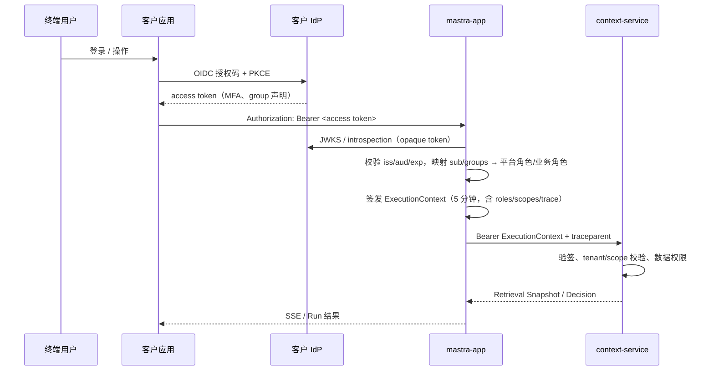

# 客户环境内的身份、权限与部署

> 状态：决策稿，对应 ticket「客户环境内的身份、权限与部署」。
> 范围：v0 单客户 bundle；不做多租户、UI、首客场景、agent 专项安全控制。
> 关联：[ADR-0003](adr/0003-runtime-and-integration-contract.md) · [ADR-0004](adr/0004-semantic-modeling-and-context-packaging.md) · [ADR-0005](adr/0005-evaluation-and-observability.md) · [ADR-0006](adr/0006-identity-permissions-and-deployment.md)
> 术语：[`GLOSSARY.md`](../GLOSSARY.md) · 运行时接缝：[`runtime-contract.md`](runtime-contract.md) · 语义权限：[`semantic-modeling.md`](semantic-modeling.md) §7 · 审计保留：[`evaluation-and-observability.md`](evaluation-and-observability.md) §10

## 1. 结论摘要

| # | 决策 | 结论 |
|---|---|---|
| D1 | 威胁模型 | bundle 边界 + agent 行为层的确定性控制（data block、审批覆盖、rate/budget、output guard、egress、kill switch）；主机 root、恶意客户管理员、模型 provider 侧信道、概率检测/内容消毒/沙箱不在 v0；详见 [agent-security.md](agent-security.md) |
| D2 | 终端用户认证 | 客户 IdP OIDC；客户应用持有登录会话；`mastra-app` 作为 resource server 校验 access token（JWT + JWKS，opaque token 走 introspection） |
| D3 | 用户目录 | JIT provisioning；bundle 不建本地用户表；唯一例外是客户持有的本地 break-glass 管理员 |
| D4 | 角色模型 | 平台角色固定词表 + 业务角色透传；平台角色授予 scope，业务角色只用于数据权限，不能获得平台 scope |
| D5 | 角色映射 | 平台角色词表和 scope 矩阵在 Bundle；IdP group→平台角色映射在 Environment 配置，变更写 configuration Decision |
| D6 | 授权执行 | `mastra-app` 做平台 RBAC；`context-service` 做编译式数据权限（`permissions.yaml` + Recipe filter + mask），不引入 OPA/Cedar |
| D7 | 租户边界 | 一个 bundle 一个 `tenant_id`（= Customer）；不引入 sub-tenant；硬隔离业务单元用独立 bundle |
| D8 | 数据权限 | 源端下推 → `context-service` 注入 `ExecutionContext`、过滤、mask → 审计；未分类默认 restricted，无法强制则 fail closed |
| D9 | 加密与密钥 | 客户负责卷加密、TLS、secret store；bundle 只用每 Deployment/issuer 的 ES256 签名密钥 + SHA-256 审计链，不做应用层 CMK/BYOK |
| D10 | 服务身份 | 两个 issuer：`mastra-app`（用户/Run）和 `fde-jobs`（维护作业）；各自每 Deployment 一对 key，scopes 分离 |
| D11 | 审计范围 | Decision/Provenance + `auth/authz/identity/release/deployment/retention/audit` 事件；客户侧 append-only；工作台不回传 |
| D12 | 审计访问 | `auditor` 只读 + 导出；`customer_admin` 只读 + retention/legal hold，不能导出；`support`/FDE 无默认访问；导出本身写审计 |
| D13 | 部署执行 | 客户运维执行 install/upgrade/rollback/backup；工作台无入站连接、无常驻凭证；FDE 只通过客户 IdP 的限时 `support` 角色支持 |
| D14 | 部署目标 | 单节点 Compose 是 v0 唯一认证目标；Helm 清单生成并 smoke 验证，但不承诺支持；airgap 是打包模式 |
| D15 | 离线契约 | 完全离线：签名离线包、客户内部 IdP、本地模型 endpoint、内部 NTP、无 phone-home/license server；pinned-key 验签 |
| D16 | 审批与职责分离 | 运行时请求人 ≠ 审批人；FDE 不能批准自己的 Release 进入客户生产；客户签部署和验收，不签技术 Release |
| D17 | Break-glass | 本地 break-glass 凭证归客户；FDE 没有本地账号；支持访问走客户 IdP 限时 `support` 角色 |
| D18 | 工作台边界 | 工作台复用公司 SSO/Git + 独立 Release 签名 key；工作台审计与客户审计分离；客户数据不进工作台 |

## 2. 威胁模型与信任边界

### 2.1 信任假设

**信任**：客户主机/虚拟化层、客户网络、客户 IdP、客户 secret store、客户运维在受审计流程下的操作。

**不信任**：终端用户与客户端、客户应用、bundle 外进程、工作台网络、模型 provider 网络、任何未签名的内部调用。

bundle 内部网络只提供可用性隔离，不作为身份来源；所有跨组件断言必须签名。

### 2.2 v0 防御的威胁

| 威胁 | 控制 |
|---|---|
| 组件冒充 / 伪造 tenant/actor | 每 Deployment/issuer 的 ES256 `ExecutionContext`；`aud`/`exp`/`tenant_id`/`trace_id` 校验；明文 `X-Tenant-Id`/`X-Actor` 不作为信任来源 |
| 越权检索 / 数据泄漏 | 平台 RBAC + 编译式数据权限；源端下推；`context-service` mask/过滤；未分类默认 restricted；无法强制则 fail closed |
| 角色映射提权 | 平台角色词表在 Bundle；Environment 映射经 `fde identity validate`；业务角色不能获得平台 scope |
| 审计篡改 / 删除 | 独立 append-only 审计卷；哈希链；定期 `verify_chain`；常规回滚不回滚审计；导出到客户 SIEM |
| PII 泄漏 | 检索时 mask；审计/OTel/评测报告默认只存引用/摘要；无原始 PII；脱敏摘录需 Policy 显式允许 |
| 供应链篡改 | Bundle/Release 双签名；SBOM/notice；镜像 digest pin；客户侧 `fde install verify`/`fde verify` |
| 离线包篡改 | pinned public key 验签；checksums；离线吊销列表随升级包带入 |
| Agent 行为层注入/滥用/外泄 | 不可信内容 data block；副作用 Tool 审批覆盖；rate/budget；output guard；egress allowlist；kill switch；见 [agent-security.md](agent-security.md) |
| 支持访问滥用 | 无常驻 FDE 权限；客户 IdP 限时 `support` 角色；默认只读诊断；写操作单独审批；全部审计 |

### 2.3 v0 明确不防

- 客户主机 root / 虚拟化层被攻破；恶意客户管理员或运维拥有 root；这是客户责任，bundle 只能通过卷加密、备份和审计导出降低影响。
- 模型 provider 侧信道、模型输出投毒。
- Agent 行为层的概率检测、内容消毒、Extension 沙箱和 provider 侧保证；确定性控制已由 [agent-security.md](agent-security.md) 定稿，见 §10。
- DoS、HA/灾备、多区域、正式合规认证（SOC 2、ISO 27001 等）。
- 物理安全、客户网络内部横向移动。

### 2.4 残余风险

- 无应用层 CMK/BYOK：客户必须真的对 graph/audit/mastra-state 卷加密；否则审计元数据和图数据只受主机保护。
- 无 WORM/外部锚定：拥有 root 的客户管理员可以删审计；依赖备份、导出到 SIEM 和链校验发现。
- 无 SCIM/admin UI/SAML：IdP group 管理靠人工；部分企业 IdP 需要 OIDC bridge。
- 单节点无 HA：主机故障即停机；SLO 99.0%/月，维护窗口内 stop-the-world。
- Agent 行为层仍有残余风险：data block、allowlist、审批、record-before-act、output guard、egress 和评测降低影响，但不保证模型不采纳注入内容；概率检测/内容消毒/沙箱延后，见 [agent-security.md](agent-security.md) §7。

## 3. 参与者与身份

### 3.1 参与者

| 参与者 | 认证方式 | 平台角色 | 说明 |
|---|---|---|---|
| 终端用户 | 客户 IdP access token | `end_user` | 可有业务角色；只能访问自己的 Run/审批 |
| 审批人 | 客户 IdP access token | `approver` | 业务角色必须命中 Capability 的 `approver_roles`；禁止自审 |
| 客户管理员 | 客户 IdP access token | `customer_admin` | 管理 Environment 角色映射、部署审批、retention/legal hold、support 授权；可读审计，不可导出 |
| 客户审计 | 客户 IdP access token | `auditor` | 只读 + 导出审计；不参与变更审批 |
| 客户运维 | 客户 IdP access token | `deployment_operator` | 执行 install/upgrade/rollback/backup/restore/keys rotate |
| 客户应用服务账号 | 客户 IdP client credentials | `service` | 系统发起 Run；不 impersonate 用户；用户请求应转发用户 token |
| 维护作业 | `fde-jobs` issuer | `service` | migrate/ingest/rebuild/eval；只能访问维护 API 和限定 scope |
| FDE 支持 | 客户 IdP access token | `support` | 客户管理员限时授予；默认只读诊断；写操作单独审批 |
| FDE Release 经理 | 工作台 SSO | 工作台 `release:approve` | 批准/签署 Release；不进入客户运行时 |
| 客户本地 break-glass | 本地密封凭证 | `customer_admin` | 仅 IdP 不可用时启用；只恢复管理面，不访问业务数据 |

### 3.2 终端用户认证流



- 客户应用拥有登录 UI、MFA、会话和 IdP 集成；`mastra-app` 不做登录页、不存密码、不建普通用户表。
- `mastra-app` 同时接受 JWT 和 opaque token：JWT 用 JWKS 验签；opaque token 走 RFC 7662 introspection，结果缓存 60 秒。
- `sub` 是客户 IdP 的稳定 subject；`actor` 是本次操作的实际主体；`on_behalf_of` 在 v0 只保留给受控服务场景，客户应用转发用户 token，不用服务账号 impersonate。
- 审批 UI 复用同一 access token；`mastra-app` 代理审批到 `context-service`，审批人身份来自 `ExecutionContext`。

### 3.3 服务账号与维护作业

- **客户应用服务账号**：客户 IdP client credentials，`actor.type=service`；只能发起系统级 Run，不自动获得用户数据权限；需要用户上下文时由客户应用转发用户 token。
- **维护作业**：`fde-jobs` issuer，`iss=fde://<deployment_id>/jobs`；私钥只挂进 migrate/ingest/rebuild/eval 作业容器；scope 限定 `context:ingest`、`context:rebuild`、`migration:run`、`eval:run`；`actor.type=service`；禁止 `on_behalf_of`。
- `mastra-app` 与 `fde-jobs` 各有一对 per-Deployment ES256 key；`context-service` 通过 `kid` + `iss` 选择公钥。密钥轮换手动执行，新旧公钥重叠到旧 token 过期。

### 3.4 Break-glass

- 本地 break-glass 凭证归客户所有，放在密封信封或客户 secret store；由两名客户管理员在 IdP 不可用时启用，自动过期 24 小时。
- 只允许管理面恢复：健康检查、配置修复、密钥恢复、审计链校验；不允许通过 break-glass 读取业务数据或修改历史审计。
- 每次启用写 `identity.break_glass.granted` 审计事件并告警；使用后轮换凭证。
- FDE 不持有本地 break-glass；FDE 支持走客户 IdP 的 `support` 角色（默认只读诊断，最长 8 小时），写操作需客户管理员单独批准。

## 4. 角色与授权

### 4.1 平台角色

平台角色是固定词表，随 Bundle 发布；每个角色映射到一组 scope。业务角色不能获得这些 scope。

| 平台角色 | 代表 scope | 说明 |
|---|---|---|
| `end_user` | `run:create`、`run:read`、`run:cancel`、`context:retrieve` | 只能访问自己的 Run/审批；数据可见性由业务角色 + 数据策略决定 |
| `approver` | `approval:read`、`approval:decide`、`run:read` | 必须命中 Capability 的 `approver_roles`；禁止自审 |
| `customer_admin` | `identity:manage`、`deployment:approve`、`audit:read`、`retention:manage`、`legal_hold:manage`、`support:grant`、`killswitch:execute` | 不能导出审计；不能修改生成物 |
| `deployment_operator` | `deployment:execute`、`backup:run`、`restore:run`、`keys:rotate`、`health:read` | 执行部署/备份/恢复/轮换；不读业务数据 |
| `auditor` | `audit:read`、`audit:export`、`deployment:read` | 只读 + 导出；不参与变更审批 |
| `service` | `run:create`、`context:retrieve`、`decision:write`、`approval:create`、`approval:consume` | 系统主体；不能 `on_behalf_of` 用户 |
| `support` | `health:read`、`diagnostics:read` | 默认只读；`support:repair` 需单独审批且限时 |
| 工作台 `release:approve` | `release:approve`、`release:sign` | 只存在于工作台，不进客户运行时 |

工作台 `release:approve` 不是客户平台角色，不进入 `ExecutionContext`；它只用于工作台的 Release 批准/签名。

### 4.2 业务角色

- 业务角色是客户 IdP group 的透传字符串（如 `claims-adjuster`、`claims-supervisor`），只用于 `permissions.yaml` 的 `rowFilter`、`requiredScopes` 和 Capability 的 `approver_roles`。
- `ExecutionContext.roles` 是平台角色与业务角色的并集；平台角色是固定词表的子集，业务角色必须与平台角色词表无冲突。
- `fde identity validate` 拒绝：未知平台角色、业务角色与平台角色重名、业务角色映射到平台 scope、映射缺失或循环。
- 不做 per-user ACL 存储；用户权限来自 IdP group + Solution/Capability 配置，JIT 生效。

### 4.3 角色映射

平台角色词表 + scope 矩阵在 Bundle（不可变，随 Release 审核）。IdP group → 平台角色的映射在 Environment 配置：

```yaml
apiVersion: fde.dev/v0
kind: IdentityProfile
metadata:
  customer: acme
  environment: acme-prod
spec:
  oidc:
    issuer: https://idp.acme.example/realms/acme
    clientId: fde-claims-triage
    audience: fde-claims-triage
    jwksUri: https://idp.acme.example/realms/acme/protocol/openid-connect/certs
  claimMapping:
    subject: sub
    groups: groups
    display: name
  roleMapping:
    platformRoles:
      end_user: [acme-claims-users]
      approver: [acme-claims-supervisors]
      customer_admin: [acme-fde-admins]
      auditor: [acme-audit]
      deployment_operator: [acme-platform-ops]
      support: [fde-support]
    businessRoles:
      passthrough: true
      collisionPolicy: reject
  token:
    maxAccessTokenLifetimeSeconds: 900
    clockSkewSeconds: 60
```

- 映射变更写 `identity.role_mapping.changed` 配置 Decision，通知 `auditor`，重启后生效，不需要重建 Bundle。
- 每个 Environment 独立 IdP client、签名 key、audit store、graph；不跨 Environment 复用 token 或数据。

### 4.4 授权执行点

| 层 | 强制内容 |
|---|---|
| 客户 IdP | 认证、MFA、group 声明 |
| `mastra-app` | token 验签/校验、平台角色映射、Run/审批/导出授权、`ExecutionContext` 签发、support/break-glass 闸门 |
| `context-service` | JWT 验签、tenant 隔离、scope 检查、数据权限（classification/PII/row/column）、fail closed、`policy_evaluations` |
| Connector / 数据源 | ACL、行/列投影、dataset 限制、源端 row filter |
| 审计库 | 只接受带 `tenant_id`/`actor`/`trace_id` 的写入；跨 tenant 引用拒绝 |
| 工作台 | Release 批准/签名；不进入客户运行时 |

### 4.5 租户与客户内隔离

- `tenant_id` = 不可变 `customer_id`；一个 bundle 对应一个 Customer/Solution，不引入 sub-tenant 层级。
- 同一客户内的软隔离（团队、区域、业务线）用业务角色 + row filter；硬隔离（不同法人、强合规边界）用独立 bundle/Solution。
- 跨 Solution 共享 Context Graph 不在 v0；每个 Deployment 的图自包含。
- 跨 tenant 引用在 schema、审计写入和检索过滤中一律拒绝。

### 4.6 数据权限

- `permissions.yaml` 是 CCP 的一部分：`classification`、`pii`、`rowFilter`、`columnMask`、`requiredScopes`；未声明 = `restricted`。
- 强制顺序：源端下推 → `context-service` 注入 `ExecutionContext` 的 tenant/subject/roles/scopes、编译 Recipe filter、应用 mask、丢弃未授权 item → 审计记录 `policy_evaluations`。
- 无法下推、无法 mask、未分类字段：fail closed，不能“先返回再过滤”。
- PII 类型和 mask 策略沿用 [`semantic-modeling.md`](semantic-modeling.md) §7：`none | identifier | contact | sensitive`；`redact | hash | tokenize | null`。
- 数据驻留：客户数据不离开客户环境；工作台只接收元数据、schema、脱敏样本、签名工件和客户批准的脱敏报告。

## 5. 审计

### 5.1 审计事件

审计库保存两类记录：

1. **Decision / Provenance**：运行时决策、审批、治理决策；字段见 [`runtime-contract.md`](runtime-contract.md) §6.2。运行时 Decision 的 evidence 支持 `graph_entity`/`retrieval`/`run_artifact`/`approval`；`classification` 取 Tool、证据和 Policy 的最严值，`retention_class` 取最长保留类；详见 [`decision-audit-binding.md`](decision-audit-binding.md)。
2. **Audit Event**：安全、身份、发布、部署、保留和审计自身的事件。

| event_type | 触发 | 默认保留 |
|---|---|---|
| `auth.login.succeeded` / `auth.login.failed` / `auth.token.rejected` | IdP 认证、token 校验 | `ephemeral` 30 天 |
| `authz.denied` | 检索、审批、导出、管理操作被拒 | `standard` 180 天 |
| `identity.role_mapping.changed` | Environment 角色映射变更 | `extended` 3 年 |
| `identity.break_glass.granted` / `identity.break_glass.revoked` | 本地 break-glass 启用/撤销 | `extended` 3 年 |
| `release.approved` / `release.recalled` | Release 批准/召回 | `extended` 3 年 |
| `deployment.started` / `deployment.succeeded` / `deployment.failed` / `deployment.rolled_back` | 部署/升级/回滚 | `extended` 3 年 |
| `retention.deleted` | 保留作业删除 | `extended` 3 年 |
| `legal_hold.applied` / `legal_hold.released` | legal hold 申请/解除 | `legal_hold`，解除后按原类 |
| `audit.exported` / `audit.verified` | 审计导出/链校验 | `extended` 3 年 |
| `security.killswitch.enabled` / `security.killswitch.disabled` | kill switch 启用/解除 | `extended` 3 年 |
| `security.output_blocked` | secret 或 policy-blocked PII 阻断输出 | `extended` 3 年 |

### 5.2 字段与 PII

Audit Event 最小 envelope：

```json
{
  "event_id": "evt_01ARZ3NDEKTSV4RRFFQ69G5FAV",
  "event_type": "auth.login.failed",
  "timestamp": "2026-11-15T08:00:00Z",
  "tenant_id": "acme",
  "deployment_id": "dep_01ARZ3NDEKTSV4RRFFQ69G5FAV",
  "actor": { "type": "user", "id": "u-42" },
  "subject": { "type": "user", "id": "u-42" },
  "source": "mastra-app",
  "result": "denied",
  "reason_code": "token_expired",
  "trace_id": "4bf92f3577b34da6a3ce929d0e0e4736",
  "target_refs": [{ "type": "run", "id": "run_01ARZ3NDEKTSV4RRFFQ69G5FAV" }],
  "policy_refs": [],
  "decision_id": null,
  "retention_class": "ephemeral"
}
```

- 身份字段只存 opaque `sub`/`actor.id`；可选 redacted display；默认不存 email、姓名、原始 IP、User-Agent。
- 不存原始 prompt/output、完整文档、secret；Decision 只存 digest/引用和脱敏摘录（Policy 允许时）。
- 高频 `auth.login.failed` 可按 subject/5 分钟聚合，但保留计数和首个/末个事件；不能静默丢弃。

### 5.3 存储、访问与导出

- 独立 append-only 审计卷（v0 为 SQLite），与 graph 分开；`seq`、`prev_hash`、`hash`、`payload_digest` 组成哈希链。
- `verify_chain` 由后台作业定期执行，结果写 `verification.status`；读路径不阻塞。
- 审计库与主图分开备份/保留；常规回滚不回滚审计；灾难恢复记录链缺口，不静默修复。
- 访问：`auditor` 只读 + 导出；`customer_admin` 只读 + 配置 retention/legal hold，不能导出；`deployment_operator` 只读部署事件；`support`/FDE 无默认访问；`end_user` 只能通过 Run API 看自己的 Decision 引用。
- 导出格式为 JSONL 或 PROV-O JSON-LD，按时间窗/租户过滤；导出动作写 `audit.exported`，导出内容不含 secret/完整 PII/后端内部 ID。
- 工作台只接收客户批准的脱敏 Acceptance Report/摘要；不接收原始审计流。

### 5.4 保留与 legal hold

- 保留类沿用 `ephemeral` 30 天 / `standard` 180 天 / `extended` 3 年 / `legal_hold`。
- 保留作业是 bundle 提供的 `fde audit retention` 作业，由客户运维排期；删除写 `retention.deleted` 事件，保留 digest/tombstone，不原地改写历史。
- `legal_hold` 覆盖普通保留作业；发起/解除是 governance Decision，带范围、理由、审批人；解除后按原 `retention_class` 继续。

## 6. 部署与运维边界

### 6.1 责任划分

| 活动 | 客户管理员 | 客户运维 | FDE | 工作台 |
|---|---|---|---|---|
| IdP / 角色映射 | A/R | I | C | 提供 schema/validate |
| Release 技术批准 | I | I | A/R（release manager） | 签名/记录 Decision |
| 部署审批 | A/R | R | C | 提供签名 Bundle/runbook |
| 安装/升级/回滚/备份 | A | R | C | 提供 `fde` CLI/迁移/脚本 |
| 权限 baseline 变更 | A（签收） | I | R（起草 CCP） | 构建新 Bundle/Release |
| Legal hold | A/R（法务/合规 + 管理员） | I | I | 保留策略/工具 |
| Kill switch | A/R（或事故指挥） | R | C | 提供开关/runbook |
| Break-glass | A | R | I | 无 |
| 审计导出 | I | I | I | 无 |
| 事故响应 | A（P1） | R（L1/L2） | R（L3/on-call） | 提供工具/证据 |

A=负责批准，R=负责执行，C=需咨询，I=需知会。

### 6.2 部署目标与拓扑

- **v0 认证目标**：单节点 Docker Compose，运行在客户自有 Linux VM/服务器；单写者、无 HA、stop-the-world 升级。
- **Helm**：同一 manifest 模型生成 Helm 清单，做 schema 校验和 smoke test，但 v0 不承诺支持；第一个强制 K8s 的客户再做认证。
- **Air-gapped**：是打包/分发模式，不是独立拓扑；离线包包含镜像、manifest、SBOM、checksums、`fde` CLI 和离线吊销列表。
- 启动顺序：`migrate` → `context-service` → `ingest` → `mastra-app`；`context-service` 只在 bundle 内部网络可达，`mastra-app` 是唯一入口。

### 6.3 安装、升级、回滚、备份

- 客户运维用签名 `fde` CLI + runbook 执行；工作台不提供反向隧道、远程 shell 或常驻凭证。
- 升级 stop-the-world：备份 `graph`/`audit`/`mastra-state` 并记录 `chain_head` → audit expand → graph schema → config → 启动新 `context-service`/`mastra-app` → smoke test → 新 Deployment Revision。
- 回滚重新部署上一个 Release，生成新的 Deployment Revision；审计不回滚，保留失败部署期间全部条目，并写回滚 Decision。
- 备份/恢复：`graph`、`audit`、`mastra-state` 分开；审计备份包含 `chain_head`；恢复演练由客户运维执行，恢复后校验链并记录缺口。
- 健康检查：`/healthz` 存活、`/readyz` 可服务；`readyz` 失败不接管流量；`degraded` 显式返回原因。

### 6.4 Secret 与密钥

- `secretRef: {store, key, version?}` 由 `fde` CLI/init job 在部署/启动时从 K8s Secret/挂载文件或 Vault 解析成进程环境/文件；应用不直接调 Vault。
- v0 支持 K8s Secret/挂载文件 + Vault；云 KMS 通过客户 CSI/External Secrets 接入，不写进 bundle 代码。
- 两个 issuer：`mastra-app`（`iss=fde://<deployment_id>`）和 `fde-jobs`（`iss=fde://<deployment_id>/jobs`）；各自每 Deployment 一对 ES256 key，私钥在客户 secret store，公钥 + `kid` 配到 `context-service`。
- 每个 Environment 额外持有 `evalSigningKey`：私钥在客户 secret store，公钥 pin 在客户 repo。它只用于 `fde eval --mode live` 的 release-grade Evaluation detached 签名；`fde release approve` 用 pinned public key 验签，客户导出的 Evaluation + signature 可在离线审批中使用。
- 轮换用 `fde keys rotate` 手动执行，新旧公钥重叠到旧 token 过期；Evaluation signing key 轮换时保留旧公钥用于验签，轮换写 security Decision；v0 不做自动轮换/动态 DB 凭据。
- 客户负责卷加密、TLS ingress、内部网络隔离；mTLS 可选，v0 不强制。
- Bundle/Spec/日志/审计不得出现 secret 值；客户应用不直连 `context-service`。

### 6.5 Air-gapped

- 安装/升级不需要互联网：`fde install verify` 用 pinned public key 验 Bundle/Release 签名、checksums、SBOM；`fde verify` 重跑构建/契约/许可证检查。
- 运行时不 phone-home、不需要 license server；吊销列表随升级包带入；离线环境用客户内部 OIDC IdP、本地/on-prem 模型 endpoint、内部 NTP。
- 模型权重不进 Bundle；bundle 只引用模型 profile/endpoint；客户负责模型容量和凭据。
- 审计时间戳依赖时间同步；NTP 漂移超过阈值要告警，不能静默写错时间。

## 7. v0 范围

### 7.1 v0 必须实现

| 领域 | 内容 |
|---|---|
| 身份 | OIDC resource server + JWT/JWKS + introspection fallback；JIT；平台/业务角色；Environment 映射 + `fde identity validate`；无本地用户表（客户 break-glass 除外） |
| 授权 | RBAC + 编译式 `permissions.yaml`；一 bundle 一 tenant；源端下推 + `context-service` mask/过滤 + fail closed；`policy_evaluations` |
| Agent 安全 | 不可信内容 data block；副作用 Tool 审批覆盖；rate/budget；output guard；egress allowlist；kill switch；C33–C40（[agent-security.md](agent-security.md)） |
| 服务身份 | `mastra-app` + `fde-jobs` 两个 issuer；每 issuer 一对 key；手动轮换 + 重叠；per-Environment `evalSigningKey` 用于 Evaluation 签名 |
| 审计 | Decision/Provenance + 安全/治理/部署事件；hash chain；客户侧；`auditor` 读/导出，`customer_admin` 读 + retention/legal hold |
| 评测证据 | release-grade Evaluation 由 `evalSigningKey` 签名并以 governance Decision 锚定；`fde release approve` 只验签/对比 digest；离线导出可验签 |
| 部署 | Compose 单节点认证；Helm 生成但不认证；airgap 离线包；Bundle/Release 双签名 + pinned-key 离线验签 |
| 运维 | 客户执行 install/upgrade/rollback/backup；工作台无入站；FDE 限时 `support`；客户本地 break-glass |
| 证据 | 威胁模型、RACI、conformance cases、部署前置条件、runbook |

### 7.2 明确延后

| 延后项 | 风险 | 重新评估触发 |
|---|---|---|
| SCIM / admin UI / SAML | 人工 IdP group 管理；部分企业 IdP 需 OIDC bridge | 首客强制 SAML/SCIM 或用户规模超出人工管理 |
| Sub-tenant / per-user ACL | 硬隔离只能靠独立 bundle | 首客要求同一 bundle 内多法人/强隔离 |
| OPA/Cedar / 通用 ABAC | 策略变更要重新构建；表达力受限 | 首客要求 policy-as-code 或运行时自定义策略 |
| 应用层 CMK/BYOK/HSM | 依赖客户卷加密；密钥托管不满足 | 首客要求 BYOK/HSM 或密钥托管审计 |
| 自动轮换 / 动态 DB 凭据 / 强制 mTLS | 运维纪律要求高；长期密钥风险 | 首客安全评审要求自动轮换/动态凭据/mTLS |
| SIEM 推送 / WORM / 审计分析 UI | 只能拉取导出；root 篡改只能靠备份/导出发现 | 首客要求 WORM、实时 SIEM 或审计分析 |
| HA/DR / 多区域 / Helm 认证 | 单节点 SPOF；K8s 客户需额外 spike | 首客要求生产 SLA/K8s/多区域 |
| Agent 概率检测/内容消毒/沙箱/HMAC digest | 注入内容仍可能影响模型判断；签名 Extension 是受信代码；低熵 PII digest 可枚举 | 首客安全评审要求检测/沙箱，或出现真实注入/枚举事件；见 [agent-security.md](agent-security.md) §6.2 |
| 工作台 IAM / 客户自助 onboarding | 依赖公司 SSO/Git 与人工流程 | 工作台多团队/外部 FDE 或自助需求 |
| 正式合规认证 | 无 SOC 2/ISO 证据包 | 首客合规采购要求 |

## 8. 默认值

| 项 | 默认 |
|---|---|
| IdP access token | 最长 15 分钟；JWKS cache 5 分钟；introspection cache 60 秒；clock skew 60 秒 |
| `ExecutionContext` | 5 分钟 |
| 审计身份字段 | 只存 opaque `sub`/`actor.id`；可选 redacted display；默认不存 email、姓名、原始 IP、UA |
| 审计保留 | `auth.*` 失败 30 天；`authz.denied` 180 天；`identity.*`/`release.*`/`deployment.*`/`retention.*`/`audit.*` 3 年；legal hold 覆盖 |
| Bundle/Release 签名 | Bundle 用 CI KMS key；Release 用独立 FDE release-manager key + 两人批准；客户离线 pinned-key 验签；无在线吊销 |
| Evaluation 签名 | 每 Environment 独立 `evalSigningKey`；cosign detached；旧公钥保留用于验签；轮换写 security Decision |
| Environment 隔离 | 每 Environment 独立 IdP client、签名 key、audit store、graph；不跨环境复用 token 或数据 |
| 工作台边界 | 不存客户数据；诊断 opt-in + 脱敏；工作台审计与客户审计分离 |

这些是默认值；客户 Overlay/Environment 只能收紧，不能放宽。

## 9. 对实施切片（#13）的输入

1. **身份适配器**：OIDC JWT/JWKS + introspection、claim 映射、JIT、`IdentityProfile` schema、`fde identity validate`。
2. **ExecutionContext issuer**：`mastra-app` + `fde-jobs` 双 issuer、per-Deployment key、`kid` 轮换、secret resolver。
3. **数据权限编译器**：`permissions.yaml` → 编译检查；源端下推接口；`context-service` filter/mask/fail-closed；`policy_evaluations`。
4. **审计事件**：Audit Event schema、writer、hash chain、retention/legal hold、export CLI、`auditor`/`customer_admin` 访问控制、SIEM 拉取格式。
5. **部署与离线**：Compose 认证路径、Helm 生成/校验、离线包、`fde install/upgrade/rollback/backup/restore/keys rotate`、break-glass 恢复流程。
6. **评测证据**：per-Environment `evalSigningKey`、Evaluation detached 签名、governance Decision 锚定、`eval_binding_digest`、`fde release approve` 验签/对比、离线导出验签。
7. **验收**：conformance cases 覆盖 authn/authz、tenant 隔离、fail closed、审计事件、离线安装、密钥轮换、评测证据验签、break-glass；威胁模型/RACI/runbook 评审。

契约 delta（由 #13 实现时落地）：

- `ExecutionContext.roles` 语义：平台角色 ∪ 业务角色；平台角色是固定词表子集，业务角色不得重名。
- `ExecutionContext.iss`：`fde://<deployment_id>`（用户）和 `fde://<deployment_id>/jobs`（作业）。
- 新增 `IdentityProfile`（Environment 配置，不是 Bundle 生成物）。
- 新增 Audit Event schema/family；不改变现有 Decision/Provenance wire 字段。
- 新增 Environment `evalSigningKey` 与 Evaluation `signature`/`signer` 字段；`fde release approve` 增加验签和 `eval_binding_digest` 对比。
- `fde` 命令面增加 `identity validate`、`keys rotate`、`audit export`、`audit retention`、`break-glass`。

## 10. 开放问题与边界

- **Agent 专项安全控制**：已由 [Agent 专项安全](agent-security.md) 与 [ADR-0009](adr/0009-agent-security-controls.md) 定稿；本票的 bundle 边界、身份、权限、审计和部署仍是其基础。概率检测/内容消毒/Extension 沙箱/HMAC digest 延后；残余风险见 `agent-security.md` §7。
- **Helm 认证**：v0 只认证 Compose；第一个强制 K8s 的客户需要额外 spike。
- **应用层 CMK/BYOK/HSM**：延后；客户必须对卷加密，否则审计元数据和图数据只受主机保护。
- **SCIM/SAML/admin UI**：延后；客户 IdP 需要支持 OIDC；用户/group 管理靠人工或客户现有流程。
- **WORM/外部锚定/SIEM 推送**：延后；审计完整性靠哈希链、备份和客户 SIEM 拉取。
- **HA/DR/多区域**：延后；v0 是单节点、stop-the-world，SLO 99.0%/月不包含主机故障。
- **工作台 IAM**：复用公司 SSO/Git 和独立 Release 签名 key；工作台 IAM 的详细实现不在本票。
