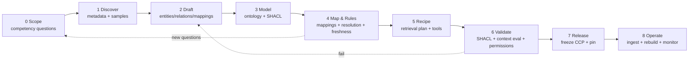
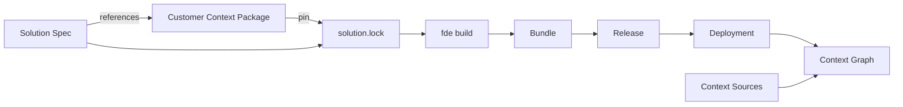
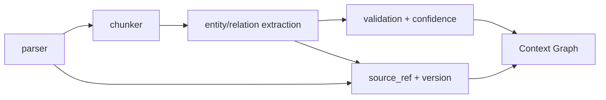
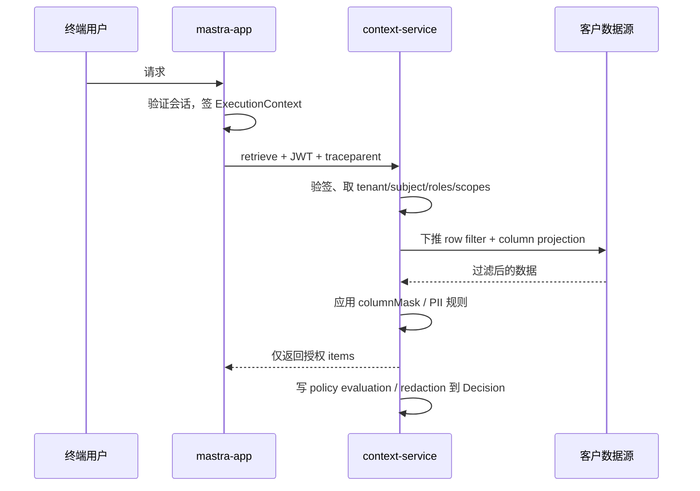
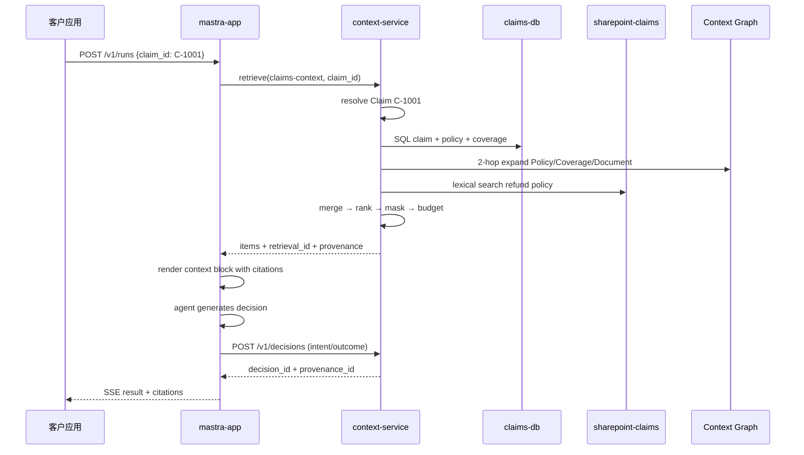

# 语义建模与上下文组装方法

> 状态：决策稿，对应 ticket「语义建模与上下文组装方法」。
> 范围：v0 单客户 bundle；不做多租户托管、首客场景、可视化 Builder。
> 术语：见 [`GLOSSARY.md`](../GLOSSARY.md)。领域模型见 [`domain-model.md`](domain-model.md)，运行时接缝见 [`runtime-contract.md`](runtime-contract.md)。
> 契约版本：`fde.runtime/v1.2.0`。示例工件见 [`examples/semantic/`](../examples/semantic/)。

本文定义 FDE 如何从客户的数据与业务知识中构建可用的语义模型，如何把它打包成可复用的 **Customer Context Package**，以及 Agent 在运行时如何组装正确的上下文。

## 1. 结论摘要

| # | 决策 | 结论 |
|---|---|---|
| D1 | 建模起点 | **Capability-scoped, data-informed**：先定 3–5 个 competency questions，再按切片循环建模；不先建全客户本体。 |
| D2 | 数据进入工作台的边界 | 工作台只接收元数据、schema、脱敏样本；**不搬全量客户数据**。实际数据留在客户环境，由 context-service ingest。 |
| D3 | Customer Context Package | 客户级、版本化、不可变的**声明式源工件**；不含数据、secret、生成图或运行时状态；`solution.lock` pin，Bundle 构建时编译。 |
| D4 | 语义分层 | Domain Ontology（跨客户模板）/ Customer Ontology Extension（客户扩展）/ Semantic Model（客户绑定）。 |
| D5 | 业务规则边界 | 语义约束、解析/合并规则、访问规则进语义层；可执行业务逻辑归 Capability/Workflow/Policy。 |
| D6 | Mapping 与摄取 | 结构化源用声明式 mapping；文档源走抽取候选；批处理 + watermark 增量 upsert；v0 不做 CDC。 |
| D7 | 身份、冲突、时效 | 确定性 key 优先；保留所有断言与 provenance；冲突显式呈现；时效字段驱动 stale 标记。 |
| D8 | Recipe 所有权 | FDE 编写确定性 Recipe；Agent 只能选 `recipe_id` + 填 query/filters，不能生成 Cypher/SQL 或改阶段顺序。 |
| D9 | 运行时编排 | `resolve → structured → graph → lexical → merge → rank → mask → budget`；精确结构 > 图 > 词法/向量；vector 为 experimental。 |
| D10 | Context 输出 | context-service 返回结构化 items；Mastra 用生成的确定性 renderer 组装 prompt，带引用、无隐藏截断。 |
| D11 | 权限与脱敏 | 语义注解 + 分层强制：源端下推 → context-service mask/过滤 → 审计；未分类默认 restricted，无法强制则 fail closed。 |
| D12 | 质量与运维 | Context Eval 作为 CCP freeze / Recipe 变更的 gate；ingest、rebuild、backup、资源限制由客户环境执行，工作台不托管运行时。 |

完整决策记录见 [ADR-0004](adr/0004-semantic-modeling-and-context-packaging.md)。

## 2. 客户接入流水线

这是一条**技术流水线**，不是客户交付 SOP。工作台的职责是生成声明式工件和 Bundle；它不托管运行时，也不持有客户数据。



| 步骤 | 做什么 | 产出 | Gate | 负责人 |
|---|---|---|---|---|
| 0 Scope | 选 Capability，写 3–5 个 competency questions、成功标准、候选数据源 | `scope.md`、问题清单 | 业务专家确认问题 | FDE + 业务专家 |
| 1 Discover | 注册 Context Source；抓 schema/metadata；可选脱敏样本 | Source 定义、catalog 摘要 | 数据驻留/安全审查 | FDE + 客户数据 owner |
| 2 Draft | 从 catalog/文档起草候选实体、关系、mapping | 草稿 TTL/YAML、open questions | FDE review | FDE（AI 辅助） |
| 3 Model | 选 Domain Ontology 模块 + Customer Ontology Extension；写 SHACL | `ontology/`、`semantic-model.yaml` | SHACL + 术语评审 | FDE + 业务专家 |
| 4 Map & Rules | 实体映射、解析/合并、源优先级、时效、权限 baseline | `mappings/`、`permissions.yaml` | 样本 dry-run + 冲突清单 | FDE + 业务专家 |
| 5 Recipe | 编写 Context Recipe；生成 typed tool | `recipes/`、tool schema | Recipe schema 校验 | FDE |
| 6 Validate | SHACL + context eval + 权限/脱敏检查 | `evals/`、验证报告 | 全部通过 | FDE |
| 7 Release | `fde context freeze`；写 Decision；pin 到 Solution | frozen CCP + digest | FDE lead + 客户业务 owner | FDE |
| 8 Operate | ingest、rebuild、备份、监控 | 运行记录、健康状态 | 客户运维 runbook | 客户运维 |

**迭代规则**：2–4 是循环，不是瀑布；一个 Capability 切片通过 context eval 后，才把它的资产并入 CCP 的下一个版本。客户级 CCP 可以包含多个切片，但每个切片都必须有自己的 competency questions 和 eval。

## 3. Customer Context Package

### 3.1 定义与边界

**Customer Context Package（CCP）** 是一个 Customer 的、版本化且不可变的声明式语义资产包。它是客户接入的交付物，也是多个 Solution 复用同一套客户语义的单位。

CCP **包含**：

| 目录 | 内容 | 格式 |
|---|---|---|
| `ontology/` | 选中的 Domain Ontology 模块（vendored）+ Customer Ontology Extension + SHACL | Turtle |
| `semantic-model.yaml` | 模块选择、实体映射引用、解析/合并规则、源优先级、时效规则 | YAML |
| `context-sources/` | 数据源定义（`connectorRef`、dataset、classification、freshness、schedule） | YAML |
| `mappings/` | 表/视图/文档 → 类/属性；抽取配置 | YAML |
| `recipes/` | 可复用的 Context Recipe 定义 | YAML |
| `permissions.yaml` | 客户级 baseline：分类、PII、row/column 规则、required scopes | YAML |
| `evals/` | Context Eval Suite：golden questions、期望事实、阈值 | YAML |
| `manifest.yaml` | 包版本、digest、兼容性、来源 | YAML |

CCP **不包含**：

- 客户数据、样本数据、PII 明文。
- secret 值、连接串、API key、私钥；只出现 `secretRef`。
- 生成的 Context Graph、索引、运行时状态。
- Bundle、Release、Deployment、Run、Decision。
- 可执行业务逻辑（审批、计算、分支）；这些归 Capability/Workflow/Policy。
- Solution 专属的 Capability 实现；CCP 只提供可复用的语义上下文。

**Connector 的边界**：CCP 只引用 `connectorRef`，不包含 Connector 定义。Connector 是独立 Customer 级资产，可被多个 Solution 和 Tool 引用；它的 endpoint、secretRef 和限流规则留在 Connector 定义中，由 `solution.lock` 单独 pin。

### 3.2 Context Recipe 的层级

为了让 CCP 能生成客户级可复用的 Context API，**Context Recipe 允许 Customer 级可复用定义**，由 Solution Revision 引用并可收紧覆盖。这类似 Capability Template 与 Capability Binding：

- **Context Recipe（Customer 级）**：可复用的检索/组装方案，版本化、不可变。
- **Context Recipe Binding（Solution 级）**：Solution 选择一个 Recipe，按 Capability 需要收紧 filters、budget、ranking 或 output schema。
- Solution 不能放宽 CCP 中的权限 baseline，也不能改变 Recipe 的强制阶段（如 mask、budget）。
- Solution 可以新增自己的 Recipe，但必须通过 context eval，并在 Solution Spec 中版本化。

### 3.3 目录布局

```text
acme/
├── customer/
│   ├── connectors/              # 独立 Customer 级资产，不在 CCP 内
│   └── context-packages/
│       └── acme-claims-context/
│           ├── manifest.yaml
│           ├── semantic-model.yaml
│           ├── permissions.yaml
│           ├── ontology/
│           │   ├── insurance-claims.ttl
│           │   ├── acme-claims-extension.ttl
│           │   └── acme-claims.shacl.ttl
│           ├── context-sources/
│           │   ├── claims-db.yaml
│           │   └── sharepoint-claims.yaml
│           ├── mappings/
│           │   ├── claims-db.yaml
│           │   └── sharepoint-claims.yaml
│           ├── recipes/
│           │   └── claims-context.yaml
│           ├── evals/
│           │   └── claims-context.golden.yaml
│           └── files/
│               ├── extraction/
│               └── schemas/
├── environments/
└── solutions/
    └── claims-triage/
        ├── solution.yaml
        └── solution.lock
```

### 3.4 生命周期、版本与引用

| 阶段 | 含义 | 谁能改 |
|---|---|---|
| `draft` | 建模中的可变版本 | FDE |
| `validated` | schema、SHACL、权限、context eval 全部通过 | FDE；不可直接部署 |
| `frozen` | 不可变版本；可被 Solution 引用 | 冻结后不可改，只能出新版本 |

- **版本**：semver；冻结时分配版本号，并计算内容 digest。
- **冻结**：`fde context freeze` 要求干净 Git tree、validate 通过、context eval 通过；生成 `revision.yaml`（spec digest、commit、actor、timestamp）并写一条 Decision。
- **引用**：Solution Spec 用 `spec.semantic.contextPackageRef` 引用；`solution.lock` pin `customerContextPackage: <version>@<digest>`。
- **编译**：`fde build` 读取 frozen CCP，把 ontology、mapping、recipe、permission、eval 定义编译进 Bundle；构建不解析浮动范围，不回拉 Template registry。
- **签名**：v0 不单独签 CCP；Git commit + digest + Bundle 签名覆盖。客户强制要求时，用 cosign 签 `manifest.yaml`，签名与 digest 一起进 lock。
- **签核**：FDE 语义负责人 + 客户业务 owner 在 freeze 时签核；签核本身是一条 Decision。

`manifest.yaml` 示意：

```yaml
apiVersion: fde.dev/v0
kind: CustomerContextPackage
metadata:
  customer: acme
  name: acme-claims-context
  version: 1.0.0
spec:
  semanticModelRef: semantic-model.yaml
  contextSources:
    - context-sources/claims-db.yaml
    - context-sources/sharepoint-claims.yaml
  recipes:
    - recipes/claims-context.yaml
  permissionsRef: permissions.yaml
  evals:
    - evals/claims-context.golden.yaml
  compatibility:
    specMajor: v0
    runtimeContract: fde.runtime/v1
    graphSchema: 1
    auditSchema: 1
  provenance:
    createdBy: fde://acme
    createdAt: 2026-11-15T08:00:00Z
    decisions:
      - dec_01ARZ3NDEKTSV4RRFFQ69G5FAV
```

### 3.5 与 Solution / Bundle / Deployment 的关系



- CCP 是 Customer 级、源工件；Solution 是引用者。
- 同一 Customer 的多个 Solution 可以 pin 同一个 CCP 版本；运行时图各自独立，不跨 Solution 共享。
- Bundle 是构建产物，包含编译后的语义资产；Deployment 在客户环境物化 Context Graph。
- CCP 不直接产生运行时服务；Context API 仍由 context-service 提供。

## 4. 语义分层与建模

### 4.1 三个层次

| 层 | 实体 | 谁拥有 | 例子 |
|---|---|---|---|
| 领域层 | Domain Ontology | FDE 平台团队 | `insurance-claims@1.0.0`：Claim、Policy、Coverage |
| 客户层 | Customer Ontology Extension | FDE + 客户专家 | Acme 特有的 `ClaimPriority`、`acme:priority` |
| 绑定层 | Semantic Model | FDE | 选择模块、映射 `claims.claim_id → ic:claimId`、源优先级 |

**Domain Ontology** 是可跨客户复用的版本化模板，提供 classes、properties 和 SHACL shapes。**Customer Ontology Extension** 只包含客户特有的类、属性和约束，不能 fork 领域模板。**Semantic Model** 是客户对 ontology 模块的绑定，包含实体映射、解析/合并规则、源优先级和时效规则。

### 4.2 Competency questions 驱动切片

每个 Capability 先定义 3–5 个问题，格式是业务语言 + 期望事实：

```yaml
capability: document-triage
questions:
  - id: q1
    question: 给定理赔单，哪张保单覆盖它，保额是多少？
    expected: [Claim, Policy, Coverage]
  - id: q2
    question: 高级客户的退款政策是什么？
    expected: [Policy, ClaimDocument]
  - id: q3
    question: 这个理赔单是否关联到历史欺诈标记？
    expected: [Claim, FraudFlag]
```

问题用于三件事：决定要选哪些 ontology 模块、决定要接哪些数据源、生成 context eval 的 golden questions。一个问题如果当前数据答不了，要么补数据源，要么明确降级，不能假装模型能答。

### 4.3 本体载体与校验

- 本体和 SHACL 用 **Turtle** 作为作者源；构建时用 Semantica 0.7.x 的 `OntologyIngestor` 导入，用 `SHACLGenerator` / `OntologyValidator` 校验。
- v0 只承诺 **OWL-lite + SHACL**：类、属性、domain/range、子类关系、SHACL 约束。不承诺 OWL DL 推理；需要形式化推理时外接 HermiT/Pellet/Stardog，不在 v0 范围。
- SHACL 是硬 gate：形状不通过，CCP 不能 freeze。
- 本体模块版本不可变；客户扩展是版本化文件，不能直接修改领域模板。
- `entity_id` 使用 `fde:<tenant>:<type>:<key>`，不暴露 Semantica/Neo4j 内部 ID；源键变化时生成新 ID 并用 `same_as` 保留旧 ID。

### 4.4 业务规则的分类

| 规则类型 | 放在哪 | 例子 |
|---|---|---|
| 语义约束 | SHACL / ontology | Claim 必须恰好有一个 Policy；amount ≥ 0 |
| 解析/合并规则 | Semantic Model | Claim 的源优先级；同名实体合并阈值 |
| 访问规则 | permissions.yaml | 客户邮箱必须 hash；理赔金额仅 claims:read |
| 可执行业务逻辑 | Capability / Workflow / Policy | 超过 10 万必须人工审批；退款计算 |

**判断标准**：如果规则是“世界的结构或约束”，进语义层；如果规则是“执行顺序或业务动作”，进 Capability/Workflow。不要用 ontology 表达审批流。

### 4.5 业务专家参与与自动化边界

| 阶段 | 业务专家做什么 | AI 能做什么 | 谁签核 |
|---|---|---|---|
| Scope | 确认 competency questions、术语、范围外数据 | 起草问题、归纳历史案例 | 业务专家 |
| Model | 确认类/属性含义、枚举值、冲突裁决 | 从 catalog/文档生成草稿；建议命名 | 业务专家 + FDE |
| Map | 确认样例映射、源优先级、例外 | 生成 mapping 草稿；跑样本 dry-run | FDE |
| Validate | 确认样例检索结果、引用、脱敏 | 跑 eval；生成差异报告 | FDE + 业务专家 |

工具形态：`fde context review` 生成 review packet（术语表、定义、样例事实、10–20 条样例问题与检索结果、冲突清单、open questions），专家在 Markdown/CSV 上批注；FDE 把批注转成 YAML/TTL patch + Decision。**专家不直接改图；AI 不自动批准语义承诺**（新增类/属性、合并规则、源优先级、权限分类）。

## 5. 数据接入与映射

### 5.1 Context Source 注册

Context Source 是 Customer 级配置，包含：

```yaml
apiVersion: fde.dev/v0
kind: ContextSource
metadata:
  customer: acme
  name: claims-db
spec:
  connectorRef: claims-db
  dataset: public.claims
  classification: confidential
  freshness:
    staleAfter: PT1H
    watermark: updated_at
  schedule: "*/15 * * * *"
  mode: incremental
```

- 注册时只抓 metadata、schema、行数/空值率等统计；样本必须脱敏并显式 opt-in。
- 不把全量数据复制进工作台；profiling 在客户环境跑只读作业，回传统计/样本。
- `classification` 和 `freshness` 是必填；未知 = `restricted`。

### 5.2 结构化 mapping

结构化源用声明式 mapping manifest，不写代码：

```yaml
apiVersion: fde.dev/v0
kind: EntityMapping
metadata:
  customer: acme
  source: claims-db
spec:
  connectorRef: claims-db
  dataset: public.claims
  entity: ic:Claim
  key: [claim_id]
  properties:
    claim_id: {property: ic:claimId, type: string}
    policy_number: {property: ic:policyNumber, type: string}
    status: {property: ic:status, type: string}
    amount: {property: ic:amount, type: decimal}
    incident_date: {property: ic:incidentDate, type: date}
  relations:
    - property: ic:hasPolicy
      targetEntity: ic:Policy
      targetKey: policy_number
      join:
        table: public.policies
        on: claims.policy_number = policies.policy_number
  watermark:
    column: updated_at
    mode: updated_at
  filters:
    - "tenant_id = :tenant_id"
```

规则：

- `key` 必须稳定；复合 key 按声明顺序拼接。
- `properties` 的 target 必须在 ontology 中存在；类型必须兼容。
- `relations` 只允许 ontology 中声明的 object property；不得在 mapping 中发明关系。
- `filters` 是源端下推的 row filter，不能绕过权限 baseline。
- mapping 变更必须版本化进 CCP；不允许手改生成图。

### 5.3 文档与半结构化源

文档源走抽取流水线：



- 解析器支持 Markdown、PDF、HTML、DOCX；chunker 按标题/段落，保留 `source_ref` 和 `version`。
- 抽取 schema 声明实体/关系类型、属性、置信度阈值；LLM 抽取只产生候选，不直接写权威事实。
- 候选实体/关系带 `source_ref`、`confidence`、`extractor_version`、`observed_at`；通过 SHACL 和规则后才进入规范视图。
- 文档中的 PII 在 ingest 时分类，在 retrieval 时 mask；审计只存引用/摘要。

### 5.4 实体身份与解析

- 确定性 key 优先：`Claim(claim_id)`、`Policy(policy_number)`、`Customer(customer_id)`。
- 没有稳定 key 时，用规则匹配（名称 + 地址 + 时间窗）；LLM/embedding 只做候选，不做最终合并。
- 合并用 `same_as` 关系保留旧 ID；被引用的 ID 不删除。
- 解析规则、阈值、源优先级都在 Semantic Model 中版本化；变更走 CCP 新版本 + context eval。

### 5.5 增量摄取与重建

| 模式 | 使用场景 | 行为 |
|---|---|---|
| `incremental` | 日常 | 按 watermark 拉新增/变更；upsert；幂等 |
| `backfill` | 补历史 | 按时间窗重放；写同一 `entity_id`；不重复 Decision |
| `rebuild` | ontology/mapping major 变更 | 从源 + CCP 全量重建；维护窗口；新图替换旧图 |

- v0 不做 CDC；定时批处理足够。
- ingest 作业在客户环境运行；工作台只生成配置和 job 清单。
- 失败可重试；幂等键防止重复写入。
- 全量重建是兜底；重建后必须跑 SHACL + context eval。

### 5.6 冲突、重复与时效

- **保留所有断言**：每条事实带 `source_ref`、`version`、`observed_at`、`provenance_id`；不做破坏性覆盖。
- **规范视图**：按源优先级 + 时效 + 置信度计算；优先级在 Semantic Model 中声明，例如 `Claim: [claims-db, sharepoint-claims]`。
- **冲突显式**：未解决的冲突在 retrieval item 的 metadata 中带 `conflict=true` 和候选来源；Recipe/Policy 决定返回双方、失败还是转人工，不能静默选一个。
- **重复**：确定性 key 去重；同一实体多来源合并时保留 provenance 列表；内容重复按内容 hash 去重。
- **时效**：`observed_at`、`valid_from`、`valid_to`、`source_version`、`stale_after`；超过 SLA 的事实标 `stale=true`，不得静默当新鲜事实。
- **人工修正**：修正本身是一条 Decision；规则变更走 CCP 新版本，不直接改图。

### 5.7 验证门禁

1. **Schema**：mapping/ontology/recipe 通过 Zod/JSON Schema。
2. **SHACL**：样本数据 + 全量图通过 shapes；失败阻断 freeze。
3. **样本 dry-run**：每条 mapping 用 100–1000 行样本跑通，报告空值率、类型冲突、未映射字段。
4. **Context eval**：golden questions 的 recall/citation/freshness 达标。
5. **权限检查**：未分类字段、无法下推的 row filter、无法 mask 的 PII 都必须显式失败或标记。

## 6. Context Recipe 与运行时组装

### 6.1 所有权

- **FDE 编写 Recipe**，在 CCP 中版本化；Solution 可以引用或收紧。
- **Agent 只能选 `recipe_id`**，填 query/filters；不能生成 Cypher/SQL，不能改阶段顺序、权重或预算上限。
- 新 Recipe 或调参走 Spec review + context eval；不在运行时即兴发挥。
- 每个 Capability 至少一个默认 Recipe；可选命名变体（例如 `claims-context-fast`、`claims-context-deep`），但必须分别评测。

### 6.2 Recipe 结构

```yaml
apiVersion: fde.dev/v0
kind: ContextRecipe
metadata:
  customer: acme
  name: claims-context
  version: 1.0.0
spec:
  semanticModelRef: acme-claims@1.0.0
  inputSchema:
    type: object
    required: [claim_id]
    properties:
      claim_id: {type: string}
      query: {type: string}
  stages:
    - type: resolve
      entity: ic:Claim
      key: claim_id
    - type: structured
      source: claims-db
      entities: [ic:Claim, ic:Policy, ic:Coverage]
    - type: graph
      from: resolved
      relations: [ic:hasPolicy, ic:hasCoverage, ic:documentsPolicy]
      maxHops: 2
    - type: lexical
      source: sharepoint-claims
      query: "$query"
      topK: 20
    - type: merge
      dedupe: [entity_id, content_hash]
    - type: rank
      weights: {structured: 0.5, graph: 0.3, lexical: 0.2}
      freshnessBoost: 0.1
    - type: mask
      permissions: permissions.yaml
    - type: budget
      maxNodes: 50
      maxTokens: 4000
      maxHops: 2
  output:
    schema: files/schemas/claims-context.output.json
    render: mastra
```

### 6.3 阶段语义与优先级

| 阶段 | 作用 | 失败/降级 |
|---|---|---|
| `resolve` | 从 query/filters 解析业务对象；确定性 key 优先 | 解析不到 → 进入图/词法实体匹配；仍失败 → `degraded=empty` |
| `structured` | SQL 精确查询当前业务事实 | 源不可用 → 跳过并 `degraded=true`；不阻断图/词法 |
| `graph` | 从已解析实体做 1–2 跳扩展 | 图不可用 → 跳过并 `degraded=true`；不编造关系 |
| `lexical` | 文档块/实体词法检索 | 索引不可用 → `degraded=index_unavailable` |
| `vector` | 向量召回；v0 **experimental**，仅索引存在时启用 | 无索引 → 跳过，不影响基础 Recipe |
| `merge` | 按 `entity_id`/内容 hash 去重；合并 provenance | 冲突保留，不丢弃候选 |
| `rank` | Recipe 显式权重 + 新鲜度；v0 不做 LLM rerank | 分数归一化到 0–1；预算内截断 |
| `mask` | 应用 `columnMask` / PII 规则 | 无法 mask → fail closed |
| `budget` | 强制 `max_nodes` / `max_tokens` / `max_hops` | 超限 → 确定性截断 + `budget_used` |

**优先级**：精确结构化事实 > 图扩展 > 词法/向量。规则引擎只做过滤/策略判定，不参与召回排序。Recipe 可以在允许范围内调权重，但不能把 `mask` 或 `budget` 放到最后或省略。

### 6.4 降级语义

| 情况 | 返回 |
|---|---|
| 图规模超限 | `degraded=true`, `reason=scale_limit` |
| 索引不可用 | `degraded=true`, `reason=index_unavailable` |
| 检索超时 | `degraded=true`, `reason=timeout` |
| 部分源失败 | `degraded=true`, `reason=partial` |
| 无结果 | `degraded=true`, `reason=empty` |

Recipe/Policy 决定“无上下文继续”还是“失败”；任何情况下都不能编造上下文。降级事件写 OTel span；是否写 Decision 由 Capability 要求决定。

### 6.5 Agent 调用与多轮

- Run 开始时，Mastra 用 Capability 绑定的默认 Recipe 调 `POST /v1/context/retrieve`。
- 运行中，Agent 可通过生成的 `retrieve_context` tool 再次调用；只能传 `recipe_id`、query、filters、budget（不超过 Recipe 上限）。
- 每次调用返回一个 Retrieval Snapshot（`retrieval_id` + `snapshot_digest`）；Decision 引用 snapshot，不复制内容。
- v0 不做跨请求缓存；同一 Run 内可以复用 snapshot，但必须显式引用。
- **跨会话记忆/用户偏好不在本票范围**；地图的 fog 里保留。

### 6.6 输出与 Prompt 组装

context-service 返回结构化 items：

```json
{
  "retrieval_id": "ret_01ARZ3NDEKTSV4RRFFQ69G5FAV",
  "items": [
    {
      "entity_id": "fde:acme:Policy:P-2001",
      "type": "Policy",
      "content": "Premium customers may receive a refund within 30 days.",
      "score": 0.92,
      "source_ref": "sharepoint://claims/policies/refund.md",
      "version": "3",
      "provenance_id": "prov_01ARZ3NDEKTSV4RRFFQ69G5FAV",
      "metadata": {
        "freshness": "fresh",
        "classification": "internal",
        "conflict": false
      }
    }
  ],
  "degraded": false,
  "trace_id": "4bf92f3577b34da6a3ce929d0e0e4736",
  "snapshot_digest": "sha256:9f2caaaaaaaaaaaaaaaaaaaaaaaaaaaaaaaaaaaaaaaaaaaaaaaaaaaaaaaaaaaa",
  "budget_used": {"nodes": 12, "tokens": 1800, "hops": 2}
}
```

Mastra 的生成 tool 用固定模板渲染：

```text
[1] Policy P-2001 — "Premium customers may receive a refund within 30 days."
    source: sharepoint://claims/policies/refund.md@3
[2] Coverage COV-1 — ...
    source: claims-db://public.coverages/COV-1@...
```

规则：

- 顺序稳定，按 score + recipe 权重排序；不做隐藏截断。
- 每条必须有 `source_ref@version`；没有引用的 item 不允许进入 prompt。
- token 预算由 context-service 强制；Mastra 不自行删减事实。
- `degraded=true` 时，prompt 明确标注“上下文不完整”，不得假装完整。

## 7. 权限、脱敏与审计

### 7.1 注解字段

| 字段 | 取值 | 作用 |
|---|---|---|
| `classification` | `public \| internal \| confidential \| restricted` | 数据分级；未声明 = restricted |
| `pii` | `none \| identifier \| contact \| sensitive` | PII 类型；决定 mask 策略 |
| `rowFilter` | 谓词模板 | 源端下推；可引用 `tenant`/`subject`/`roles`/`scopes` |
| `columnMask` | `redact \| hash \| tokenize \| null` | 返回前脱敏 |
| `requiredScopes` | scope 列表 | 访问该属性/实体所需 scope |
| `Source` 级 | 默认 row filter、允许 dataset、classification | 数据源边界 |

### 7.2 强制顺序



1. **源端下推**：Connector 把 `rowFilter`、列投影、dataset 限制下推到客户数据源；这是第一道防线。
2. **context-service 强制**：从 `ExecutionContext` 注入 tenant/subject/roles/scopes；编译 Recipe 过滤器；对返回 item 应用 mask；丢掉未授权 item。Recipe 不能覆盖。
3. **审计**：Decision 记录 `policy_evaluations`、`redaction_applied`、`classification`、`retention_class`；审计库只存引用/摘要，不存明文 PII。Retrieval 响应返回每个 item 的 `classification` 和数据策略 `policy_evaluations`；context-service 在 Decision 写入时服务端追加 authoritative 结果（见 [`decision-audit-binding.md`](decision-audit-binding.md) §5）。
4. **默认拒绝**：未分类字段 = restricted；无法下推/无法 mask 时 fail closed，不能“先返回再过滤”。

### 7.3 边界

- 角色词表、IdP/SSO、客户管理员权限、审批人角色由「客户环境内的身份、权限与部署」决定；本文只定注解格式和强制点。
- PII 保留期、legal hold、分类词表已由[评测、验收与可观测性](evaluation-and-observability.md)定默认值；身份/RBAC 词表由「客户环境内的身份、权限与部署」决定。
- 文档抽取的 PII 在 ingest 时分类；检索时 mask；审计不存完整文档内容。

## 8. 客户环境内的运维

### 8.1 作业与命令

| 命令 | 作用 | 运行位置 |
|---|---|---|
| `fde context ingest` | 按 Source 调度增量摄取 | 客户环境 |
| `fde context backfill` | 按时间窗补历史 | 客户环境 |
| `fde context rebuild` | 从源 + CCP 全量重建图 | 客户环境，维护窗口 |
| `fde context eval` | 跑 context eval | 客户环境或 CI |
| `fde context verify` | 校验图/SHACL/审计链 | 客户环境 |

命令名是建议，最终由「架构综合与实施切片」收敛。

### 8.2 备份与恢复

- `graph`、`audit`、`mastra-state` 分别备份；审计备份必须包含 `chain_head`。
- 图可重建；审计不可重建。常规回滚不恢复 audit；只有灾难恢复才从备份恢复，并记录链缺口。
- 恢复后跑 `fde context verify`：检查 schema、审计链、SHACL、context eval。
- 备份/恢复演练由客户运维执行；FDE 提供 runbook。

### 8.3 资源限制与降级

- v0 交互上限：**10k 节点 / 50k 边**；超过返回 `degraded=true` + `reason=scale_limit`。
- 默认资源：context-service 0.5 CPU / 1 GiB；mastra-app 1 CPU / 1 GiB；卷按规模预留。
- 单写者：context-service 不能多副本；mastra-app 不能多副本共享 `mastra-state`。
- 生产检索后端已由「生产检索索引与 100k+ 规模上限」定为 Postgres 17 + pgvector（Recipe 的 stage 接口不变，只替换 `GraphStore`/索引实现）；100k/500k p95 实测留作实施阶段 gate，本票不承诺 100k+。

### 8.4 监控

| 指标 | 说明 |
|---|---|
| ingest lag | 源 watermark 与当前时间差 |
| graph size | 节点/边数；接近上限告警 |
| retrieval latency | p50/p95；按 Recipe/阶段拆分 |
| degraded rate | 按 reason 分组 |
| stale facts | 超过 SLA 的断言数 |
| conflict rate | 未解决冲突数 |
| eval score | recall/citation/freshness 的滚动值 |

`readyz` 返回 `{status: ready\|degraded, reasons: []}`；不能服务时返回 503。健康状态不改变生命周期。

### 8.5 责任划分

| 角色 | 负责 |
|---|---|
| 客户运维 | 主机、网络、TLS ingress、IdP、secret store、备份介质、升级窗口、执行 ingest/rebuild |
| FDE | CCP、Recipe、mapping、权限 baseline、runbook、bundle 验证 |
| 工作台 | 构建、校验、冻结、打包；不托管运行时、不持客户数据 |
| context-service | 检索、Decision/Provenance、审批状态、ingest 执行 |

## 9. 上下文质量

### 9.1 定义

上下文质量 = **在预算内拿到正确事实，并且可追溯、不过期、不隐藏冲突**。它不等于答案质量；答案质量由[评测、验收与可观测性](evaluation-and-observability.md)定义。

### 9.2 离线 Context Eval

每个 Capability 维护 20–50 条 golden questions：

```yaml
apiVersion: fde.dev/v0
kind: ContextEvalSuite
metadata:
  customer: acme
  name: claims-context
  version: 1.0.0
spec:
  recipeRef: claims-context@1.0.0
  thresholds:
    recallAtBudget: 0.8
    citationValidity: 1.0
    silentStale: 0
    silentConflict: 0
  questions:
    - id: q1
      question: 理赔单 C-1001 由哪张保单覆盖，保额多少？
      input: {claim_id: "C-1001"}
      expectedEntities:
        - ic:Claim/C-1001
        - ic:Policy/P-2001
        - ic:Coverage/COV-1
      requiredCitations:
        - claims-db://public.claims/C-1001
        - claims-db://public.policies/P-2001
```

| 指标 | 定义 | v0 目标 |
|---|---|---|
| `recallAtBudget` | 期望事实在预算内被召回的比例 | ≥ 0.8 |
| `citationValidity` | 每条 item 有 `source_ref` + `version` + provenance | 100% |
| `freshness` | 超过 `stale_after` 的事实被标记 | 100% |
| `silentStale` | 未标记的 stale 事实数 | 0 |
| `silentConflict` | 未标记的冲突数 | 0 |
| `budgetEfficiency` | 实际 tokens/nodes vs 期望 | 记录，不设硬阈值 |
| `degradedRate` | 降级请求比例 | 记录并告警 |

### 9.3 在线抽样

- 确定性监控覆盖 100% Run；LLM judge 默认按 2% 抽样（可配 0–10%），按 trace ID 确定性采样，检查 groundedness、引用、时效、冲突。
- 人工每月抽检 20–50 条 Run；P1/P2 事故窗口 100% 复核。记录空结果率、degraded 率、人工修正率；修正进入下一轮 CCP 版本。
- 生产日志不回流工作台；抽样和评分在客户环境完成，只回传脱敏指标。完整规则见[评测、验收与可观测性](evaluation-and-observability.md) §7。

### 9.4 Gate

- CCP `freeze` 必须通过 context eval；不达标不能冻结。
- Recipe 变更、mapping 变更、ontology major 变更都必须重跑。
- 失败可以用 Waiver 放行，但必须有理由、审批人和有效期；Waiver 是一条 Decision。
- 整体评测架构、答案级指标、数据集污染控制已由[评测、验收与可观测性](evaluation-and-observability.md)定稿；Context Eval 是 L1，答案级是 L2。本文只定 context eval 的口径。

### 9.5 数据集来源

- 业务专家编写 + 历史案例脱敏；合成数据只用于边缘案例。
- golden questions 不包含生产数据；期望事实用稳定 entity ID/业务 key。
- 评测集版本化，随 CCP 版本冻结；变更走新版本。来源配额、`dev`/`holdout`/`regression` 分区、holdout ACL 和重复检测见[评测、验收与可观测性](evaluation-and-observability.md) §4；生产日志不自动回流。

## 10. 参考场景走查

### 10.1 Acme Claims 理赔分诊

**配置**

- Customer `acme`；Solution `claims-triage`；Capability `document-triage`。
- Context Sources：`claims-db`（结构化，staleAfter 1h）、`sharepoint-claims`（文档，staleAfter 24h）。
- CCP：`acme-claims-context@1.0.0`，包含 `insurance-claims@1.0.0` + Acme 扩展、mapping、`claims-context` Recipe、权限 baseline、context eval。
- Solution Spec 用 `contextPackageRef: acme-claims-context@^1.0.0` 引用；`solution.lock` pin 精确版本与 digest（`1.0.0@sha256:...`）。

**建模**

1. Competency questions：q1 保单/保额、q2 退款政策、q3 历史欺诈标记。
2. 选择 `insurance-claims` 模块：Claim、Policy、Customer、Coverage、ClaimDocument、FraudFlag。
3. Acme 扩展：`ClaimPriority`、`FraudFlag`；SHACL 约束 Claim 恰好一个 Policy、amount ≥ 0。
4. Mapping：`public.claims` → Claim；`public.policies` → Policy；`public.coverages` → Coverage；SharePoint 文档 → ClaimDocument/Policy 片段。
5. 权限：Customer 邮箱 hash、姓名 redact；Claim 金额仅 `claims:read`；文档 PII 在 ingest 分类。
6. Context eval：20 条 golden questions，recall ≥ 0.8、citation 100%。

**Runtime**



**降级走查**：如果 `sharepoint-claims` 不可用，`degraded=true, reason=partial`；Agent 仍可用 claims-db 的结构化事实，但 prompt 标注“文档上下文不完整”；Recipe/Policy 决定是否继续。若 Claim 金额超过审批阈值，Workflow 进入 `waiting_for_human`，审批写 Decision。

### 10.2 Beta Bank KYC 复用差异

- 复用 Capability Template `document-triage@1.0.0`，不 fork。
- 新 CCP `beta-kyc-context@1.0.0`：`kyc-ontology@1.0.0` + Beta 扩展；Sources `beta-dms`、`core-banking`；更严 PII（姓名/证件号全 mask）；context eval 阈值 0.9。
- Solution Overlay 只收紧 Policy/Eval/阈值，不放宽权限。
- 展示同一方法、不同客户、不同本体/数据源/权限的复用；不写成第二个完整案例。

## 11. 交付物与边界

### 11.1 交付物

- 本文 `docs/semantic-modeling.md`。
- 示例工件：
  - [`examples/semantic/acme/`](../examples/semantic/acme/)：TTL/SHACL、Semantic Model、mapping、Recipe、permissions、golden questions、manifest。
  - [`examples/semantic/beta/`](../examples/semantic/beta/)：KYC 复用差异。
- [ADR-0004](adr/0004-semantic-modeling-and-context-packaging.md)。
- 同步更新 `GLOSSARY.md` 与 `docs/domain-model.md`。

### 11.2 明确不做

- 首客/垂直场景、多租户、可视化 Builder、客户交付 SOP：地图已排除。
- 身份/RBAC/IdP 词表：归「客户环境内的身份、权限与部署」。
- 生产图存储/索引：已由「生产检索索引与 100k+ 规模上限」定为 Postgres 17 + pgvector；100k/500k p95 实测留作实施阶段 gate。
- 答案级评测/可观测性基础设施：已由[评测、验收与可观测性](evaluation-and-observability.md)定稿；本文不重复定义。
- 成本模型、Agent 安全威胁模型、长会话记忆：地图的 fog。
- 实现代码：由「样例 Solution Spec 与生成物骨架」和「架构综合与实施切片」承接。

### 11.3 对后续 ticket 的输入

- 「样例 Solution Spec 与生成物骨架」：用 `examples/semantic/acme/` 的 CCP 形状压测 Spec/生成物，检查字段缺口。
- 「架构综合与实施切片」：最薄切片建议为 `context init → freeze → build → ingest → retrieve → decision`，参考 Acme q1/q2。
- 「生产检索索引与 100k+ 规模上限」已定稿：Recipe 的 stage 接口保持不变，生产检索由 Postgres + pgvector 承担（Semantica 不承担 serving 检索），只替换 `GraphStore`/索引实现。
- 「评测、验收与可观测性」：已消费 context eval 指标，补答案级 groundedness、SLO、在线抽样和 Acceptance Report；见[评测、验收与可观测性](evaluation-and-observability.md)。

## 12. 决策记录

| 决策 | 结论 | 理由 |
|---|---|---|
| 建模起点 | Capability-scoped, data-informed | 避免全量本体大爆炸；每个切片可评测 |
| 数据边界 | 不搬全量数据 | 符合工作台定位、数据驻留、air-gapped |
| CCP | 客户级声明式源工件 | Spec 是唯一真相；多 Solution 复用；Bundle 可重建 |
| 语义载体 | Turtle/SHACL + YAML/Zod | 标准可复用；配置易校验；不造本体 DSL |
| Recipe 所有权 | FDE 确定性 Recipe | 可审计、可评测；Agent 不改计划 |
| Mapping | 声明式 + 抽取候选 | 可 review、可重建；LLM 不做权威 |
| 冲突/时效 | 保留断言 + 显式标记 | 不静默覆盖；可追溯 |
| 权限 | 注解 + 分层强制 | 源端下推 + 服务端强制 + 审计 |
| 质量 | Context Eval gate | 上下文质量可验收；不靠 demo |
| 运维 | 客户环境执行 | 工作台不托管运行时；v0 规模受限 |

完整权衡与被淘汰方案见 [ADR-0004](adr/0004-semantic-modeling-and-context-packaging.md)。
